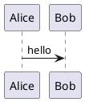

# py-doc: Markdown technical documentation tools


`py-doc` turns Markdown technical documentation into **Word (`.docx`)** documents, **PowerPoint (`.pptx`)** decks, **PDF** and **HTML**, checks its writing quality, and builds whole sets of documents from one `py-doc.yml`. It replaces three earlier tools (`py-doc2docx`, `py-doc2slides`, `py-doclint`) and the `createdocs` build files from `markbac/technical-documentation`.

Pandoc, run in the tool container, writes every output. The linter reads the Markdown with its own parser.

> **Important:** Docker is required for every conversion. The earlier built-in Word and PowerPoint renderers (`engine: native`) are gone, and so are the options that only they had. See [Upgrading](#upgrading-from-the-native-renderers).

## Commands

| Command | What it does |
|---|---|
| `py-doc docx` | Convert Markdown to Word |
| `py-doc slides` | Convert Markdown to PowerPoint |
| `py-doc lint` | Check writing style, glossary terms and acronyms |
| `py-doc build` | Build every document described in `py-doc.yml` |
| `py-doc migrate` | Create `py-doc.yml` from legacy `createdocs` build files |

The old commands `py-doc2docx`, `py-doc2slides` and `py-doclint` still work and print a one-line note naming their replacement. `-q` hides the note. The old import names `pydoc2docx`, `pydoc2slides` and `pydoclint` also still work.

## Supported platforms

Linux and Windows. The tool runner (see below) refuses to start on any other platform, with exit status `2` and a message that names the two supported ones. Commands that run no external tool work wherever Python does.

## Tool container

Programs that are not Python (pandoc, TeX, PlantUML, Mermaid, Graphviz and the rest) run inside one container image, so nothing but Python and Docker has to be installed. On Linux that is Docker. On Windows it is Docker Engine inside a WSL 2 distribution (not Docker Desktop).

```bash
py-doc doctor            # check the platform, WSL, Docker, the image and a trivial run
py-doc tools lock        # record the checksums of the downloaded tools (once, then commit tools.lock)
py-doc tools build       # build the image here (several GB, 10 to 30 minutes the first time)
py-doc tools status      # image tag, and the version of each tool inside it
py-doc tools prune       # remove images left by older py-doc versions
```

The image is built from a `Dockerfile` that ships in the package, and its tag is a hash of that folder, so a release that changes the toolchain rebuilds and one that does not reuses the image. A command that needs the image and finds none builds it first. Builds behind a proxy that re-signs TLS take `--ca-file`. Machines that cannot build can use `py-doc tools save` and `py-doc tools load`.

`py-doc.yml` can name the engine:

```yaml
runtime:
  docker: /usr/bin/docker   # if it is not on the path
  wsl_distro: Ubuntu        # Windows only: the distribution that runs Docker
```

Environment problems (no engine, no image, an unsupported platform) exit with status `2`. A tool that runs and fails exits with `1` and its whole output is shown.

## Installation

```bash
git clone https://github.com/markbac/py-doc2docx.git
cd py-doc2docx

# Needs Python 3.10 or later. ctxlogkit is installed from GitHub automatically.
pip install -e .

# With development tools (pytest, ruff, build, twine)
pip install -e ".[dev]"
```

## Converting files

```bash
py-doc docx Technical_Specification.md -o Technical_Specification.docx
py-doc docx Technical_Specification.md -t Template.docx
py-doc docx docs/ -o dist/docx/              # a whole folder, structure kept

py-doc slides talk.md -o talk.pptx
py-doc slides talk.md -t Corporate.pptx --split-level 1
```

The same options work with the old command names (`py-doc2docx`, `py-doc2slides`).

| Option | Commands | Description |
|---|---|---|
| `input` | both | A Markdown file, or a folder searched for `.md` and `.markdown` files in any capitalisation |
| `-o`, `--output` | both | The output file, or a folder. A folder (an existing one, or a path ending in `/`) gets `<name>.docx` or `<name>.pptx` inside it |
| `-t`, `--template` | both | A reference `.docx` or `.dotx` (Word), or `.pptx` or `.potx` (PowerPoint). `-r`, `--reference` is the old slides name |
| `--allow-missing-template` | both | Warn and use a blank document if the template file is missing (default: fail) |
| `--split-level N` | slides | Start a new slide at each heading up to level N (default 2) |
| `-q`, `-v` | both | Only warnings and errors, or debug detail |
| `--version` | both | Print the version |

Behaviour that applies to a folder:

- Hidden folders and `node_modules`, `venv`, `env`, `site-packages`, `__pycache__`, `dist`, `build` and `vendor` are skipped, and so is an output folder inside the input.
- One bad file does not stop the rest. Each failure is printed on stderr, a summary follows, and the exit status is `1` if anything failed.
- Two sources that would write the same output (`a.md` and `a.markdown`) are refused before anything is converted.
- The input is checked before any folder is created, so a typo leaves nothing behind.

## Supported Markdown

Pandoc reads the Markdown (its own flavour, with fenced divs, raw HTML, table captions, strikethrough and task lists), so footnotes, definition lists, math and the rest of pandoc Markdown work too. The Word styles pandoc writes (`Heading 1`, `Body Text`, `First Paragraph`, `Compact`, `Block Text`, `Source Code`, `Table`, `Image Caption` and so on) come from the template, which is the reference document.

| Markdown | Output |
|---|---|
| Front matter | Title, author, date, version, status and the like become the document properties and the title block. A first heading equal to the title is not shown twice |
| Callouts, `> [!NOTE]` and `> **Note:**` | A box in the `Div.note` to `Div.caution` styles (Word), a coloured block (HTML, PDF) |
| `[[CAPTION:Figure]] text` | A numbered caption for the picture or table that follows |
| `[[LANDSCAPE]]`, `[[PORTRAIT]]` | A section of that orientation (Word, and picture widths in the other formats) |
| `[[STYLE:Name]] text` | The paragraph in that Word style |
| `::: {.pagebreak}` and `:::` | A page break, or a new slide |
| Fenced diagram blocks | A picture, see [Diagrams](#diagrams) |
| Raw HTML | Kept in HTML, dropped elsewhere by pandoc |

A word or sentence is never dropped silently by py-doc itself, but anything pandoc cannot represent in a format (raw HTML in Word, for example) is dropped by pandoc, which says so in a warning.

### Word templates

The template is pandoc's reference document, so its styles decide how everything looks, and the result is merged into it (see [Pandoc outputs](#pandoc-outputs)). A template can be `.docx` or `.dotx`. Without one, a built-in reference document is used, which defines the callout box styles. If the template lacks a `Div.note` style or another the document needs, one warning names it.

## PowerPoint output

Slides start at headings up to `split_level` (`--split-level`, default 2) and at `::: {.pagebreak}` lines. The title and author in the front matter make the title slide. Layouts are chosen by pandoc from the template's standard layout names, so a template must come from `pandoc --print-default-data-file reference.pptx`, edited in PowerPoint. A template that gives an empty deck is reported with that hint.

- **Speaker notes**: write `<!-- notes: text -->`.
- **Footer**: `footer: "{title} v{version}"` in `py-doc.yml`, and `{{VERSION}}` in a template shape.
- **Long slides**: a slide with more than 16 lines gets a warning, because nothing is shrunk silently.

## Linting

`py-doc lint` (also `py-doclint`) checks Markdown for writing quality. It runs on the shared document tree, so code blocks, inline code, HTML, link destinations and front matter are never treated as prose, and URLs and file names written as plain text are skipped.

```bash
py-doc lint docs/             # lint a directory (default: the current one)
py-doc lint docs/Guide.md     # lint one file
py-doc lint docs/ --strict    # exit 1 if any warning or error is reported
py-doc lint . --exclude drafts
```

| Rule | Category | Default severity | What it reports |
|---|---|---|---|
| `DOC001` | Glossary | warning | A glossary term written differently from its canonical form, in any capitalisation (`mQTT`), plus listed misspellings (`Lw2m`) |
| `DOC002` | Style | warning | Wordy phrases such as "in order to", also when wrapped over two lines, with a shorter wording suggested |
| `DOC003` | Acronym | info | The first use of an all-capitals acronym that is never defined, or is defined only later |
| `DOC004` | Directive | error | An `[[ENDIF]]` with nothing open, an `[[IF:]]` never closed, or an include whose file does not exist |

- **Acronym definitions** are recognised in both orders, `Pre-Shared Key (PSK)` and `PSK (Pre-Shared Key)`, including mixed-case forms such as `LwM2M` and `IoT`. The words must spell out the acronym. Words in the built-in allow-list and glossary terms need no definition.
- **Directories**: hidden directories and `node_modules`, `venv`, `env`, `site-packages`, `__pycache__`, `dist`, `build` and `vendor` are skipped. `.md` and `.markdown` files are found in any capitalisation. Paths are printed relative to the working directory.
- **Exit status**: `0` when clean, or when only info is reported, or when warnings are reported without `--strict`. `1` for any issue the configuration calls an error, or with `--strict` and at least one warning. `2` when the target is missing or not Markdown, or when any file cannot be read, so an error is never mistaken for a clean result.
- **Limits**: issues carry a line number but no column, because the document tree records lines only. Terms inside a URL, a dotted or slashed name such as `lwm2m/dtls`, or code are not checked.

```python
from py_doc.lint import DocLinter

report = DocLinter().lint_path("docs")
for issue in report.issues:
    print(issue)  # docs/Guide.md:12: warning DOC001 [Glossary] ...
print(report.files_scanned, "files scanned,", len(report.errors), "could not be read")
```

## Project configuration (`py-doc.yml`)

One file describes documents, outputs and lint policy. `py-doc build` and `py-doc lint` find the nearest `py-doc.yml` above the current folder (or take `--config`). Paths are relative to the file. Every key is checked, so a typo is an error that names its place, such as `documents.guide.sources[1].page_brek`.

```yaml
project:
  name: Technical documentation

outputs:                       # defaults for every document
  docx:
    template: templates/Template.docx
    dir: build                 # where documents go unless they set a path
  pptx:
    split_level: 2

documents:
  c4-guide:
    title: C4 Architecture Modelling
    author: Mark Bacon
    version: "1.0.4"
    document_number: GD-001
    status: Proposed
    keywords: [architecture, C4]
    sources:
      - index.md
      - file: 01-foundations.md
        heading_offset: 0      # shift every heading level (kept within 1 to 6)
        page_break: true       # start on a new page, or a new slide
        title: Foundations     # replaces the first heading, or adds one
      - {file: draft.md, include: false}
    outputs:
      docx: {path: build/guides/c4-guide.docx}
      pptx: {}                 # also build a deck

lint:
  exclude: [drafts]
  rules:
    DOC001: error              # error, warning, info or off
    DOC002: off
  glossary:
    Kubernetes: [k8s]
  phrases:
    utilise: use
  acronyms:
    min_length: 3
    allowed: [SBOM]
```

- **Documents** join their sources in order. Properties come from the configuration, then from the first source's front matter. A document builds the formats listed under `outputs`, or Word if none is listed.
- **Output options** per format: `template`, `allow_missing_template`, `name`, `placeholder_prefix`, `marker`, `toc` (docx), `split_level`, `footer` (pptx). A document's value overrides the default. See [Pandoc outputs](#pandoc-outputs) for the details, `pdf` and `html`.
- **Lint** settings extend the built-in glossary, phrases and allowed acronyms. An issue whose rule is set to `error` fails `py-doc lint` even without `--strict`.
- **Reserved**: `collections`, `bundles`, `content` and `site` are accepted and kept, with a warning, because nothing uses them yet.

```bash
py-doc build                      # every document
py-doc build c4-guide -f pptx     # one document, one format
py-doc build --var version=2.1 --condition internal=true
```

### Pandoc outputs

Every output is made by pandoc, which runs in the tool container (see [Tool container](#tool-container)).

```yaml
outputs:
  docx: {template: templates/Template.docx}
  pdf: {toc: true}                  # XeLaTeX, with the built-in template unless `template` names a .tex file
  html: {template: styles/doc.css}  # one self-contained file; `template` is the stylesheet
  pptx: {split_level: 2, template: templates/Slides.pptx}
```

- **Word** is written by pandoc with the template as its reference document. When a template is set, the result is merged into it: `Replace-with-Title`, `-Author`, `-Version`, `-Document-Number`, `-Date`, `-Description` and `-Classification` are filled in, and the body goes where `[[INSERTCONTENT]]` stands (at the end if there is no marker). `[[LANDSCAPE]]`, `[[PORTRAIT]]`, `[[STYLE:Name]]` and `[[CAPTION:Figure]]` lines are applied afterwards.
- **Placeholders** are filled in the template body, tables, headers and footers. `placeholder_prefix` (default `Replace-with-`) and `marker` (default `[[INSERTCONTENT]]`) can be changed. A placeholder the document has no value for is emptied with a warning, and one that no property can fill (`Replace-with-Mystery`) is left and named in a warning.
- **PowerPoint** (pandoc): `split_level` is the heading level that starts a slide. `<!-- notes: text -->` becomes speaker notes. `footer: "{title} v{version}"` fills the footer placeholder of every slide (a layout without one is reported), `{{VERSION}}` in a template shape is replaced by the version, and a slide with more than 16 lines is reported. Fonts embedded in a template are kept.
- **Status templates**: with `status: Draft` and `template: Template.docx`, `Template_Draft.docx` (then `Template_draft.docx`) is used when it exists, else the base template, and the log says which. The same rule applies to PowerPoint templates.
- **File names**: the default is exactly the path given. `name: "{name}-{version_safe}"` on any output makes `guide-1_2_3.docx`; the fields are `{name}` (the file name it would have had), `{version}` (an error when there is no version) and `{version_safe}` (dots become underscores, no version gives `x_x_x`).
- **Version from git**: `version: git` (in the configuration or the front matter) is `git describe --tags --always` of the project folder. Outside a repository, or without a commit, the build fails instead of inventing a version.
- **Document properties** (title, author, subject, keywords, category, comments) are capped at Word's 255 characters, with a warning when a value is cut.
- **Callouts** are drawn as boxes in every format, in both spellings: `> [!NOTE]` and `> **Note:** text`. The kinds are NOTE, TIP, IMPORTANT, WARNING and CAUTION.
- **Page breaks**: `::: {.pagebreak}` followed by `:::`, or `page_break: true` on a source.
- **Code** is highlighted with the built-in theme. Headings in `heading_offset` and `title` are found outside code blocks only, and must use `#` markers.
- **A missing template is an error**, unless `allow_missing_template: true`. Pandoc's own warnings are shown as warnings.
- Pictures are looked up in the folders of the source files, so `` works as it does next to the Markdown.

Word layout features:

- **Contents list**: `docx: {toc: true}` adds a table of contents to the depth of `toc_depth` (front matter). Word fills in the page numbers when the file is opened and asks to update fields.
- **Captions**: `[[CAPTION:Figure]] Text` (or `Table`) on the line before a picture or table becomes a numbered caption. Numbers are `SEQ` fields, shared with the captions pandoc makes itself, so they renumber in Word. Cross-references to captions are not supported.
- **Callouts**: `> [!NOTE]` and `> **Note:**` (note, tip, important, warning, caution) become boxes in the `Div.note` ... `Div.caution` styles. The built-in reference document defines them. If your template lacks a style that the document uses, one warning says so and those callouts are plain paragraphs.
- **Pages**: `[[LANDSCAPE]]` and `[[PORTRAIT]]` start a section of that orientation. `[[STYLE:Name]]` applies a named style, and warns once if the template has none of that name.

### Diagrams

A fenced block whose language is a diagram type becomes a picture in the pandoc outputs:

````markdown

````

| Fences | Tool |
|---|---|
| `mermaid` (also `:::mermaid`), `plantuml` or `puml`, `dot` or `graphviz`, `ditaa` | Mermaid, PlantUML, Graphviz, ditaa |
| `blockdiag`, `seqdiag`, `actdiag`, `nwdiag`, `packetdiag` | the blockdiag family |
| `wavedrom`, `bytefield-svg`, `pikchr`, `railroad`, `wireviz` | drawn as SVG |
| `vega`, `vega-lite` | Vega, drawn as SVG |

- **Format**: HTML keeps SVG where the tool can write it. Word, PowerPoint and PDF get PNG at 192 dpi, shrunk to the page width (wider after a `[[LANDSCAPE]]` line, until `[[PORTRAIT]]`).
- **Alt text** comes from `caption="..."` or `title="..."` after the language, else from a `title` line in the diagram, else the diagram type.
- **A broken diagram stops the build** with the file, the line and the tool's own message, and no output file is written. `py-doc build --keep-going` draws every diagram first and lists all the failures together.
- **Pictures are cached** in your user cache folder (`PY_DOC_CACHE` overrides it), keyed by the diagram text, the format and the tool image, so an unchanged diagram is not drawn again. A PlantUML diagram with `!include` is always drawn, because the included file can change on its own.
- **PlantUML includes** are looked up in the folder of the Markdown file, which is the only source folder the tool can read.

### Includes, conditions and variables

These lines are applied to each source before it is parsed. They are only recognised outside code, so a document can show the syntax in a fenced block or in backticks.

```markdown
[[INCLUDE: shared/legal.md]]        <!-- another Markdown file, expanded in turn -->
[[INCLUDE-CODE: src/server.py]]     <!-- a file as a fenced code block; the language comes from the extension -->

[[IF: internal]]                    <!-- also [[IF: audience == staff]] and [[NOT: internal]] -->
Internal notes.
[[ENDIF]]

This is version {{version}}.
```

Set values under a document in `py-doc.yml`, or for one build with `--var` and `--condition`, which win over the file:

```yaml
documents:
  guide:
    sources: [guide.md]
    variables: {version: "2.1"}
    conditions: {internal: false}
```

- **Paths** start at the file that holds the directive. Image paths in an included file are relative to the file that includes it, not to the included file.
- **Mistakes are errors** that name the file and line: a missing or circular include, an `[[IF:]]` that is never closed, an `[[ENDIF]]` with nothing open, or a condition that is not defined. An undefined `{{variable}}` is left as written and reported as a warning, because the braces are ordinary text in many documents.
- **Truth**: `false`, `no`, `off`, `0` and an empty value are false; anything else is true. `==` and `!=` compare as text.

## Migrating from createdocs

```bash
py-doc migrate docs/ --check      # report only
py-doc migrate docs/              # write py-doc.yml
py-doc migrate docs/ --backup     # also keep .bak copies of the originals and any old py-doc.yml
```

Each `createdocs` YAML file becomes one document, so folders, sources, templates and shared chapters keep their relations. A template used by every Word document is set once under `outputs`. YAML files that are not build files (such as `mkdocs.yml`) are listed as skipped, and the originals are never changed or deleted. An existing output file is not replaced unless you pass `--backup` or `--force`.

The report lists what has no equivalent yet, so nothing is lost quietly:

- Processed Markdown output and the build switches for it.
- The template chosen from the document status, and the version added to the output file name. `py-doc` writes exactly the path you give.
- Unknown `meta` and `entries` keys.

## Python API

```python
from pathlib import Path
from py_doc import DocxConverter, SlidesConverter
from py_doc.config import load_config
from py_doc.build import build_document
from py_doc.lint import DocLinter

DocxConverter(template_path=Path("Template.docx")).convert_file(Path("a.md"), Path("out/a.docx"))
SlidesConverter(split_level=1).convert_file(Path("a.md"), Path("out/a.pptx"))

config = load_config(Path("py-doc.yml"))
build_document(config, config.documents["c4-guide"])

for issue in DocLinter().lint_path("docs").issues:
    print(issue)
```

Failures raise `py_doc.ConversionError` (unreadable or unsupported input, bad template, unwritable output) or `FileNotFoundError` (missing input or template). The library only uses the standard `logging` module and never configures it. The command line tools configure it with [ctxlogkit](https://github.com/markbac/py-logkit): progress on stderr, colour on a terminal only.

## Layout

```
src/
├── py_doc/
│   ├── app.py            # the py-doc command
│   ├── cli.py            # py-doc2docx and py-doc docx
│   ├── slides_cli.py     # py-doc2slides and py-doc slides
│   ├── _cli.py           # options, output paths and batch conversion shared by both
│   ├── convert.py        # DocxConverter and SlidesConverter, one file through pandoc
│   ├── pandoc/           # the pandoc command, Word and PowerPoint finishing, Lua filters
│   ├── diagrams/         # diagram fences to pictures
│   ├── runtime/          # the tool container
│   ├── config.py         # py-doc.yml model and validation
│   ├── build.py          # joins a document's sources and renders it
│   ├── migrate.py        # createdocs to py-doc.yml
│   ├── files.py          # finding Markdown, template types
│   ├── markdown/         # parser and front matter, used by the linter
│   └── lint/             # rules, linter and py-doclint command line
├── pydoc2docx/           # old import names, kept as aliases
├── pydoc2slides/
└── pydoclint/
tests/                    # command line, pandoc output, linter and migration tests
```

## Upgrading from the native renderers

Earlier versions drew Word and PowerPoint files themselves unless a document said `engine: pandoc`. That path is removed, so Docker is needed for every conversion.

- `engine` in `py-doc.yml` is an error, with a message. Delete it.
- `keep_template_body`, `keep_template_slides`, `title_layout` and `content_layout` are errors too, and so are `--keep-template-body`, `--keep-template-slides`, `--title-layout` and `--content-layout`. The document now goes where the template has `[[INSERTCONTENT]]` (at the end without one), and pandoc picks the layouts.
- Output looks different: pandoc's styles replace the old ones. Check your templates, and run `py-doc doctor` first.
- `DocxConverter` and `SlidesConverter` keep their names. They take an optional `runtime` and connect to the container on first use.

## Running tests

```bash
python -m pytest
ruff check .
```

CI runs on Linux with Python 3.10 to 3.14, and on Windows with the oldest and newest. macOS is not supported.

## License

Licensed under the [MIT License](LICENSE).
