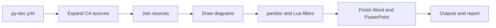
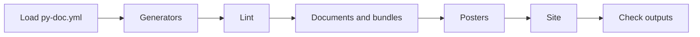

# The build pipeline

`py-doc build` makes every output of a document in five steps. `py-doc docx` and `py-doc slides` run the same steps for a single file, and `py-doc site` runs the first three for each page. Around the documents, `app.py` runs the project's generators first and its lint and site on request, as the last section describes.

## 1. Configuration

`config.py` loads `py-doc.yml` into typed objects (`ProjectConfig`, `DocumentConfig`, `Source`, `OutputSettings`, `SiteConfig`). Each section has a parser that accepts only its known keys and types, so the rest of the code never sees a value it did not expect. Paths are resolved against the file's folder.

## 2. C4 sources

A source with `structurizr:` is replaced by Markdown files before anything else (`c4/source.py`). The `structurizr-cli` program exports the workspace to JSON, cached by the hash of the DSL and its includes. `c4/generate.py` writes the chapters. Structurizr Local draws the views (`c4/render.py`), or they are written as PlantUML or Mermaid for the diagram step. The result is cached in `.py-doc/c4/<document>`, keyed by the workspace and the source's options.

## 3. Joining

`pandoc/source.py` reads each included source and expands its directives (`directives.py`: includes, conditions, variables). It splits off the front matter, applies the title and heading offset, and puts a page break block before sources that ask for one. The metadata of the document is merged from the configuration, the first source's front matter and its first heading (`build.py`). Headings are found line by line outside code fences, so a `#` in a code block is never mistaken for one.

## 4. Diagrams

`diagrams/render.py` finds the diagram fences (`diagrams/scan.py`) and draws each with the renderer for its fence (`diagrams/registry.py`) in the tool container. HTML and site pages get SVG where the tool can write it, other formats PNG at 192 dpi, shrunk to the page width. Pictures are cached by a key of the tool image, the renderer scripts, the format, the orientation and the diagram text. The fence is replaced by a picture line, inside a centring div for Word, PDF and HTML. PowerPoint gets the bare picture, because pandoc's PowerPoint writer prints the alt text of a picture inside a div instead of the picture.

## 5. Pandoc and finishing

`pandoc/engine.py` writes the joined Markdown, the pictures and a metadata file into a temporary folder and runs pandoc in the container with py-doc's Lua filters:

| Filter | Job | Formats |
|---|---|---|
| `admonitions.lua` | Callouts in both spellings become a box of their kind | all |
| `pagebreak.lua` | Page break blocks become a page break, or a new slide | all |
| `markers.lua` | `[[CAPTION:]]`, `[[STYLE:]]` and orientation markers. On slides the caption also becomes the alt text pandoc prints under a picture | PowerPoint, HTML, PDF |
| `center-div.lua` | Centring divs become LaTeX centring | PDF |
| `site.lua` | Admonitions or asides, figures as picture and caption, no repeated title | site pages |

Word handles the markers itself after pandoc (`pandoc/docx_post.py`), because they become Word fields, sections and styles. `pandoc/docx_finish.py` merges the result into the template, fills the placeholders and applies the layout. `pandoc/pptx_finish.py` keeps embedded fonts, fills the version token and the footer, and warns about crowded slides. The finished file is moved to its output path, and the build report records it with its checksum.

## Around the documents

`py-doc build` runs the steps above for each document inside a pipeline of the whole project (`app.py`). A failed stage stops the stages after it, but every document is tried. Each stage is recorded in the build report as `ok`, `failed` or `skipped`.

- **Generators** (`generators/`): each entry of `content.generators` returns Markdown, written only when it changes. The built-in types are in `generators/builtin.py`, and others are found through the `py_doc.generators` entry point group, so the core depends on none of their tools. They run before anything reads the sources, because the files they write are sources.
- **Lint** (`lint/`): with `build.lint` or `--lint`, the sources of the documents being built are linted before anything is written, and the issues can go to a SARIF, JSON or CSV file for CI (`lint/formats.py`).
- **Documents and bundles**: a bundle is a document whose sources are those of its documents, so it takes the same path.
- **Posters** (`poster*.py`): every poster under `posters:`, one self-contained HTML page each, with its PDF when it asks for one. The settings come in layers (`poster_settings.py`): `poster:`, the front matter, the poster's entry, then the command line. The page is built in Python, with diagrams through the same cache as the documents. A script in the page balances the columns by measured height and fits the poster to its paper. The PDF is that page printed by the container's Chromium (`diagrams/tools/poster_pdf.js`), from a copy with the web fonts inside, as the container has no network. `py-doc poster --watch` (`watch.py`) runs the same build on every save and serves the page with a script that reloads it.
- **Site** (`site/`): with `build.site` or `--site`, the pages are written and the site tool runs. The posters `site.posters` names are built into it as pages of their own.
- **Check outputs**: every file the build wrote is there and not empty.

`py-doc check`, `py-doc stats` and `py-doc diff` (`analysis/`) read the same configuration and the same document model, and build nothing. The diff splits each version into sections by its top-level headings. It matches them by heading path, then by text, so a renamed or moved section is not mistaken for one removed and another added.

## Live previews

`--watch` on `py-doc poster`, `py-doc docx` and `py-doc slides` runs one loop (`watch.py`). It builds, then serves the pages on 127.0.0.1 from a thread of its own. Every half second it looks at the modification times of the source files: the Markdown, includes, pictures, diagram sources and templates below the folders of the sources. The pages it wrote and hidden folders are not watched. A change builds again. Each page is served with a small script that asks `/__status` whether a newer build is there, and reloads when it is. The script is added as the page is served, so the files are the same as without `--watch`. A build that fails keeps the last good page and shows its error over it.

A poster is already a web page. A Word document or deck is not, so `docx` and `slides` (`_cli.py`) also write an *HTML twin* of each file (`convert.py`, `convert_twin`). The twin is the same Markdown through the same pipeline to pandoc's HTML. It adds `preview.css` after `html.css` to show page breaks, speaker notes and columns. The twin of a deck also runs `slides-preview.lua`, which puts each slide in a box. A box starts where pandoc's PowerPoint writer starts a slide: at headings up to the split level and at page breaks. The twins go to `.py-doc/preview/` below the input's folder and are served by their path. No file of the user's is overwritten, and two `readme.md` in different folders stay apart. When Word or PowerPoint has the output open, the engine raises `OutputLocked`; the watch loop warns and still writes the twin.

The VS Code extension (`editors/vscode`) is outside the Python package. Its only preview is the live preview (`src/watch.js`), so no py-doc block is drawn a second time in JavaScript. It runs `py-doc <command> --watch --no-open` as a child process, with the output in an output channel. py-doc picks a free port, and the extension reads the address from the `serving` line it prints, then opens it in VS Code's Simple Browser. Stopping the preview ends the whole process tree. It chooses the command with one function (`src/detect.js`), from the front matter and the blocks only a deck has. A line `Error: ...` printed after the page is served is a save that did not build, shown as a warning.

