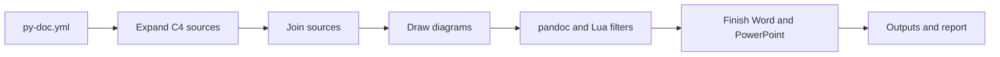

# The build pipeline

`py-doc build` makes every output of a document in five steps. `py-doc docx` and `py-doc slides` run the same steps for a single file, and `py-doc site` runs the first three for each page.

## 1. Configuration

`config.py` loads `py-doc.yml` into typed objects (`ProjectConfig`, `DocumentConfig`, `Source`, `OutputSettings`, `SiteConfig`). Each section has a parser that accepts only its known keys and types, so the rest of the code never sees a value it did not expect. Paths are resolved against the file's folder.

## 2. C4 sources

A source with `structurizr:` is replaced by Markdown files before anything else (`c4/source.py`). The `structurizr-cli` program exports the workspace to JSON, cached by the hash of the DSL and its includes. `c4/generate.py` writes the chapters. Structurizr Local draws the views (`c4/render.py`), or they are written as PlantUML or Mermaid for the diagram step. The result is cached in `.py-doc/c4/<document>`, keyed by the workspace and the source's options.

## 3. Joining

`pandoc/source.py` reads each included source and expands its directives (`directives.py`: includes, conditions, variables). It splits off the front matter, applies the title and heading offset, and puts a page break block before sources that ask for one. The metadata of the document is merged from the configuration, the first source's front matter and its first heading (`build.py`). Headings are found line by line outside code fences, so a `#` in a code block is never mistaken for one.

## 4. Diagrams

`diagrams/render.py` finds the diagram fences (`diagrams/scan.py`) and draws each with the renderer for its fence (`diagrams/registry.py`) in the tool container. HTML and site pages get SVG where the tool can write it, other formats PNG at 192 dpi, shrunk to the page width. Pictures are cached by a key of the tool image, the renderer scripts, the format, the orientation and the diagram text. The fence is replaced by a picture line, inside a centring div for Word, PDF and HTML. PowerPoint gets the bare picture, because pandoc's PowerPoint writer prints the alt text of a picture inside a div instead of the picture.

## 5. Pandoc and finishing

`pandoc/engine.py` writes the joined Markdown, the pictures and a metadata file into a temporary folder and runs pandoc in the container with py-doc's Lua filters:

| Filter | Job | Formats |
|---|---|---|
| `admonitions.lua` | Callouts in both spellings become a box of their kind | all |
| `pagebreak.lua` | Page break blocks become a page break, or a new slide | all |
| `markers.lua` | `[[CAPTION:]]`, `[[STYLE:]]` and orientation markers. On slides the caption also becomes the alt text pandoc prints under a picture | PowerPoint, HTML, PDF |
| `center-div.lua` | Centring divs become LaTeX centring | PDF |
| `site.lua` | Admonitions or asides, figures as picture and caption, no repeated title | site pages |

Word handles the markers itself after pandoc (`pandoc/docx_post.py`), because they become Word fields, sections and styles. `pandoc/docx_finish.py` merges the result into the template, fills the placeholders and applies the layout. `pandoc/pptx_finish.py` keeps embedded fonts, fills the version token and the footer, and warns about crowded slides. The finished file is moved to its output path, and the build report records it with its checksum.
