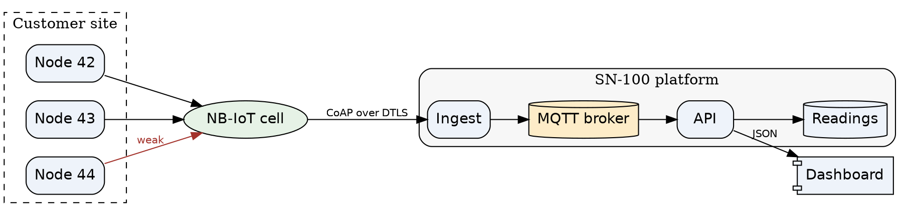
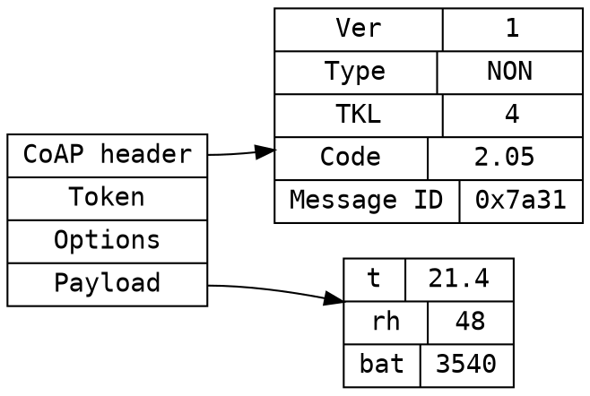
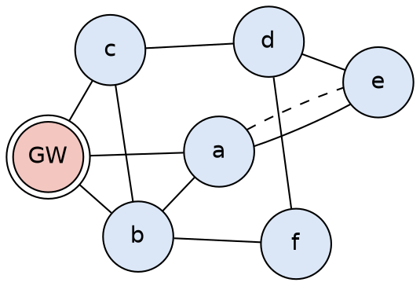
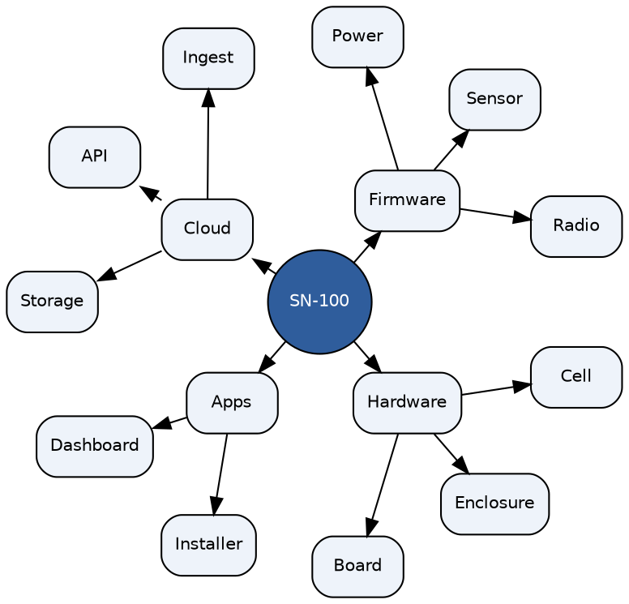

# Graphviz, ditaa, blockdiag and Pikchr

Graphs laid out for you, ASCII art, block, sequence and network diagrams, and precise line drawings. Each is a fence named after its tool.

## Graphviz: a directed graph with clusters

`dot` (or `graphviz`) lays out nodes and edges in ranks. Clusters group them, and attributes set shapes, colours and labels.

````markdown

````


## Graphviz: records

Record shapes draw structures with fields, and edges can join one field to another.

````markdown

````


## Graphviz: an undirected network with neato

`layout=neato` places nodes by spring forces instead of ranks, which suits a mesh.

````markdown

````


## Graphviz: a radial layout with twopi

`layout=twopi` puts the root in the middle and each level on a ring round it.

````markdown

````


## ditaa

ASCII art becomes a drawing: boxes, arrows, colours (`cBLU`), shapes (`{s}` storage, `{d}` document) and dashed lines.

````markdown
```ditaa
+-------------+     +-------------+     +---------------+
|  cBLU       |     |  cGRE       |     |  cYEL         |
| Sensor node +---->+  NB-IoT     +---->+  Ingest       |
|  x 200      |     |  cell       |     |               |
+-------------+     +-------------+     +-------+-------+
                                                |
                         +----------------------+
                         |
                         v
                 +-------+-------+      +---------------+
                 |  Readings     |      |  Dashboard    |
                 |  {s}          +----->+  {d}          |
                 +---------------+      +---------------+
```
````

```ditaa
+-------------+     +-------------+     +---------------+
|  cBLU       |     |  cGRE       |     |  cYEL         |
| Sensor node +---->+  NB-IoT     +---->+  Ingest       |
|  x 200      |     |  cell       |     |               |
+-------------+     +-------------+     +-------+-------+
                                                |
                         +----------------------+
                         |
                         v
                 +-------+-------+      +---------------+
                 |  Readings     |      |  Dashboard    |
                 |  {s}          +----->+  {d}          |
                 +---------------+      +---------------+
```

## blockdiag

Blocks joined by edges, with groups, shapes and colours.

````markdown
```blockdiag
blockdiag {
  orientation = portrait;
  default_shape = roundedbox;
  sensor [label = "Sensor", color = "#dbe7f7"];
  ctrl [label = "Controller", color = "#dbe7f7"];
  radio [label = "Radio", color = "#dbe7f7"];
  cell [label = "NB-IoT cell", shape = cloud];
  ingest [label = "Ingest"];
  db [label = "Readings", shape = flowchart.database];
  dash [label = "Dashboard"];
  sensor -> ctrl -> radio -> cell -> ingest -> db -> dash;
  group node { label = "SN-100 node"; color = "#eeeeee"; sensor; ctrl; radio; }
  group cloud { label = "Platform"; color = "#fdecc8"; ingest; db; dash; }
}
```
````

```blockdiag
blockdiag {
  orientation = portrait;
  default_shape = roundedbox;
  sensor [label = "Sensor", color = "#dbe7f7"];
  ctrl [label = "Controller", color = "#dbe7f7"];
  radio [label = "Radio", color = "#dbe7f7"];
  cell [label = "NB-IoT cell", shape = cloud];
  ingest [label = "Ingest"];
  db [label = "Readings", shape = flowchart.database];
  dash [label = "Dashboard"];
  sensor -> ctrl -> radio -> cell -> ingest -> db -> dash;
  group node { label = "SN-100 node"; color = "#eeeeee"; sensor; ctrl; radio; }
  group cloud { label = "Platform"; color = "#fdecc8"; ingest; db; dash; }
}
```

## seqdiag

A sequence diagram in the blockdiag style, with labels, return messages, separators and notes.

````markdown
```seqdiag
seqdiag {
  activation = none;
  node; gateway; broker; dashboard;
  node -> gateway [label = "join request"];
  node <-- gateway [label = "join accept"];
  === Normal running ===
  node -> gateway [label = "reading"];
  gateway -> broker [label = "PUBLISH"];
  broker -> dashboard [label = "push"];
  ... 15 minutes ...
  node -> gateway [label = "low battery", color = red, note = "CON message,\nneeds an ACK"];
  node <-- gateway [label = "ACK"];
}
```
````

```seqdiag
seqdiag {
  activation = none;
  node; gateway; broker; dashboard;
  node -> gateway [label = "join request"];
  node <-- gateway [label = "join accept"];
  === Normal running ===
  node -> gateway [label = "reading"];
  gateway -> broker [label = "PUBLISH"];
  broker -> dashboard [label = "push"];
  ... 15 minutes ...
  node -> gateway [label = "low battery", color = red, note = "CON message,\nneeds an ACK"];
  node <-- gateway [label = "ACK"];
}
```

## actdiag

An activity diagram with a lane for each role.

````markdown
```actdiag
actdiag {
  alarm -> ticket -> plan -> book -> visit -> swap -> close;
  lane node { label = "Node"; alarm [label = "Low battery"]; }
  lane platform { label = "Platform"; ticket [label = "Open ticket"]; plan [label = "Plan visit"]; close [label = "Close ticket"]; }
  lane field { label = "Field team"; book [label = "Book"]; visit [label = "Visit site"]; swap [label = "Replace cell"]; }
}
```
````

```actdiag
actdiag {
  alarm -> ticket -> plan -> book -> visit -> swap -> close;
  lane node { label = "Node"; alarm [label = "Low battery"]; }
  lane platform { label = "Platform"; ticket [label = "Open ticket"]; plan [label = "Plan visit"]; close [label = "Close ticket"]; }
  lane field { label = "Field team"; book [label = "Book"]; visit [label = "Visit site"]; swap [label = "Replace cell"]; }
}
```

## nwdiag

Networks as horizontal bars, with the devices on each and their addresses. A device on two networks joins them.

````markdown
```nwdiag
nwdiag {
  internet [shape = cloud];
  internet -- firewall;
  network dmz {
    address = "10.0.1.0/24";
    firewall [address = "10.0.1.1"];
    gateway [address = "10.0.1.10", description = "SN-100\ngateway"];
  }
  network plant {
    address = "10.0.2.0/24";
    gateway [address = "10.0.2.1"];
    bms [address = "10.0.2.20", description = "BMS"];
    logger [address = "10.0.2.30"];
    hmi [address = "10.0.2.40", description = "HMI panel"];
  }
  network sensors {
    address = "fd00::/64";
    gateway;
    node42 [address = "fd00::42"];
    node43 [address = "fd00::43"];
  }
}
```
````

```nwdiag
nwdiag {
  internet [shape = cloud];
  internet -- firewall;
  network dmz {
    address = "10.0.1.0/24";
    firewall [address = "10.0.1.1"];
    gateway [address = "10.0.1.10", description = "SN-100\ngateway"];
  }
  network plant {
    address = "10.0.2.0/24";
    gateway [address = "10.0.2.1"];
    bms [address = "10.0.2.20", description = "BMS"];
    logger [address = "10.0.2.30"];
    hmi [address = "10.0.2.40", description = "HMI panel"];
  }
  network sensors {
    address = "fd00::/64";
    gateway;
    node42 [address = "fd00::42"];
    node43 [address = "fd00::43"];
  }
}
```

## packetdiag

The fields of a frame, bit by bit, 32 bits to a row.

````markdown
```packetdiag
packetdiag {
  colwidth = 32;
  node_height = 48;
  0-1: Ver;
  2-3: T;
  4-7: TKL;
  8-15: Code;
  16-31: Message ID;
  32-63: Token (0 to 8 bytes) [colheight = 1];
  64-95: Options;
  96-103: 0xFF;
  104-127: Payload;
}
```
````

```packetdiag
packetdiag {
  colwidth = 32;
  node_height = 48;
  0-1: Ver;
  2-3: T;
  4-7: TKL;
  8-15: Code;
  16-31: Message ID;
  32-63: Token (0 to 8 bytes) [colheight = 1];
  64-95: Options;
  96-103: 0xFF;
  104-127: Payload;
}
```

## rackdiag

The units of a rack, with their heights and notes.

````markdown
```rackdiag
rackdiag {
  16U;
  ascending;
  description = "Plant room rack";
  1: UPS [2U];
  3: Battery pack [2U];
  5: Gateway server [2U];
  7: Logger;
  8: Core switch;
  9: Firewall;
  10: Patch panel;
  11: Cable manager;
  12: KVM [2U];
  15: Blanking panel [2U];
}
```
````

```rackdiag
rackdiag {
  16U;
  ascending;
  description = "Plant room rack";
  1: UPS [2U];
  3: Battery pack [2U];
  5: Gateway server [2U];
  7: Logger;
  8: Core switch;
  9: Firewall;
  10: Patch panel;
  11: Cable manager;
  12: KVM [2U];
  15: Blanking panel [2U];
}
```

## Pikchr

A precise drawing in the PIC language of Unix troff: boxes, arrows, splines and text placed relative to each other.

````markdown
```pikchr
arrowht = 0.08
Node: box "SN-100" "node" rad 8px fit
arrow right 150% "NB-IoT" above
Cell: ellipse "Cell" fit
arrow right 150% "CoAP" above
Ingest: box "Ingest" rad 8px fit
arrow down from Ingest.s
DB: cylinder "Readings" fit
arrow left from DB.w
API: box "API" rad 8px fit
arrow left from API.w
Dash: box "Dashboard" rad 8px fit
spline -> from Dash.n up 0.4 then right until even with Node then to Node.s dashed "settings" below
```
````

```pikchr
arrowht = 0.08
Node: box "SN-100" "node" rad 8px fit
arrow right 150% "NB-IoT" above
Cell: ellipse "Cell" fit
arrow right 150% "CoAP" above
Ingest: box "Ingest" rad 8px fit
arrow down from Ingest.s
DB: cylinder "Readings" fit
arrow left from DB.w
API: box "API" rad 8px fit
arrow left from API.w
Dash: box "Dashboard" rad 8px fit
spline -> from Dash.n up 0.4 then right until even with Node then to Node.s dashed "settings" below
```

## Railroad

A railroad (syntax) diagram, written as nested constructors: `Sequence`, `Choice`, `Optional`, `OneOrMore`, `ZeroOrMore`, `Terminal` and `NonTerminal`.

````markdown
```railroad
Diagram
  Sequence
    Terminal "sn100/"
    NonTerminal "site"
    Terminal "/"
    NonTerminal "node"
    Terminal "/"
    Choice
      Terminal "temp"
      Terminal "rh"
      Terminal "battery"
    Optional
      Sequence
        Terminal "/"
        Terminal "raw"
```
````

```railroad
Diagram
  Sequence
    Terminal "sn100/"
    NonTerminal "site"
    Terminal "/"
    NonTerminal "node"
    Terminal "/"
    Choice
      Terminal "temp"
      Terminal "rh"
      Terminal "battery"
    Optional
      Sequence
        Terminal "/"
        Terminal "raw"
```
