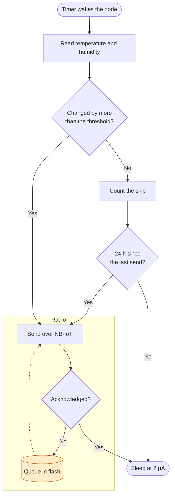
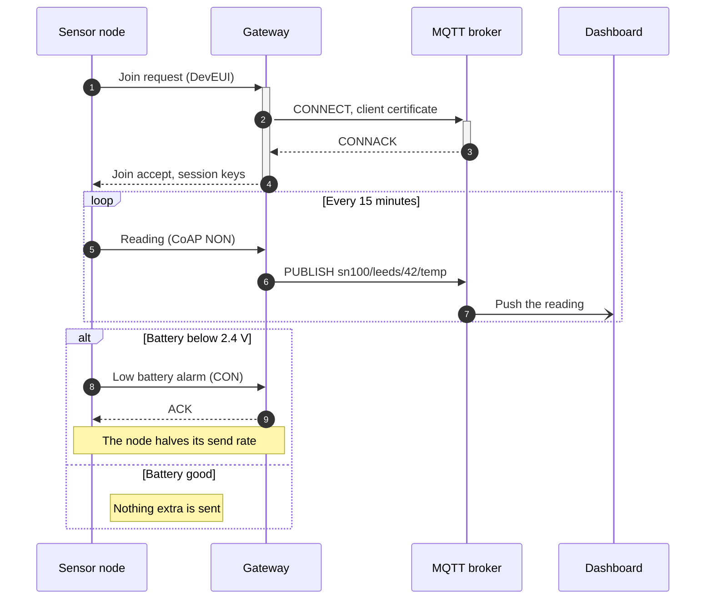
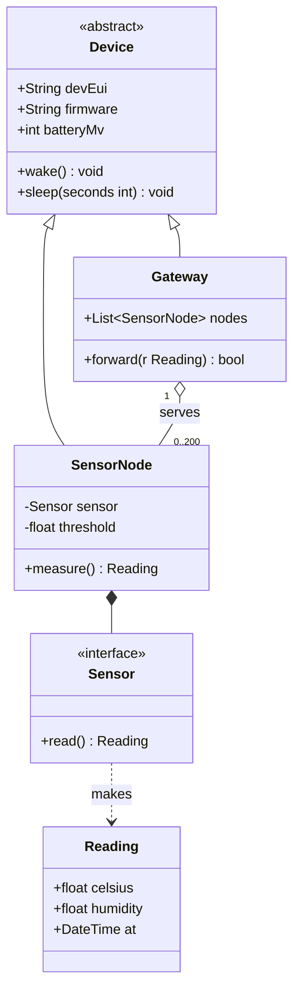
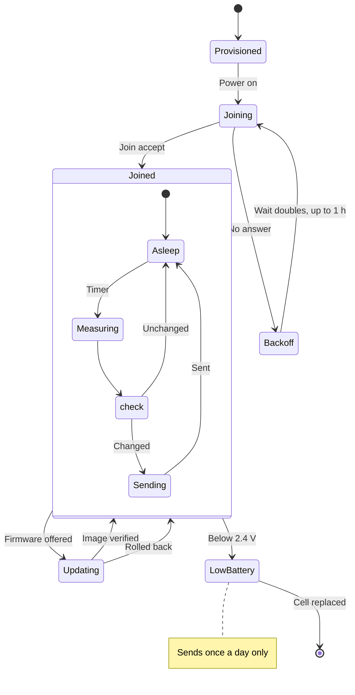
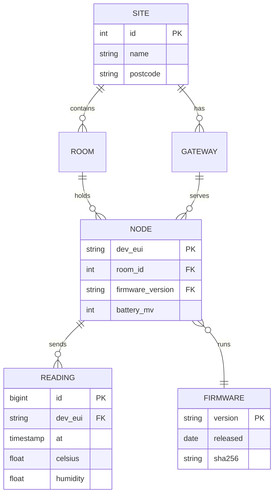
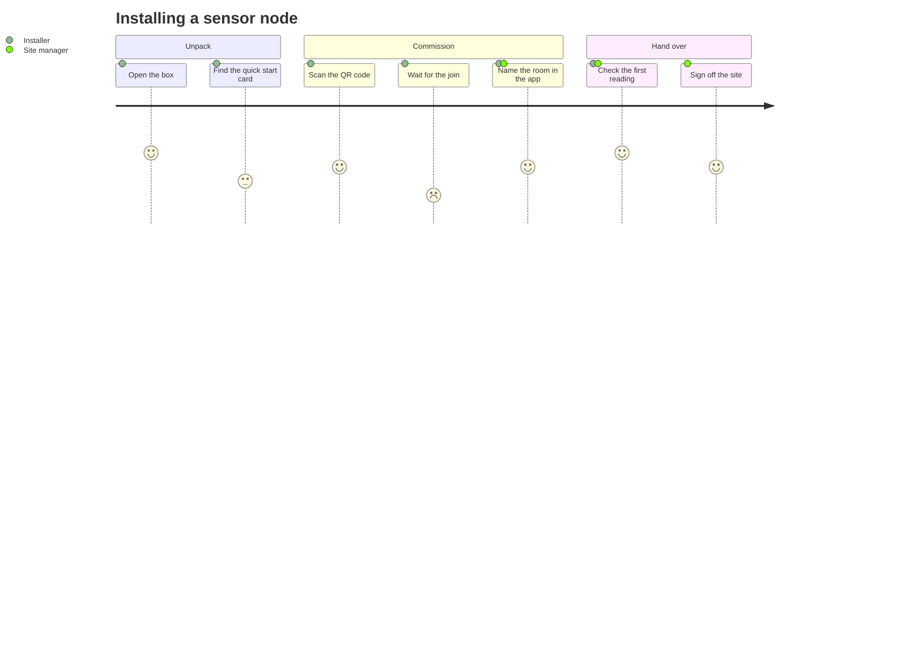
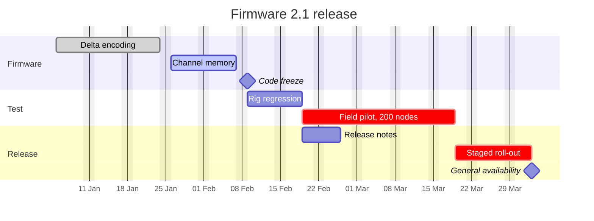
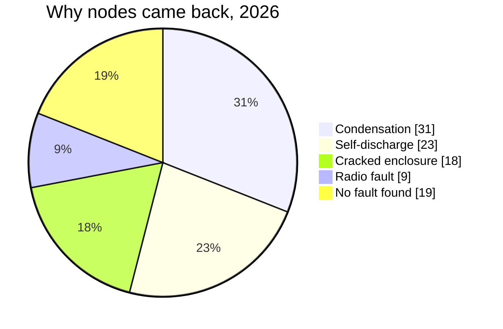
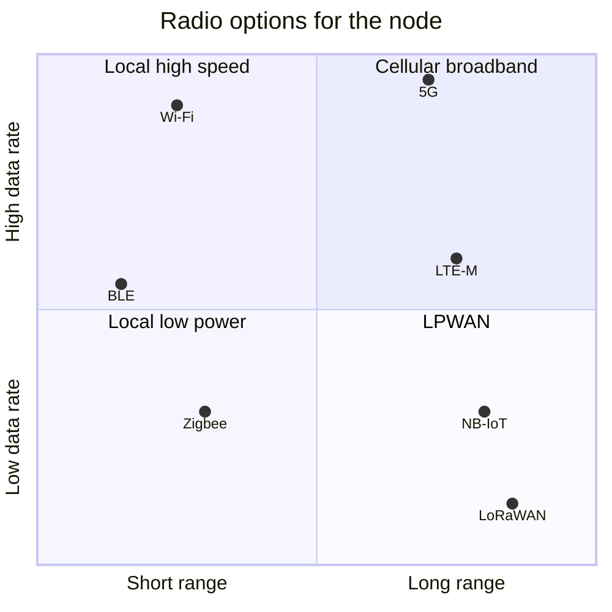
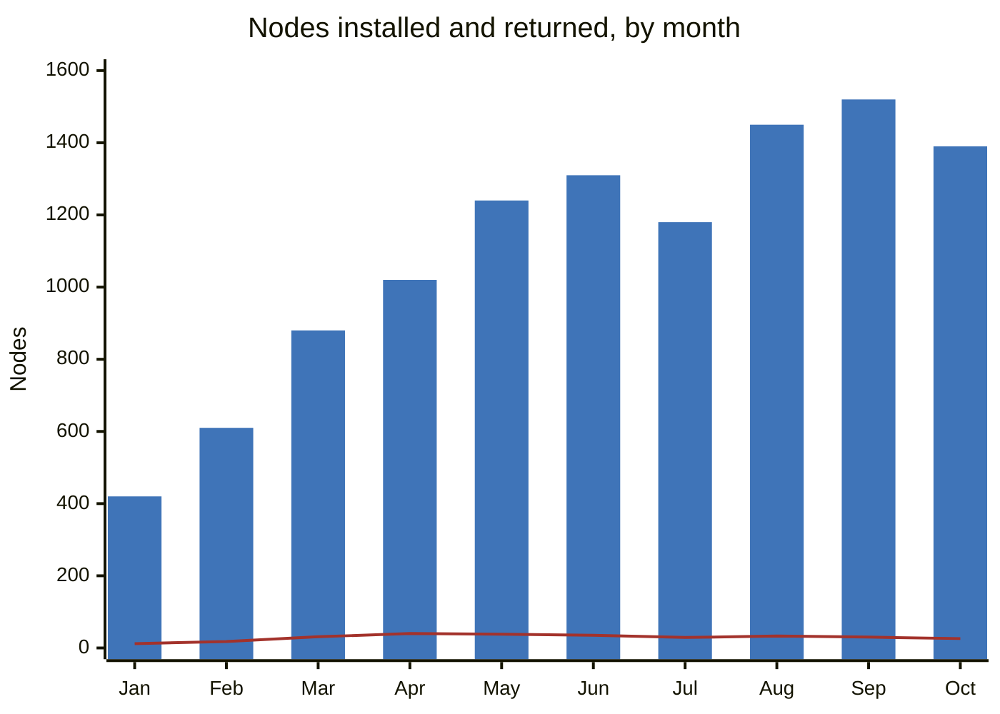

# Mermaid

[Mermaid](https://mermaid.js.org) draws more kinds of diagram than any other tool in the container. The first word of the fence names the kind. The tool image has Mermaid 12.1, which draws flowcharts, class, state and ER diagrams with the Eclipse Layout Kernel (ELK) and the `neo` look.

## Flowchart

`flowchart` with `TD`, `LR`, `BT` or `RL`. Shapes, subgraphs, labelled and dotted links, and classes for colour.

````markdown

````



## Sequence diagram

`sequenceDiagram`: participants, activations, loops, alternatives and notes.

````markdown

````


## Class diagram

`classDiagram`: classes, members, visibility, generalisation, composition and multiplicity.

````markdown

````


## State diagram

`stateDiagram-v2`: states, composite states, choices, forks and notes.

````markdown

````


## Entity relationship diagram

`erDiagram`: entities, attributes with keys, and the cardinality of each relationship.

````markdown

````


## User journey

`journey`: tasks in sections, each scored 1 to 5 for the people who do it.

````markdown

````


## Gantt chart

`gantt`: tasks in sections, with dates, durations, dependencies, milestones and states.

````markdown

````


## Pie chart

`pie`: slices from values, with `showData` to print them.

````markdown

````


## Quadrant chart

`quadrantChart`: points placed on two axes, in four labelled quadrants.

````markdown

````


## XY chart

`xychart`: bars and lines on shared axes.

````markdown

````


## Requirement diagram

`requirementDiagram`: requirements, the elements that satisfy and verify them, and how they trace.

````markdown
```mermaid
requirementDiagram
  requirement battery_life {
    id: "SN-R-001"
    text: "The node shall run five years on one cell"
    risk: high
    verifymethod: analysis
  }
  performanceRequirement sleep_current {
    id: "SN-R-002"
    text: "Sleep current below 3 µA"
    risk: medium
    verifymethod: test
  }
  functionalRequirement delta_send {
    id: "SN-R-003"
    text: "Send only readings that changed"
    risk: low
    verifymethod: inspection
  }
  element firmware {
    type: software
    docref: "fw/2.1"
  }
  element power_test {
    type: "test"
    docref: "TR-114"
  }
  battery_life - contains -> sleep_current
  battery_life - derives -> delta_send
  firmware - satisfies -> delta_send
  power_test - verifies -> sleep_current
```
````

```mermaid
requirementDiagram
  requirement battery_life {
    id: "SN-R-001"
    text: "The node shall run five years on one cell"
    risk: high
    verifymethod: analysis
  }
  performanceRequirement sleep_current {
    id: "SN-R-002"
    text: "Sleep current below 3 µA"
    risk: medium
    verifymethod: test
  }
  functionalRequirement delta_send {
    id: "SN-R-003"
    text: "Send only readings that changed"
    risk: low
    verifymethod: inspection
  }
  element firmware {
    type: software
    docref: "fw/2.1"
  }
  element power_test {
    type: "test"
    docref: "TR-114"
  }
  battery_life - contains -> sleep_current
  battery_life - derives -> delta_send
  firmware - satisfies -> delta_send
  power_test - verifies -> sleep_current
```

## Git graph

`gitGraph`: commits, branches, merges and tags.

````markdown
```mermaid
gitGraph
  commit id: "2.0.0" tag: "v2.0.0"
  branch develop
  commit id: "Delta encoding"
  branch feature/channel-memory
  commit id: "Remember the channel"
  commit id: "Fall back to a scan"
  checkout develop
  merge feature/channel-memory
  commit id: "Bump to 2.1-rc1"
  checkout main
  branch hotfix/2.0.1
  commit id: "Fix the RTC drift"
  checkout main
  merge hotfix/2.0.1 tag: "v2.0.1"
  checkout develop
  merge main
  checkout main
  merge develop tag: "v2.1.0"
```
````

```mermaid
gitGraph
  commit id: "2.0.0" tag: "v2.0.0"
  branch develop
  commit id: "Delta encoding"
  branch feature/channel-memory
  commit id: "Remember the channel"
  commit id: "Fall back to a scan"
  checkout develop
  merge feature/channel-memory
  commit id: "Bump to 2.1-rc1"
  checkout main
  branch hotfix/2.0.1
  commit id: "Fix the RTC drift"
  checkout main
  merge hotfix/2.0.1 tag: "v2.0.1"
  checkout develop
  merge main
  checkout main
  merge develop tag: "v2.1.0"
```

## C4 context

`C4Context`: the people and systems around the system. Mermaid's C4 support is experimental; for C4 models use Structurizr and `py-doc c4`.

````markdown
```mermaid
C4Context
  title System context of the SN-100 platform
  Person(manager, "Site manager", "Watches the rooms of a building")
  Person(installer, "Installer", "Fits and commissions nodes")
  System(platform, "SN-100 platform", "Collects and shows readings from the nodes")
  System_Ext(operator, "Mobile operator", "NB-IoT network")
  System_Ext(bms, "Building management system", "Runs heating and ventilation")
  Rel(installer, platform, "Commissions nodes with", "Mobile app")
  Rel(manager, platform, "Reads dashboards and alarms in", "HTTPS")
  Rel(platform, operator, "Receives readings through", "NB-IoT, CoAP")
  Rel(platform, bms, "Sends room readings to", "BACnet/IP")
```
````

```mermaid
C4Context
  title System context of the SN-100 platform
  Person(manager, "Site manager", "Watches the rooms of a building")
  Person(installer, "Installer", "Fits and commissions nodes")
  System(platform, "SN-100 platform", "Collects and shows readings from the nodes")
  System_Ext(operator, "Mobile operator", "NB-IoT network")
  System_Ext(bms, "Building management system", "Runs heating and ventilation")
  Rel(installer, platform, "Commissions nodes with", "Mobile app")
  Rel(manager, platform, "Reads dashboards and alarms in", "HTTPS")
  Rel(platform, operator, "Receives readings through", "NB-IoT, CoAP")
  Rel(platform, bms, "Sends room readings to", "BACnet/IP")
```

## C4 container

`C4Container`: the containers inside the system and how they talk.

````markdown
```mermaid
C4Container
  title Containers of the SN-100 platform
  Person(manager, "Site manager")
  System_Boundary(platform, "SN-100 platform") {
    Container(app, "Dashboard", "React", "Rooms, trends and alarms")
    Container(api, "API", "Python, FastAPI", "Sites, nodes and readings")
    Container(ingest, "Ingest", "Go", "Decodes CoAP and checks each reading")
    ContainerDb(db, "Readings", "TimescaleDB", "Every reading, by node and time")
    ContainerQueue(bus, "Broker", "MQTT", "Readings and alarms")
  }
  System_Ext(nodes, "Sensor nodes", "NB-IoT")
  Rel(manager, app, "Uses", "HTTPS")
  Rel(app, api, "Calls", "JSON")
  Rel(nodes, ingest, "Send readings", "CoAP over DTLS")
  Rel(ingest, bus, "Publishes", "MQTT")
  Rel(bus, api, "Delivers", "MQTT")
  Rel(api, db, "Reads and writes", "SQL")
```
````

```mermaid
C4Container
  title Containers of the SN-100 platform
  Person(manager, "Site manager")
  System_Boundary(platform, "SN-100 platform") {
    Container(app, "Dashboard", "React", "Rooms, trends and alarms")
    Container(api, "API", "Python, FastAPI", "Sites, nodes and readings")
    Container(ingest, "Ingest", "Go", "Decodes CoAP and checks each reading")
    ContainerDb(db, "Readings", "TimescaleDB", "Every reading, by node and time")
    ContainerQueue(bus, "Broker", "MQTT", "Readings and alarms")
  }
  System_Ext(nodes, "Sensor nodes", "NB-IoT")
  Rel(manager, app, "Uses", "HTTPS")
  Rel(app, api, "Calls", "JSON")
  Rel(nodes, ingest, "Send readings", "CoAP over DTLS")
  Rel(ingest, bus, "Publishes", "MQTT")
  Rel(bus, api, "Delivers", "MQTT")
  Rel(api, db, "Reads and writes", "SQL")
```

## C4 component

`C4Component`: the components inside one container.

````markdown
```mermaid
C4Component
  title Components of the ingest service
  Container_Ext(nodes, "Sensor nodes", "NB-IoT")
  ContainerQueue_Ext(bus, "Broker", "MQTT")
  Container_Boundary(ingest, "Ingest") {
    Component(listener, "CoAP listener", "go-coap", "Ends DTLS and receives messages")
    Component(decoder, "Decoder", "Go", "Turns the payload into a reading")
    Component(validator, "Validator", "Go", "Drops readings out of range")
    Component(publisher, "Publisher", "paho", "Publishes each reading")
  }
  Rel(nodes, listener, "Sends", "CoAP")
  Rel(listener, decoder, "Passes the payload to")
  Rel(decoder, validator, "Checks with")
  Rel(validator, publisher, "Hands good readings to")
  Rel(publisher, bus, "Publishes to", "MQTT")
```
````

```mermaid
C4Component
  title Components of the ingest service
  Container_Ext(nodes, "Sensor nodes", "NB-IoT")
  ContainerQueue_Ext(bus, "Broker", "MQTT")
  Container_Boundary(ingest, "Ingest") {
    Component(listener, "CoAP listener", "go-coap", "Ends DTLS and receives messages")
    Component(decoder, "Decoder", "Go", "Turns the payload into a reading")
    Component(validator, "Validator", "Go", "Drops readings out of range")
    Component(publisher, "Publisher", "paho", "Publishes each reading")
  }
  Rel(nodes, listener, "Sends", "CoAP")
  Rel(listener, decoder, "Passes the payload to")
  Rel(decoder, validator, "Checks with")
  Rel(validator, publisher, "Hands good readings to")
  Rel(publisher, bus, "Publishes to", "MQTT")
```

## C4 dynamic

`C4Dynamic`: numbered steps of one scenario.

````markdown
```mermaid
C4Dynamic
  title Commissioning a node
  Person(installer, "Installer")
  Container(mobile, "Installer app", "Kotlin")
  Container(api, "API", "FastAPI")
  ContainerDb(db, "Nodes", "PostgreSQL")
  Container(ingest, "Ingest", "Go")
  Rel(installer, mobile, "Scans the QR code with")
  Rel(mobile, api, "Registers the node", "HTTPS")
  Rel(api, db, "Stores the node and its room")
  Rel(ingest, api, "Reports the first reading", "MQTT")
  Rel(api, mobile, "Shows the node as live", "WebSocket")
```
````

```mermaid
C4Dynamic
  title Commissioning a node
  Person(installer, "Installer")
  Container(mobile, "Installer app", "Kotlin")
  Container(api, "API", "FastAPI")
  ContainerDb(db, "Nodes", "PostgreSQL")
  Container(ingest, "Ingest", "Go")
  Rel(installer, mobile, "Scans the QR code with")
  Rel(mobile, api, "Registers the node", "HTTPS")
  Rel(api, db, "Stores the node and its room")
  Rel(ingest, api, "Reports the first reading", "MQTT")
  Rel(api, mobile, "Shows the node as live", "WebSocket")
```

## C4 deployment

`C4Deployment`: where the containers run.

````markdown
```mermaid
C4Deployment
  title Production deployment
  Deployment_Node(cloud, "Cloud", "eu-west-2") {
    Deployment_Node(k8s, "Kubernetes", "3 nodes") {
      Container(ingest, "Ingest", "Go", "3 replicas")
      Container(api, "API", "FastAPI", "2 replicas")
    }
    Deployment_Node(rds, "Managed database", "db.r6g.large") {
      ContainerDb(db, "Readings", "TimescaleDB")
    }
  }
  Deployment_Node(site, "Customer site", "Leeds") {
    Deployment_Node(sn, "SN-100 node", "Cortex-M0+") {
      Container(fw, "Firmware", "C", "2.1")
    }
  }
  Rel(fw, ingest, "Sends readings", "CoAP over NB-IoT")
  Rel(ingest, db, "Writes", "SQL")
  Rel(api, db, "Reads", "SQL")
```
````

```mermaid
C4Deployment
  title Production deployment
  Deployment_Node(cloud, "Cloud", "eu-west-2") {
    Deployment_Node(k8s, "Kubernetes", "3 nodes") {
      Container(ingest, "Ingest", "Go", "3 replicas")
      Container(api, "API", "FastAPI", "2 replicas")
    }
    Deployment_Node(rds, "Managed database", "db.r6g.large") {
      ContainerDb(db, "Readings", "TimescaleDB")
    }
  }
  Deployment_Node(site, "Customer site", "Leeds") {
    Deployment_Node(sn, "SN-100 node", "Cortex-M0+") {
      Container(fw, "Firmware", "C", "2.1")
    }
  }
  Rel(fw, ingest, "Sends readings", "CoAP over NB-IoT")
  Rel(ingest, db, "Writes", "SQL")
  Rel(api, db, "Reads", "SQL")
```

## Mind map

`mindmap`: ideas by indentation, with shapes for the nodes.

````markdown
```mermaid
mindmap
  root((Battery life))
    Sleep
      Sleep current 2 µA
      RTC wake only
      Sensor powered off
    Radio
      PSM and eDRX
      Send only changes
      Remember the channel
    Cell
      Lithium thionyl chloride
      Self-discharge 1 % a year
      Passivation on cold starts
    Firmware
      No busy waits
      Flash writes batched
```
````

```mermaid
mindmap
  root((Battery life))
    Sleep
      Sleep current 2 µA
      RTC wake only
      Sensor powered off
    Radio
      PSM and eDRX
      Send only changes
      Remember the channel
    Cell
      Lithium thionyl chloride
      Self-discharge 1 % a year
      Passivation on cold starts
    Firmware
      No busy waits
      Flash writes batched
```

## Timeline

`timeline`: periods with their events, in sections.

````markdown
```mermaid
timeline
  title The SN-100 so far
  section Prototype
    2024 Q3 : First board : Bench tests at 2 µA
    2024 Q4 : NB-IoT certified
  section Pilot
    2025 Q2 : 200 nodes in two buildings
    2025 Q4 : Firmware 2.0 : Over-the-air updates
  section Production
    2026 Q1 : 5,000 nodes : Second contract manufacturer
    2026 Q3 : Firmware 2.1 : Ten-year cell option
```
````

```mermaid
timeline
  title The SN-100 so far
  section Prototype
    2024 Q3 : First board : Bench tests at 2 µA
    2024 Q4 : NB-IoT certified
  section Pilot
    2025 Q2 : 200 nodes in two buildings
    2025 Q4 : Firmware 2.0 : Over-the-air updates
  section Production
    2026 Q1 : 5,000 nodes : Second contract manufacturer
    2026 Q3 : Firmware 2.1 : Ten-year cell option
```

## Sankey diagram

`sankey`: flows between nodes, as wide as their values.

````markdown
```mermaid
sankey
Battery,Sleep,410
Battery,Measure,120
Battery,Radio,1650
Battery,Self-discharge,820
Radio,Attach,520
Radio,Send,780
Radio,Wait for the reply,350
Measure,Sensor,80
Measure,Controller,40
```
````

```mermaid
sankey
Battery,Sleep,410
Battery,Measure,120
Battery,Radio,1650
Battery,Self-discharge,820
Radio,Attach,520
Radio,Send,780
Radio,Wait for the reply,350
Measure,Sensor,80
Measure,Controller,40
```

## Block diagram

`block`: blocks in columns that you place yourself, with spans, spaces and arrows.

````markdown
```mermaid
block
  columns 5
  sensor["Sensor\nSHT40"] space ctrl["Controller\nCortex-M0+"] space radio["Radio\nBG77"]
  space:5
  cell[("Cell\n3.6 V, 2.4 Ah")] space pmu["Power\nmanagement"] space ant(("Antenna"))
  sensor -- "I2C" --> ctrl
  ctrl -- "UART" --> radio
  radio --> ant
  cell --> pmu
  pmu --> ctrl
  style ctrl fill:#dbe7f7,stroke:#2f5d9c
```
````

```mermaid
block
  columns 5
  sensor["Sensor\nSHT40"] space ctrl["Controller\nCortex-M0+"] space radio["Radio\nBG77"]
  space:5
  cell[("Cell\n3.6 V, 2.4 Ah")] space pmu["Power\nmanagement"] space ant(("Antenna"))
  sensor -- "I2C" --> ctrl
  ctrl -- "UART" --> radio
  radio --> ant
  cell --> pmu
  pmu --> ctrl
  style ctrl fill:#dbe7f7,stroke:#2f5d9c
```

## Packet

`packet`: the bit fields of a frame, 32 bits to a row.

````markdown
```mermaid
packet
  title CoAP message header
  0-1: "Ver"
  2-3: "T"
  4-7: "TKL"
  8-15: "Code"
  16-31: "Message ID"
  32-63: "Token (0 to 8 bytes)"
  64-95: "Options (variable)"
  96-103: "0xFF"
  104-127: "Payload (variable)"
```
````

```mermaid
packet
  title CoAP message header
  0-1: "Ver"
  2-3: "T"
  4-7: "TKL"
  8-15: "Code"
  16-31: "Message ID"
  32-63: "Token (0 to 8 bytes)"
  64-95: "Options (variable)"
  96-103: "0xFF"
  104-127: "Payload (variable)"
```

## Kanban

`kanban`: columns of cards, with their owner, ticket and priority.

````markdown
```mermaid
kanban
  Backlog
    k1[Coat the humidity sensor]@{ priority: 'High' }
    k2[Ten-year cell option]
  In progress
    k3[Channel memory]@{ assigned: 'L. Chen', ticket: 'SN-412', priority: 'High' }
    k4[Installer app: room photos]@{ assigned: 'M. Duarte' }
  Review
    k5[Delta encoding]@{ assigned: 'L. Chen', ticket: 'SN-398' }
  Done
    k6[RTC drift fix]@{ ticket: 'SN-401', priority: 'Very High' }
    k7[Torque-limited driver in the kit]
```
````

```mermaid
kanban
  Backlog
    k1[Coat the humidity sensor]@{ priority: 'High' }
    k2[Ten-year cell option]
  In progress
    k3[Channel memory]@{ assigned: 'L. Chen', ticket: 'SN-412', priority: 'High' }
    k4[Installer app: room photos]@{ assigned: 'M. Duarte' }
  Review
    k5[Delta encoding]@{ assigned: 'L. Chen', ticket: 'SN-398' }
  Done
    k6[RTC drift fix]@{ ticket: 'SN-401', priority: 'Very High' }
    k7[Torque-limited driver in the kit]
```

## Architecture

`architecture-beta`: services and groups with icons, joined edge to edge.

````markdown
```mermaid
architecture-beta
  group site(cloud)[Customer site]
  group platform(cloud)[SN-100 platform]
  service node(server)[Sensor node] in site
  service tower(internet)[NB-IoT cell] in site
  service ingest(server)[Ingest] in platform
  service broker(server)[MQTT broker] in platform
  service db(database)[Readings] in platform
  service api(server)[API] in platform
  service web(internet)[Dashboard]
  node:R --> L:tower
  tower:R --> L:ingest
  ingest:R --> L:broker
  broker:B --> T:api
  api:R --> L:db
  api:B --> T:web
```
````

```mermaid
architecture-beta
  group site(cloud)[Customer site]
  group platform(cloud)[SN-100 platform]
  service node(server)[Sensor node] in site
  service tower(internet)[NB-IoT cell] in site
  service ingest(server)[Ingest] in platform
  service broker(server)[MQTT broker] in platform
  service db(database)[Readings] in platform
  service api(server)[API] in platform
  service web(internet)[Dashboard]
  node:R --> L:tower
  tower:R --> L:ingest
  ingest:R --> L:broker
  broker:B --> T:api
  api:R --> L:db
  api:B --> T:web
```

## Radar chart

`radar-beta`: values on axes round a centre, a curve each.

````markdown
```mermaid
radar-beta
  title Radio options for the node
  axis range["Range"], power["Low power"], rate["Data rate"]
  axis cost["Low cost"], indoor["Indoor reach"], roam["Roaming"]
  curve nb["NB-IoT"]{4, 5, 1, 3, 5, 4}
  curve lora["LoRaWAN"]{5, 5, 1, 5, 3, 2}
  curve ltem["LTE-M"]{4, 3, 3, 3, 4, 5}
  max 5
  graticule polygon
```
````

```mermaid
radar-beta
  title Radio options for the node
  axis range["Range"], power["Low power"], rate["Data rate"]
  axis cost["Low cost"], indoor["Indoor reach"], roam["Roaming"]
  curve nb["NB-IoT"]{4, 5, 1, 3, 5, 4}
  curve lora["LoRaWAN"]{5, 5, 1, 5, 3, 2}
  curve ltem["LTE-M"]{4, 3, 3, 3, 4, 5}
  max 5
  graticule polygon
```

## Treemap

`treemap-beta`: a hierarchy as nested rectangles, each the size of its value.

````markdown
```mermaid
treemap-beta
"Bill of materials, £"
  "Electronics"
    "Radio module": 7.80
    "Controller": 1.90
    "Sensor": 2.40
    "PCB and passives": 2.10
  "Power"
    "Cell": 4.60
    "Regulator": 0.70
  "Mechanics"
    "Enclosure": 2.30
    "Wall plate": 0.60
    "Gasket and screws": 0.40
  "Box and card": 0.90
```
````

```mermaid
treemap-beta
"Bill of materials, £"
  "Electronics"
    "Radio module": 7.80
    "Controller": 1.90
    "Sensor": 2.40
    "PCB and passives": 2.10
  "Power"
    "Cell": 4.60
    "Regulator": 0.70
  "Mechanics"
    "Enclosure": 2.30
    "Wall plate": 0.60
    "Gasket and screws": 0.40
  "Box and card": 0.90
```

## Ishikawa (fishbone)

`ishikawa-beta`: the causes of an effect, by category.

````markdown
```mermaid
ishikawa-beta
  Node stops reporting
  Power
    Cell passivated after cold storage
    Self-discharge above spec
  Radio
    Weak signal in the meter cupboard
    Operator changed the band
  Firmware
    RTC drift misses the wake
    Flash full of queued messages
  Installation
    Mounted on a metal pipe
    Enclosure cracked by over-torque
  Environment
    Condensation on the sensor
```
````

```mermaid
ishikawa-beta
  Node stops reporting
  Power
    Cell passivated after cold storage
    Self-discharge above spec
  Radio
    Weak signal in the meter cupboard
    Operator changed the band
  Firmware
    RTC drift misses the wake
    Flash full of queued messages
  Installation
    Mounted on a metal pipe
    Enclosure cracked by over-torque
  Environment
    Condensation on the sensor
```

## Venn diagram

`venn-beta`: sets and what they share.

````markdown
```mermaid
venn-beta
  title Which nodes need a site visit
  set Battery["Low battery"]
  set Signal["Weak signal"]
  set Firmware["Old firmware"]
  union Battery,Signal["Move it"]
  union Signal,Firmware["Update"]
  union Battery,Firmware["New cell"]
  union Battery,Signal,Firmware["Swap"]
```
````

```mermaid
venn-beta
  title Which nodes need a site visit
  set Battery["Low battery"]
  set Signal["Weak signal"]
  set Firmware["Old firmware"]
  union Battery,Signal["Move it"]
  union Signal,Firmware["Update"]
  union Battery,Firmware["New cell"]
  union Battery,Signal,Firmware["Swap"]
```

## Tree view

`treeView-beta`: a folder tree, by indentation.

````markdown
```mermaid
treeView-beta
  sn100-firmware/
    src/
      main.c
      radio/
        bg77.c
        coap.c
      sensor/
        sht40.c
    tests/
      test_coap.c
    CMakeLists.txt
    README.md
```
````

```mermaid
treeView-beta
  sn100-firmware/
    src/
      main.c
      radio/
        bg77.c
        coap.c
      sensor/
        sht40.c
    tests/
      test_coap.c
    CMakeLists.txt
    README.md
```

## Use case diagram

`usecase-beta`: actors, use cases inside a system boundary, and include and extend links.

````markdown
```mermaid
usecase-beta
direction LR
actor Installer("Installer")
actor Manager("Site manager")
actor Operator("Mobile operator")@{ type: hollow }
systemBoundary platform["SN-100 platform"]
  Commission("Commission a node")
  Scan("Scan the QR code")
  Watch("Watch the rooms")
  Alarm("Acknowledge an alarm")
  Update("Update the firmware")
end
Installer --> Commission
Commission ..> : include Scan
Manager --> Watch
Manager --> Alarm
Alarm ..> : extend Watch
Operator --> Update
```
````

```mermaid
usecase-beta
direction LR
actor Installer("Installer")
actor Manager("Site manager")
actor Operator("Mobile operator")@{ type: hollow }
systemBoundary platform["SN-100 platform"]
  Commission("Commission a node")
  Scan("Scan the QR code")
  Watch("Watch the rooms")
  Alarm("Acknowledge an alarm")
  Update("Update the firmware")
end
Installer --> Commission
Commission ..> : include Scan
Manager --> Watch
Manager --> Alarm
Alarm ..> : extend Watch
Operator --> Update
```

## Swimlanes

`swimlane-beta`: a flowchart with a lane for each role.

````markdown
```mermaid
swimlane-beta LR
  subgraph Node
    alarm[Raise the low-battery alarm]
    halve[Halve the send rate]
  end
  subgraph Platform
    open[Open a ticket]
    plan{Visit due within\n30 days?}
  end
  subgraph Field team
    add[Add to that visit]
    book[Book a visit]
    swap[Replace the cell]
  end
  alarm --> halve
  alarm --> open --> plan
  plan -->|Yes| add --> swap
  plan -->|No| book --> swap
```
````

```mermaid
swimlane-beta LR
  subgraph Node
    alarm[Raise the low-battery alarm]
    halve[Halve the send rate]
  end
  subgraph Platform
    open[Open a ticket]
    plan{Visit due within\n30 days?}
  end
  subgraph Field team
    add[Add to that visit]
    book[Book a visit]
    swap[Replace the cell]
  end
  alarm --> halve
  alarm --> open --> plan
  plan -->|Yes| add --> swap
  plan -->|No| book --> swap
```

## Event model

`eventmodeling`: screens, commands, events and views along a timeline, with the data each carries.

````markdown
```mermaid
eventmodeling
tf 01 ui InstallerApp
tf 02 cmd RegisterNode [[RegisterNode01]]
tf 03 evt NodeRegistered [[NodeRegistered]]
tf 04 evt FirstReadingReceived [[Reading]]
tf 05 rmo LiveNodes
tf 06 ui Dashboard

data RegisterNode01 {
  devEui: '70B3D57ED0051A2C'
  room: 'Plant room'
}
data NodeRegistered {
  devEui: string
  room: string
}
data Reading {
  devEui: string
  celsius: number
}
```
````

```mermaid
eventmodeling
tf 01 ui InstallerApp
tf 02 cmd RegisterNode [[RegisterNode01]]
tf 03 evt NodeRegistered [[NodeRegistered]]
tf 04 evt FirstReadingReceived [[Reading]]
tf 05 rmo LiveNodes
tf 06 ui Dashboard

data RegisterNode01 {
  devEui: '70B3D57ED0051A2C'
  room: 'Plant room'
}
data NodeRegistered {
  devEui: string
  room: string
}
data Reading {
  devEui: string
  celsius: number
}
```

## Wardley map

`wardley-beta`: the parts of a value chain by how visible they are and how evolved.

````markdown
```mermaid
wardley-beta
title SN-100 value chain
evolution Genesis@0.25 -> Custom@0.5 -> Product@0.75 -> Commodity@1.0
anchor Facilities team [0.95, 0.60]
component "Room comfort reports" [0.85, 0.55] (build)
component "Dashboard" [0.72, 0.62] (build)
component "Sensor node" [0.60, 0.45] (build)
component "Analytics" [0.55, 0.35] (build)
component "NB-IoT network" [0.35, 0.80] (buy)
component "Cloud hosting" [0.20, 0.92] (buy)
Facilities team -> "Room comfort reports"
"Room comfort reports" -> "Dashboard"
"Room comfort reports" -> "Analytics"
"Dashboard" -> "Sensor node"
"Sensor node" -> "NB-IoT network"
"Analytics" -> "Cloud hosting"
"Dashboard" -> "Cloud hosting"
evolve "Analytics" 0.65
note "Buy the network, build what customers see" [0.30, 0.40]
```
````

```mermaid
wardley-beta
title SN-100 value chain
evolution Genesis@0.25 -> Custom@0.5 -> Product@0.75 -> Commodity@1.0
anchor Facilities team [0.95, 0.60]
component "Room comfort reports" [0.85, 0.55] (build)
component "Dashboard" [0.72, 0.62] (build)
component "Sensor node" [0.60, 0.45] (build)
component "Analytics" [0.55, 0.35] (build)
component "NB-IoT network" [0.35, 0.80] (buy)
component "Cloud hosting" [0.20, 0.92] (buy)
Facilities team -> "Room comfort reports"
"Room comfort reports" -> "Dashboard"
"Room comfort reports" -> "Analytics"
"Dashboard" -> "Sensor node"
"Sensor node" -> "NB-IoT network"
"Analytics" -> "Cloud hosting"
"Dashboard" -> "Cloud hosting"
evolve "Analytics" 0.65
note "Buy the network, build what customers see" [0.30, 0.40]
```

## Cynefin

`cynefin-beta`: work sorted into the Cynefin domains, with moves between them.

````markdown
```mermaid
cynefin-beta
  title Field problems, by how well we understand them
  clear
    "Replace a flat cell"
    "Re-mount a node"
  complicated
    "Weak signal in a basement"
    "Readings drift over a year"
  complex
    "Condensation in cold stores"
  chaotic
    "Operator outage across a city"
  confusion
    "Node silent, cause unknown"
  complex --> complicated : "Root cause found"
  complicated --> clear : "Fix written into the guide"
  chaotic --> complex : "Service restored"
```
````

```mermaid
cynefin-beta
  title Field problems, by how well we understand them
  clear
    "Replace a flat cell"
    "Re-mount a node"
  complicated
    "Weak signal in a basement"
    "Readings drift over a year"
  complex
    "Condensation in cold stores"
  chaotic
    "Operator outage across a city"
  confusion
    "Node silent, cause unknown"
  complex --> complicated : "Root cause found"
  complicated --> clear : "Fix written into the guide"
  chaotic --> complex : "Service restored"
```

## Railroad diagrams

`railroad-beta` writes a grammar from its parts. `railroad-ebnf-beta`, `railroad-abnf-beta` and `railroad-peg-beta` read a grammar in that notation.

````markdown
```mermaid
railroad-beta
title Topic of a reading
topic = sequence(
    terminal("sn100/"),
    nonterminal("site"),
    terminal("/"),
    nonterminal("node"),
    terminal("/"),
    choice(terminal("temp"), terminal("rh"), terminal("battery")),
    optional(sequence(terminal("/"), terminal("raw")))
) ;
```
````

```mermaid
railroad-beta
title Topic of a reading
topic = sequence(
    terminal("sn100/"),
    nonterminal("site"),
    terminal("/"),
    nonterminal("node"),
    terminal("/"),
    choice(terminal("temp"), terminal("rh"), terminal("battery")),
    optional(sequence(terminal("/"), terminal("raw")))
) ;
```

````markdown
```mermaid
railroad-ebnf-beta
title "Node command"
command = verb , " " , target , { " " , option } ;
verb = "get" | "set" | "reset" ;
target = "interval" | "threshold" | "radio" ;
option = "--" , name , [ "=" , value ] ;
```
````

```mermaid
railroad-ebnf-beta
title "Node command"
command = verb , " " , target , { " " , option } ;
verb = "get" | "set" | "reset" ;
target = "interval" | "threshold" | "radio" ;
option = "--" , name , [ "=" , value ] ;
```

````markdown
```mermaid
railroad-abnf-beta
title "DevEUI"
deveui = 8( hexbyte ) ;
hexbyte = 2( HEXDIG ) ;
```
````

```mermaid
railroad-abnf-beta
title "DevEUI"
deveui = 8( hexbyte ) ;
hexbyte = 2( HEXDIG ) ;
```

````markdown
```mermaid
railroad-peg-beta
title "Reading payload"
Payload <- Field ("," Field)* ;
Field <- Name "=" Number ;
Name <- "t" / "rh" / "bat" ;
Number <- "-"? Digit+ ("." Digit+)? ;
Digit <- "0" / "1" / "2" / "3" / "4" / "5" / "6" / "7" / "8" / "9" ;
```
````

```mermaid
railroad-peg-beta
title "Reading payload"
Payload <- Field ("," Field)* ;
Field <- Name "=" Number ;
Name <- "t" / "rh" / "bat" ;
Number <- "-"? Digit+ ("." Digit+)? ;
Digit <- "0" / "1" / "2" / "3" / "4" / "5" / "6" / "7" / "8" / "9" ;
```

## Agent flow

`agentflow-beta`: AI agents, their tools and reference documents, and how work passes between them.

````markdown
```mermaid
agentflow-beta TB
  ticket["Field ticket"]@{ shape: input }
  flow triage["Triage agent"]
    classify["Classify the fault"]@{ shape: task }
    history["node_history"]@{ shape: tool }
    guide["Field service guide"]@{ shape: refdoc }
    classify --> history
    classify -.- guide
  end
  flow planner["Planning agent"]
    plan["Plan the visit"]@{ shape: task }
    ok["Parts in stock?"]@{ shape: decision }
    plan --> ok
  end
  book["Book the engineer"]@{ shape: action }
  ticket --> triage
  triage --> planner
  ok --> book
```
````

```mermaid
agentflow-beta TB
  ticket["Field ticket"]@{ shape: input }
  flow triage["Triage agent"]
    classify["Classify the fault"]@{ shape: task }
    history["node_history"]@{ shape: tool }
    guide["Field service guide"]@{ shape: refdoc }
    classify --> history
    classify -.- guide
  end
  flow planner["Planning agent"]
    plan["Plan the visit"]@{ shape: task }
    ok["Parts in stock?"]@{ shape: decision }
    plan --> ok
  end
  book["Book the engineer"]@{ shape: action }
  ticket --> triage
  triage --> planner
  ok --> book
```
