# PlantUML

[PlantUML](https://plantuml.com) draws every UML diagram and many others from text between `@startuml` and `@enduml`, or the `@start` line of its kind, such as `@startmindmap`. The tool image has PlantUML 1.2025.4. `puml` is the same fence.

## Sequence diagram

Participants of each kind, groups, activations, delays and dividers.

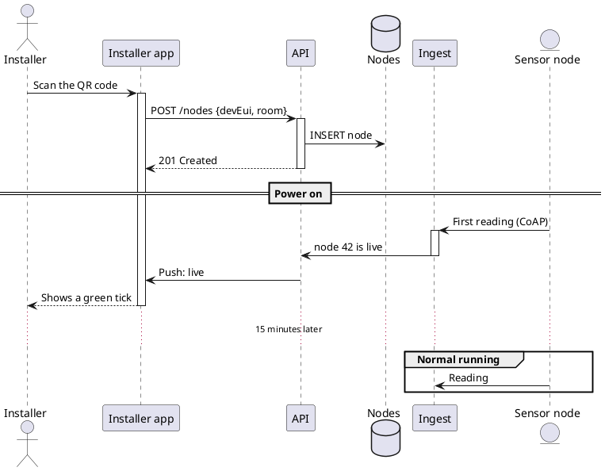

## Use case diagram

Actors, use cases in a system, and include and extend.

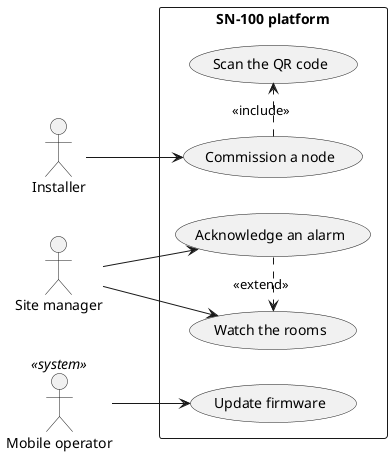

## Class diagram

Classes, interfaces, enums, packages and their relationships.

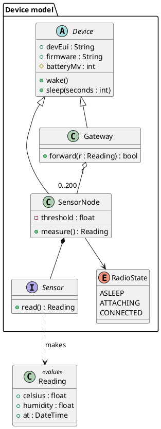

## Object diagram

Objects and the values of their fields at one moment.

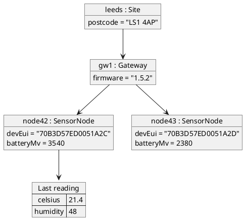

## Activity diagram

Actions, decisions, loops, forks and swim lanes.

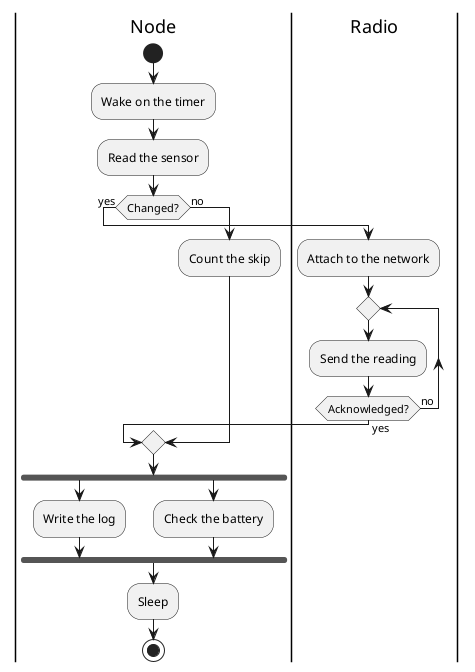

## Component diagram

Components, interfaces, ports and the dependencies between them.

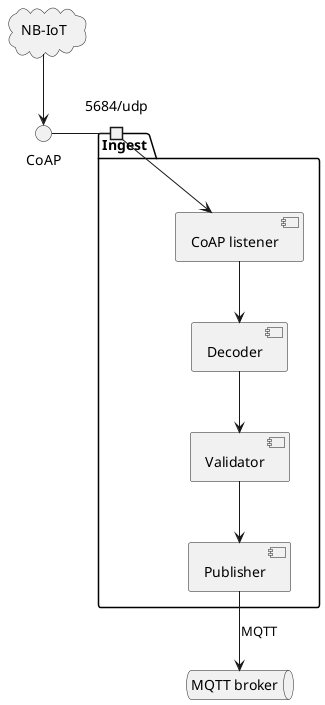

## Deployment diagram

Nodes, devices, artefacts and the links between them.

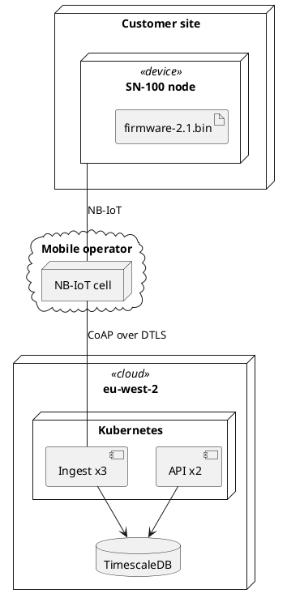

## State diagram

States, composite states, choices and concurrent regions.

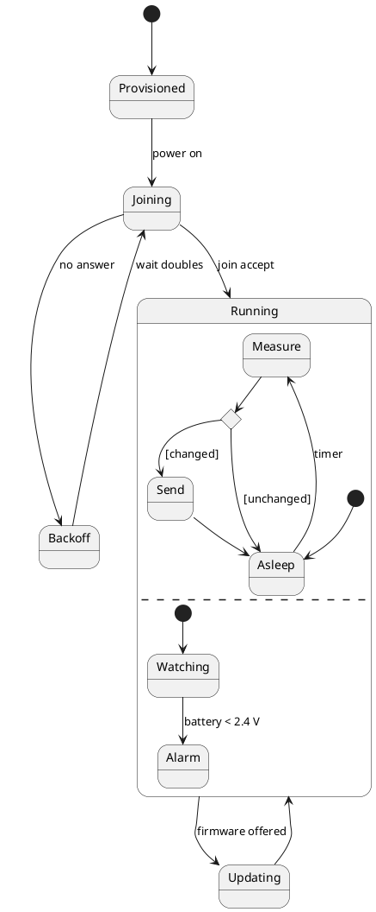

## Timing diagram

Robust and concise signals, clocks and binary lines, over time.

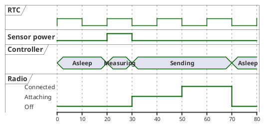

## Entity relationship diagram

Entities with keys, in information engineering notation.

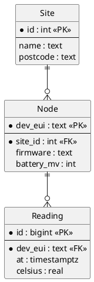

## Chen ER diagram

Entities, relationships and attributes in Chen's notation.

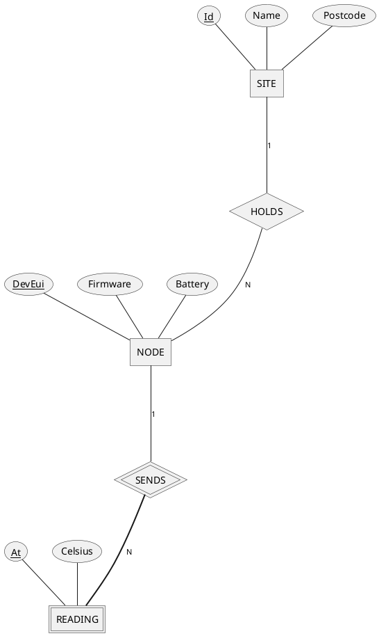

## Network diagram

Networks, the nodes on each and their addresses, in nwdiag form.

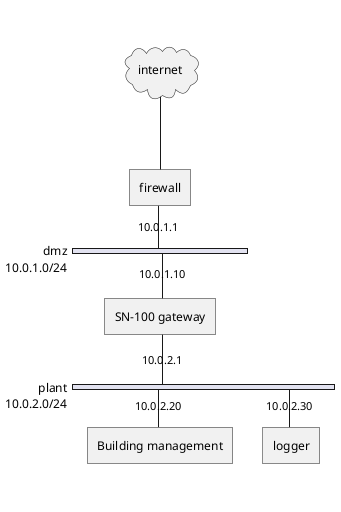

## Wireframe (Salt)

A user interface sketched from text.

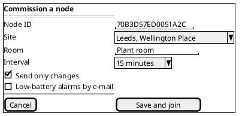

## ArchiMate

Enterprise architecture layers with ArchiMate elements.

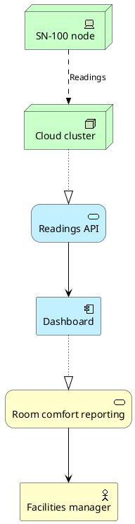

## C4 with the PlantUML standard library

C4 diagrams from the C4-PlantUML macros that ship with PlantUML.

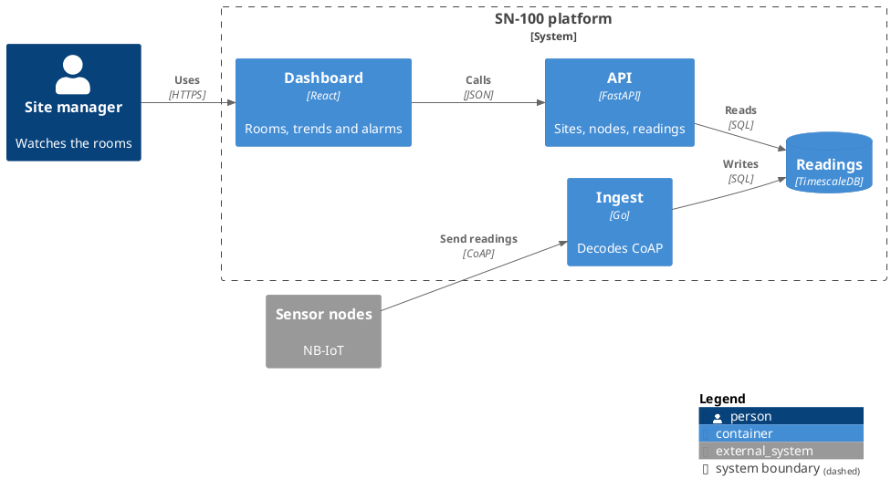

## Gantt chart

Tasks with durations, dependencies, milestones and closed days.

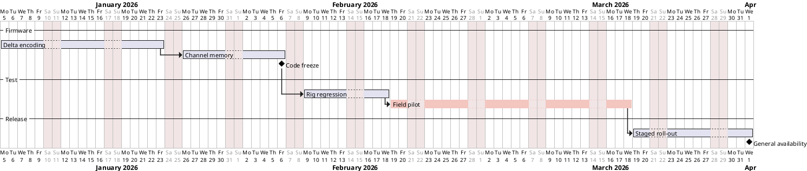

## Mind map

Ideas on both sides of a root.

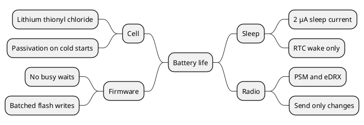

## Work breakdown structure

The parts of a project as a tree.

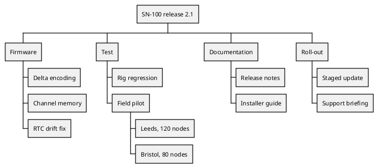

## JSON

The structure of a JSON document, with parts highlighted.

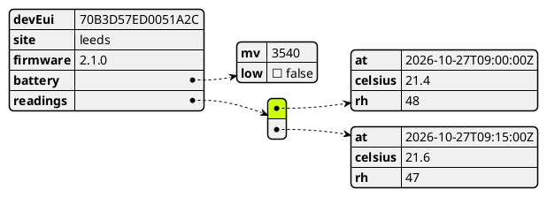

## YAML

The structure of a YAML document.

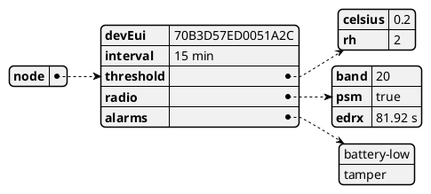

## EBNF

A grammar drawn as railroad tracks.

```plantuml
@startebnf
command = verb, " ", target, { " ", option };
verb = "get" | "set" | "reset";
target = "interval" | "threshold" | "radio";
option = "--", name, [ "=", value ];
@endebnf
```

## Regular expression

A regular expression drawn as a railroad diagram.

```plantuml
@startregex
title Topic of a reading
sn100/[a-z]+/[0-9]{1,6}/(temp|rh|battery)(/raw)?
@endregex
```

## Chronology

Events on a dated line.

```plantuml
@startchronology
[First board] happens on 2024-07-15 09:00:00
[NB-IoT certified] happens on 2024-11-02 09:00:00
[Pilot, 200 nodes] happens on 2025-04-01 09:00:00
[Firmware 2.0] happens on 2025-10-20 09:00:00
[5,000 nodes] happens on 2026-02-10 09:00:00
[Firmware 2.1] happens on 2026-09-01 09:00:00
@endchronology
```

## Files

A tree of files and folders.

```plantuml
@startfiles
/sn100-firmware/src/main.c
/sn100-firmware/src/radio/bg77.c
/sn100-firmware/src/radio/coap.c
/sn100-firmware/src/sensor/sht40.c
/sn100-firmware/tests/test_coap.c
/sn100-firmware/CMakeLists.txt
/sn100-firmware/README.md
@endfiles
```

## Maths

A formula in AsciiMath or LaTeX.

```plantuml
@startmath
I_"avg" = (I_"sleep" t_"sleep" + I_"tx" t_"tx" + I_"rx" t_"rx") / (t_"sleep" + t_"tx" + t_"rx")
@endmath
```
