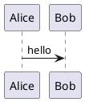

# Writing

This chapter is the reference for the Markdown py-doc reads. For a walk through writing one from a blank file, read [Writing a document](14_writing_documents.md), [Writing a slide deck](15_writing_slides.md) or [Writing a poster](13_writing_posters.md).

Pandoc reads the Markdown: its own flavour, with fenced divs, raw HTML, table captions, strikethrough and task lists. Footnotes, definition lists, maths and the rest of pandoc Markdown work too. py-doc adds front matter, callouts, markers, includes, conditions, variables and diagrams.

## Supported Markdown

| Markdown | Output |
|---|---|
| Front matter | Title, author, date, version, status and the like become the document properties and the title block. A first heading equal to the title is not shown twice |
| Callouts, `> [!NOTE]` and `> **Note:**` | A box in the `Div.note` to `Div.caution` styles (Word), a coloured block (HTML, PDF), an admonition or aside (sites) |
| `[[CAPTION:Figure]] text` | A numbered caption for the picture, diagram or table that follows |
| `[[LANDSCAPE]]`, `[[PORTRAIT]]` | A section of that orientation (Word), and picture widths in the other formats |
| `[[STYLE:Name]] text` | The paragraph in that Word style |
| `[[PAGEBREAK]]`, or `::: {.pagebreak}` and `:::` | A page break, or a new slide |
| Fenced diagram blocks | A picture: see [Diagrams](#diagrams) |
| Raw HTML | Kept in HTML and sites, dropped elsewhere by pandoc |

py-doc itself never drops a word or a sentence. Anything pandoc cannot represent in a format (raw HTML in Word, for example) is dropped by pandoc, which says so in a warning.

## VS Code preview

A companion VS Code extension in [`editors/vscode/`](../../editors/vscode) previews py-doc Markdown as you write. Click the eye button in the editor title bar. It runs `py-doc docx`, `py-doc slides` or `py-doc poster` with `--watch` on the open file, and shows the page it serves beside the editor. It rebuilds on every save, with every diagram drawn, so the preview is py-doc's own output. A save that does not build shows the error as a warning, and the preview moves to another Markdown file when you switch to it. VS Code's built-in Markdown preview shows plain Markdown only. The extension chooses the command from the file. A poster setting such as `paper` or `byline` in the front matter means a poster. `split_level` or speaker notes mean a deck, and anything else is a Word document. See [live preview](02_projects.md#live-preview) and the extension's [README](../../editors/vscode/README.md).

## Circuits, chess and science

These fences are drawn by open-source libraries in the tool image. Each is written in a short form of its own, which py-doc reads and passes to the library, so no code in a fence runs.

````markdown
```circuit
V1: source 5 V | up
R1: resistor 10 kΩ | right
R2: resistor 10 kΩ | down
line | to V1.start
dot | at R1.end
```
````

| Fence | Written as | Drawn by |
|---|---|---|
| `circuit` | One element a line: `[name:] element [label] \| direction \| at name.end \| to name.start`. Each element goes on from the end of the one before, `right` unless a direction is given. `at` starts it from a named element's anchor (`start`, `end`, `center`, or one of its own, such as an op-amp's `out`), and `to` draws it to one. The elements are `resistor`, `capacitor`, `polarised`, `inductor`, `diode`, `led`, `zener`, `schottky`, `battery`, `source`, `current`, `ac`, `switch`, `button`, `ground`, `vdd`, `vss`, `line`, `dot`, `lamp`, `fuse`, `crystal`, `antenna`, `speaker`, `motor`, `meter-v`, `meter-a`, `npn`, `pnp`, `nmos`, `pmos`, `opamp`, `relay`, `transformer`, `gap` and the gates `and`, `or`, `not`, `nand`, `nor`, `xor` | [schemdraw](https://schemdraw.readthedocs.io/) (MIT) |
| `chess` | `fen: <position>`, `highlight: e4 f3`, `arrow: f1 c4 \| colour` and `flip: yes` lines. Without a `fen:` line, the starting position | [python-chess](https://python-chess.readthedocs.io/) (GPL-3.0, run as a program of its own in the image) |
| `music`, `abc` | [ABC notation](https://abcnotation.com/wiki/abc:standard:v2.1). `X:` and `K:` lines are added when it has none | [abcjs](https://www.abcjs.net/) (MIT) |

The scientific fences are drawn in the **science image**, a second, optional image with the scientific Python libraries. It is built the first time a document or poster uses one of these fences, which takes a few minutes, or ahead of time with `py-doc tools build --science`. A project that uses none of them never downloads them.

| Fence | Written as | Drawn by |
|---|---|---|
| `molecule` | A [SMILES](https://en.wikipedia.org/wiki/Simplified_molecular-input_line-entry_system) string, or `name \| SMILES` lines for several, in a grid | RDKit (BSD) |
| `phylogeny` | A tree in [Newick](https://en.wikipedia.org/wiki/Newick_format) form, such as `((Human,Chimp),Gorilla);` | Biopython |
| `ternary` | `axes: A \| B \| C` and `label \| a \| b \| c` lines, the three parts in any unit | python-ternary (MIT) |
| `seq-logo` | Aligned sequences, one a line, of one length. `type: protein` (or `rna`) for other than DNA | logomaker (MIT) |
| `upset` | `Set A, Set B \| count` lines: how many items are in exactly those sets | UpSetPlot (BSD) |
| `smith` | `z0: 50` and `label \| 50+25j` lines: impedances in ohms, on a Smith chart | scikit-rf (BSD) |
| `plasmid`, `gene-locus` | `size: 8450` and `name \| start..end \| + or - \| colour` lines: a circular or linear map | DNA Features Viewer (MIT) |
| `cie` | `gamut: sRGB` lines (`sRGB`, `Display P3`, `Adobe RGB (1998)`, `ITU-R BT.2020`, `DCI-P3`) and `label \| x \| y` points, on the CIE 1931 diagram | colour-science (BSD) |
| `sun-path` | `lat: 51.5`, `lon: -0.1`, `timezone: Europe/London` and `day: label \| 2026-06-21` lines (default: the solstices and an equinox) | pvlib (BSD) |
| `thermo-cycle` | `fluid: Water` and `state: label \| kPa \| °C` lines, joined in order and closed, on the temperature-entropy diagram with the saturation dome | CoolProp (MIT) |

A mistake in a written form stops the build with the file and line of the fence, and the line of the mistake in it.

## Poster blocks in documents

The blocks of a poster work in a Word document, a PDF, a deck and a site page, written the same way:

````markdown
[[CAPTION:Figure]] Messages a day
```chart type=column unit=" msg"
series: 2.0, 2.1
Office | 1440 | 610
Warehouse | 1440 | 980
```

```cards cols=3 style=top
Sensor | Temperature and humidity on I2C | blue
Controller | Sleeps at 2 µA | navy
Radio | Sends one message, then sleeps | green
```
````

A [`plot`](12_posters.md#plots) works the same way. Each block becomes a picture, as a diagram does, with its caption, `width=` and alt text. A block that is all SVG, such as a `chart`, a `qr` or a `barcode`, stays SVG in HTML and a site, and is PNG in Word, PowerPoint and PDF. A block made of boxes and text, such as `cards`, `steps` or `equation`, is laid out at the width of the page's text and becomes a PNG. Pictures are cached as diagrams are, and drawing them needs the tool container.

The blocks are drawn in the `print` theme, so they suit a white page. `diagrams.theme` in `py-doc.yml` chooses another, a built-in name or a theme file:

```yaml
diagrams:
  theme: brand/poster-theme.yml   # the colours and fonts of the company's posters
```

## Diagrams and blocks as image files

`py-doc diagram` (or `py-doc image`) draws one diagram or poster block as a file of its own, for an e-mail, a slide made elsewhere, a README or a wiki:

```bash
py-doc diagram flow.mmd -o flow.svg                 # a diagram source: the type from its extension
py-doc diagram flow.puml -o flow.png --dpi 300      # PNG at 300 dpi, for print
py-doc diagram credit.txt --type threshold -o credit.pdf --theme dark
py-doc diagram returns.txt --type plot --options "type=pareto" -o returns.webp
py-doc diagram flow.mmd -o flow.png --chrome card --title "Joining" --caption "From power on to joined"
py-doc diagram poster.md -o images/                 # every diagram and block of a Markdown file
py-doc diagram flow.mmd -o flow.svg --watch         # draw again on every save, and show it in the browser
py-doc diagram --list                               # every type it draws
py-doc diagram --help-type gauge                    # the syntax of one, with an example
```

The type comes from `--type`, or from the extension: `.mmd`, `.puml`, `.dot`, `.ditaa`, `.edn`, `.pikchr`, `.railroad`, `.vl.json`, `.vg.json` and `.wavedrom.json`. `--options` holds a block's options, as they would follow its fence name. From a Markdown file, each picture is named after the file, its place and its caption or title, such as `poster-01-messages-a-day.svg`. `--format` chooses the format of all of them.

The output's extension chooses the format:

| Format | What it is | Notes |
|---|---|---|
| `.svg` | Vector, for the web | For the pictures that are SVG. Blocks made of boxes and text, such as `cards`, are not, nor are PNG-only tools such as ditaa. From a Markdown file, those are written as PNG |
| `.png` | Pixels, at 192 dpi | `--dpi 300` for print. The picture keeps its size in inches and gets more pixels |
| `.webp` | The PNG, lossless and smaller | Takes `--dpi` too |
| `.pdf` | One page the size of the picture | Text and lines stay vector, so it prints sharp at any size. Chromium prints it, so Mermaid's labels are kept |

`--chrome card` puts the picture in a box of the theme, with `--title` above it and `--caption` under it, as a figure is on a poster. From a Markdown file, a block's `caption=` or `title=` is its card's title.

Poster blocks and plots are drawn as in a document: in the `print` theme, or the one `--theme` names. `--background` is what goes behind an SVG block (default white, or `transparent`), and `--padding` adds space round the picture. A block that is all SVG, such as a chart or a gauge, is drawn by py-doc alone as SVG, with no Docker. Everything else needs the tool container, and is cached as the diagrams of documents are.

`--watch` draws the file again on every save, and shows the pictures on a local page that reloads itself, as `py-doc poster --watch` does.

### From Python

The same drawing is a Python function, for a script or a notebook:

```python
from py_doc import render_diagram

picture = render_diagram("flowchart LR
  A --> B", kind="mermaid")
picture.save("flow.svg")                             # or .png, .webp or .pdf
picture.save("flow.png", dpi=300)
svg = picture.to_svg()                               # the SVG text; to_png(), to_webp() and to_pdf() give bytes

gauge = render_diagram("0 | 50 | green
50 | 100 | red", kind="gauge", options="value=40 min=0 max=100",
                       theme="dark")
gauge.card(title="Grid load", caption="At noon").save("load.pdf")
```

`kind` is any type of `py-doc diagram --list`. `theme`, `options`, `background` and `padding` are the options of the command. In Jupyter, a picture shows itself: as SVG when it has one, else as PNG. A picture is drawn only when a format is asked for, so `to_svg()` of a chart needs no Docker.

## Front matter

The YAML between `---` lines at the top of the first source of a document gives its properties: `title`, `subtitle`, `author`, `date`, `version`, `status`, `document_number`, `description`, `classification`, `subject`, `keywords`, `category`, `company` and `toc_depth`. A value in `py-doc.yml` wins over the front matter. Every document of py-doc's own repository has front matter, so its properties travel with the file.

## Callouts

Callouts are drawn as boxes in every format, in both spellings:

```markdown
> [!WARNING]
> Disconnect the battery first.

> **Tip:** the kinds are note, tip, important, warning and caution.
```

Word uses the `Div.note` to `Div.caution` paragraph styles. The built-in reference document defines them, and a template that lacks one that the document uses gets a warning naming it. Sites get MkDocs admonitions or Starlight asides.

## Captions, orientation and styles

- **Captions**: `[[CAPTION:Figure]] Text` (or `Table`) on the line before a picture, diagram, code block or table becomes its caption. A diagram also takes one from the line after it. In Word the number is a `SEQ` field, shared with the captions pandoc makes itself, so captions renumber when Word updates fields. Cross-references to captions are not supported. On a slide the caption is the text under the picture.
- **Orientation**: `[[LANDSCAPE]]` and `[[PORTRAIT]]` start a Word section of that orientation, and widen or narrow pictures in the other formats.
- **Styles**: `[[STYLE:Name]] text` applies a named Word paragraph style, and warns once if the template has none of that name. Other formats keep the text.
- **Page breaks**: `[[PAGEBREAK]]` on its own line, `::: {.pagebreak}` followed by `:::`, or `page_break: true` on a source. In a deck it starts a new slide, and on a site it is left out.

## Includes, conditions and variables

These lines are applied to each source before it is parsed. They are only recognised outside code, so a document can show the syntax in a fenced block or in backticks.

```markdown
[[INCLUDE: shared/legal.md]]        <!-- another Markdown file, expanded in turn -->
[[INCLUDE-CODE: src/server.py]]     <!-- a file as a fenced code block; the language comes from the extension -->

[[IF: internal]]                    <!-- also [[IF: audience == staff]] and [[NOT: internal]] -->
Internal notes.
[[ENDIF]]

This is version {{version}}.
```

Set values under a document in `py-doc.yml`, or for one build with `--var` and `--condition`, which win over the file:

```yaml
documents:
  guide:
    sources: [guide.md]
    variables: {version: "2.1"}
    conditions: {internal: false}
```

- **Paths** start at the file that holds the directive. Image paths in an included file are relative to the file that includes it, not to the included file.
- **Mistakes are errors** that name the file and line: a missing or circular include, an `[[IF:]]` that is never closed, an `[[ENDIF]]` with nothing open, or a condition that is not defined. An undefined `{{variable}}` is left as written and reported as a warning, because the braces are ordinary text in many documents.
- **Truth**: `false`, `no`, `off`, `0` and an empty value are false; anything else is true. `==` and `!=` compare as text.

## Diagrams

A fenced block whose language is a diagram type becomes a picture in every output:

````markdown

````

| Fences | Tool |
|---|---|
| `mermaid` (also `:::mermaid`), `plantuml` or `puml`, `dot` or `graphviz`, `ditaa` | Mermaid, PlantUML, Graphviz, ditaa |
| `blockdiag`, `seqdiag`, `actdiag`, `nwdiag`, `packetdiag`, `rackdiag` | The blockdiag family |
| `wavedrom`, `bytefield-svg`, `pikchr`, `railroad`, `wireviz` | Drawn as SVG |
| `vega`, `vega-lite` | Vega, drawn as SVG |
| `circuit`, `chess`, `music` (or `abc`) | Specialist libraries in the tool image, from a written form. See [Circuits, chess and science](#circuits-chess-and-science) |
| `molecule`, `phylogeny`, `ternary`, `seq-logo`, `upset`, `smith`, `plasmid`, `gene-locus`, `cie`, `sun-path`, `thermo-cycle` | Scientific libraries in the optional science image |

- **Format**: HTML and sites keep SVG where the tool can write it. Word, PowerPoint and PDF get PNG at 192 dpi, shrunk to the page width (wider after a `[[LANDSCAPE]]` line, until `[[PORTRAIT]]`).
- **Alt text** comes from `caption="..."` or `title="..."` after the language, else from a `title` line in the diagram, else the diagram type.
- **Captions**: a `[[CAPTION:Figure]] text` line directly above or below the diagram is its caption. Without one, the alt text is the caption.
- **Size**: `width="100%"` after the language makes the diagram that share of the text width (the page less its margins). A length such as `12cm`, `30mm`, `4in` or `600px` is also allowed. Without it, a diagram keeps its drawn size, shrunk to fit the page.
- **A broken diagram stops the build** with the file, the line and the tool's own message, and no output file is written. `py-doc build --keep-going` draws every diagram first and lists all the failures together.
- **Pictures are cached** in your user cache folder (`PY_DOC_CACHE` overrides it), keyed by the diagram text, the format and the tool image, so an unchanged diagram is not drawn again. A PlantUML diagram with `!include` is always drawn, because the included file can change on its own.
- **PlantUML includes** are looked up in the folder of the Markdown file, which is the only source folder the tool can read.
- **Mermaid** is version 12, drawn by mermaid-cli 12. A diagram is drawn at its natural size, and only one wider or taller than the page (1200 pixels, or 1800 after `[[LANDSCAPE]]`) is shrunk to fit.
- **Mermaid 12 looks different** from Mermaid 11: flowcharts, class, state and ER diagrams are laid out with ELK and drawn in the `neo` look. To keep the Mermaid 11 layout and look for one diagram, start it with front matter:

    ```markdown
    ---
    config:
      layout: dagre
      look: classic
    ---
    flowchart LR
      A --> B
    ```

    To give every Mermaid diagram of a project the same settings, put them under `diagrams.mermaid` in `py-doc.yml`. A diagram's own front matter wins, key by key:

    ```yaml
    diagrams:
      mermaid:
        layout: dagre
        look: classic
        theme: neutral
    ```

    Give settings in front matter, not in a `%%{init: ...}%%` line. Mermaid ignores the whole init line when a value in it has a single quote, such as a font list.
- **Icons in Mermaid**: an `architecture-beta` diagram can use the icons of four packs in the tool image, with no network. Name an icon by its pack and its name, such as `service db(logos:postgresql)[Readings]`:

    | Prefix | Pack | For | Licence |
    |---|---|---|---|
    | `logos` | [logos](https://icon-sets.iconify.design/logos/) | Brands and products: `logos:aws`, `logos:docker`, `logos:postgresql` | CC0, no credit needed |
    | `tabler` | [Tabler Icons](https://tabler.io/icons) | General UI and tech: `tabler:server`, `tabler:router`, `tabler:lock` | MIT, no credit needed |
    | `mdi` | [Material Design Icons](https://pictogrammers.com/library/mdi/) | Devices and domains Tabler lacks: `mdi:thermometer`, `mdi:chip` | Apache 2.0 |
    | `wi` | [Weather Icons](https://erikflowers.github.io/weather-icons/) | Weather: `wi:rain`, `wi:day-sunny` | SIL Open Font License 1.1 |

    Search a pack on its page for the names. Poster blocks use the same four packs, so an icon looks the same in a diagram and in a block. See [Icons](12_posters.md#icons).
- **Poster blocks** (`cards`, `chart`, `steps`, `equation`, `terminal` and the rest of [the posters chapter](12_posters.md#poster-blocks)) work in documents, decks and sites too. See [Poster blocks in documents](#poster-blocks-in-documents).
- **Pictures** in Markdown are looked up in the folders of the source files, so `` works as it does next to the Markdown. `{width=50%}` makes a picture that share of the text width, in Word too, where py-doc works it out from the template's page and margins.
