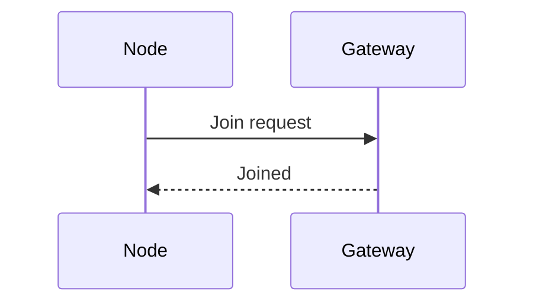

# Writing a poster

This chapter walks through writing a poster from an empty file to a printed page. It explains what each part of the Markdown becomes, which block suits which kind of idea, and how to make the layout fit. [Posters](12_posters.md) is the reference for every setting and block.

A poster is read standing up, from a few steps away, in a minute or two. So it says one thing, in few words, with pictures doing most of the work. py-doc lays it out for you: you write the Markdown in reading order, and it places the parts and sizes the page.

## Plan before you write

Answer three questions before the first line:

1. **What is the one message?** Write it as one sentence. It becomes the summary banner, and every section should support it.
1. **Who reads it, and where?** An installer at a trade stand needs steps and pictures. A reviewer at a conference needs results and evidence.
1. **What are the four to eight parts?** Each becomes a section with a heading. Fewer, fuller sections read better than many thin ones.

A good budget is 300 to 600 words for an A1 poster, and half that for A3. If the text is longer, the page widens to fit it and everything prints smaller.

## Start the file

Make a Markdown file with front matter and one section, then build it:

```markdown
---
title: SN-100 Sensor Node
subtitle: Five years of readings from one coin cell
byline: A. Writer, Product Engineering
---

## 1. Hardware: what is on the board

The node has a sensor, a microcontroller and a radio.
```

```bash
py-doc poster sn100.md        # writes sn100.html
```

Open `sn100.html` in a browser. Keep it open as you write: build again and reload to see each change. The page is self-contained, so you can send it or move it on its own.

## The parts of the page

A poster is built from its `##` headings, in the order you write them. A heading is an ordinary section unless the braces at its end say otherwise, and the heading text is always yours:

| You write | It becomes | Advice |
|---|---|---|
| Front matter `title`, `subtitle`, `byline` | The header | A title of up to six words. The subtitle says why it matters |
| `## Key figures {.stats}` | A strip of figures | Three or four figures that make the case at a glance |
| `## Introduction {.abstract}` | The introduction box | Two or three sentences: the problem and what the poster shows |
| `## 1. Heading: accent` | A section, in columns | Number the sections in reading order |
| `## In short {.summary}` | The banner and the closing blocks | The one message, then one block for each thing to remember |
| `## References {.references}` | A small list | Only what a reader would look up |

Write them in the order of this table, as most posters go. Every part is placed where it is in the file, so you can move one, such as a second strip of figures halfway down.

## The header

The header holds the title, the subtitle and the byline from the front matter. Add a logo with `logo:`, and move things with `header:`:

```yaml
logo: brand/logo.svg
header:
  align: left        # centre (default) or left
  logo: right        # left (default), right or none
```

A left-aligned header suits a long title. A centred one suits a short title and a logo on each side of the page's meaning.

## The stats strip

`{.stats}` makes a table of a value and a label into the strip. The header row is ignored, so it can say anything:

```markdown
## Key figures {.stats}

| Value | Label | Change | Verdict |
|---|---|---|---|
| 5 years | Battery life | +14 % | |
| 4 s | Typical join | -7 s | good |
| 2 uA | Sleep current | | |
```

The two last columns are optional. A change gets an arrow: up for a `+`, down for a `-`, and sideways otherwise. Up is coloured as good news and down as bad news, so write `good` or `bad` in the fourth column when that is wrong. A shorter join time is good news, for example.

Keep each value short, such as `5 years` or `0.2 °C`, so it reads from across a room. Put the explanation in the label.

## The introduction

`{.abstract}` makes a section the blue box: `## Introduction {.abstract}`. Write two or three sentences that a reader can take in before deciding to read on. It is ordinary Markdown, so **bold** and links work.

## Sections

Every other `##` heading is a section. The text before the first colon is the heading, and the text after it is coloured, so a heading reads as a topic and a question:

```markdown
## 2. Power: where the charge goes
```

The sections are shared out between the columns, in order: two columns for a portrait poster and three for a landscape one. The page measures each section, charts and diagrams included, and balances the columns by height. Change the number for the whole poster with `columns:` in the front matter, or for one band with `{cols=3}` on any of its sections. `split:` chooses the columns by hand, on a poster with one band:

```yaml
columns: 3
split: 2, 2        # two sections in the first column, two in the second, the rest in the third
```

Five attributes in braces after a heading change one section:

- `{.wide}` makes the section span every column. Use it for a timeline, a wide diagram or a table with many columns. The sections before it are balanced into columns above it, and the ones after it below.
- `{.flow}` lets a long section go on in the next column, between two of its blocks, under its heading marked "(continued)". The page breaks it only when that makes the columns more even.
- `{cols=3}` gives its band of sections three columns, so one band can have two and the next three.
- `{colour=red}` colours it, to mark a warning or a section that stands apart.
- `{style=card}` changes its look. A section can be a `bar` (the default), a `line`, a `card` or `plain`, and a stats strip, abstract, summary and references list have looks of their own. [Posters](12_posters.md#page-structure) lists them all. Pick one look for the sections and keep to it, and use another only for the one section that stands apart.

```markdown
## 5. Roadmap: what comes next {.wide}
## 6. Troubleshoot: when it will not join {colour=amber}
```

## Choose a block for each idea

A section is ordinary Markdown with py-doc's blocks in it. Pick the block by what the idea is, not by what looks busy:

| The idea is | Use | For example |
|---|---|---|
| A few parts, each with a line of text | `cards` | Sensor, controller and radio |
| Things to do, in order | `steps` | Join a node to the network |
| Photos or drawings side by side | `gallery` | Three ways to mount a node |
| How far towards a target | `progress` | 48 of 50 nodes joined |
| What must be true, ticked or not | `checklist` | Acceptance before handover |
| Before and after, or this and that | `compare` | Firmware 2.0 and 2.1 |
| Who to ask | `people` | The release manager and support lead |
| One figure that is the message | `highlight` | 0 failed updates |
| States and what moves between them | `flow` | Asleep, measure, send |
| What happens in each time window | `lanes` | Every minute, every hour |
| How a whole divides into shares | `segments` | One minute of the node's time |
| Dates and milestones | `timeline` | Pilot, release, retirement |
| Numbers to compare | `chart` | Messages a day before and after |
| Causes ranked, quality over time, distributions, curves | `plot` | A Pareto of returns, a control chart, a boxplot, a step response |
| An amount and where it goes | `chart type=waterfall` | A top-up after its deductions |
| Bands of a range and the points where things change | `threshold` | Credit counting down to cut-off |
| How full each store is | `buckets` | Credit, emergency credit and debt |
| One value on a dial | `gauge` | The grid frequency now |
| The hours of a day | `dial24` | Friendly hours and the off-peak tariff |
| A grade from A to G | `rating` | A home's energy rating |
| Benchmarks on a colour ruler | `gradient-scale` | Cooking temperatures, pH |
| Values over many orders of magnitude | `logscale` | Latencies from nanoseconds to seconds |
| Light or radio by wavelength or frequency | `spectrum` | Absorption lines, Wi-Fi channels |
| A screen the reader will see | `lcd` | The display after joining |
| A formula the section is about | `equation` | The Schwarzschild radius, with its symbols |
| Commands and what they print | `terminal` | `git status` and its output |
| Structure, sequence or architecture | A diagram fence | A Mermaid sequence diagram |
| A warning or a tip | A callout | Do not update below 2.4 V |
| A lookup | A table | Error codes and their fixes |
| Proportions that narrow or widen | `pyramid`, `cone`, `funnel` | The test pyramid, a filtering funnel |
| Layers in order | `stack` | A protocol stack |
| Layers that wrap a core | `target`, `cutaway` | Clean architecture, the inside of the Sun |
| Bands of altitude or depth | `cutaway type=column` | The layers of the atmosphere |
| Objects to scale | `sizes` | Telescope mirrors, planets |
| What fills a container | `vessels` | Coffee drinks, battery layers |
| Where things are in memory | `memory` | Flash and RAM of a controller |
| A sequence and its groups | `tape` | Codons, bytes in frames |
| A circular buffer | `ring` | A DMA buffer with its pointers |
| Steps that come round again | `cycle` | The water cycle |
| Two sides weighed | `balance` | Generation against demand |
| The small part seen and the large part not | `iceberg` | What a product hides |
| What each byte of a message means | `hex-dissect` | A CoAP header |
| What each part of a string or command means | `syntax-anatomy` | An LwM2M address, an AT command |
| Wrong code beside right code | `code-compare` | An unbounded copy and its fix |
| The pins of a chip or connector | `pinout` | A controller, a debug header |
| What the bench shows | `instrument` | A scope trace, a bus capture, a current reading |
| For and against | `proscons` | Why NB-IoT for this node |
| Terms the reader may not know | `glossary` | The acronyms of the poster |
| Places on a picture | `annotated` | The parts of a board |
| From the whole to a detail | `zoom-chain` | Room, bracket, node |
| A link to more | `qr` | The full manual |

The [Posters](12_posters.md) chapter lists every option of every block. The sections below show the common ones.

### Cards

````markdown
```cards cols=3 style=top
Sensor | Temperature and humidity on I2C | blue
Controller | Sleeps at 2 uA | navy
Radio | Sends one message, then switches off | green
```
````

Each line is a heading, a text and, for `style=top`, a colour. `cols` sets how many go across. `style=label` gives small capital headings, and `style=plain` gives text only.

### Steps

````markdown
```steps
Fit the gateways | One a floor, before any node
Hold the join button | Three seconds, until the display shows JOINING
Check the signal | -95 dBm or better | coral
```
````

Each line is a step: a heading, an optional text and an optional colour for its number. `cols=2` puts them in two columns, and `start=4` numbers them from 4, to go on from steps in another section.

### Galleries

````markdown
```gallery cols=3 height=160
images/wall.svg | On a wall, at head height
images/ceiling.svg | On a ceiling, away from lights
images/pipe.svg | On a pipe, with the clamp
```
````

Each line is a picture, relative to the Markdown file, and an optional caption. The pictures are put inside the page. `height=` crops every picture to that height, so photos of different shapes line up. Leave it out for drawings, which are shown whole.

### Progress, checklists and comparisons

````markdown
```progress unit=" nodes"
Joined | 48 | 50
Labelled | 50 | 50
```

```checklist
[x] Signal -95 dBm or better
[ ] Floor plan uploaded
[!] First reading within 2 minutes
```

```compare
| 2.0 | 2.1
Typical join | 11 s | 4 s
Firmware copies | 1 | 2
```
````

A progress bar fills towards its target and is ticked when it gets there. For a ceiling, such as a return rate, write `better=lower`: a bar over its ceiling turns red. A checklist box is ticked with `[x]`, left open with `[ ]` and crossed with `[!]`, so a blank checklist prints as a form to fill in. A comparison stresses its last column, so put the new or the better one last.

### People and highlights

````markdown
```people
Lena Chen | Firmware release manager | sn100-firmware@example.com | photos/lena.jpg
Ruth Osei | Field support lead | +44 1632 960 100
```

```highlight
0 | Failed updates | in 200 pilot nodes | good
4 s | Typical join | was 11 s
```
````

A person's photo is optional: without one, their initials stand in a circle. A highlight is a figure in large type, for the one number a section is about. Keep the strip of stats for the figures of the whole poster.

### Flow and lanes

````markdown
```flow
[Asleep|navy] -timer-> [Measure|blue] -changed-> [Send|amber]
[Measure|blue] -unchanged-> [Back to sleep, nothing sent]
```

```lanes
Every minute | *Wake | *Measure | Send if changed
Every hour | *Wake | *Measure | *Send status
```
````

In a flow, `[Text|colour]` is a filled box and `[Text]` an outlined one, and `-label->` is an arrow with a label. In lanes, a cell that starts with `*` is filled and any other is dashed, so filled cells show what always happens.

Lines in a `flow`, `lanes` or `segments` block that are not part of it become notes under it. To put two or three of them in one box, use a `figure` block with `+++` lines between them.

### Segments

````markdown
```segments
title: One minute of the node's time (not to scale)
6 | Asleep, 58 s | 2 uA | navy
2 | Measure, 1 s | 300 uA | blue
2 | Send, 1 s | 12 mA | amber
```
````

The first number is each part's share of the width. Say "not to scale" in the title when the shares are not the true proportions, which they rarely can be when one part is a thousand times another.

### Timelines

````markdown
```timeline
Jan 2026 | Pilot | 200 nodes | navy
Apr 2026 | Firmware 2.1 | Sends only what changed
Oct 2026 | Ten-year cell
```
````

A timeline in a row needs room, so put it in a `{.wide}` section, or write `timeline vertical` for a column.

### Charts

````markdown
```chart type=column title="Messages a day" unit=" msg"
series: 2.0, 2.1
Office | 1440 | 610
Warehouse | 1440 | 980
```
````

`type` is `column`, `bar` or `line`. Each line is a label and one value for each series, and `series:` names them. Use `bar` when the labels are long, and `line` for a change over time. A chart is drawn by py-doc itself, in the theme's colours, so it needs no tool container.

A line chart can start its axis above zero, so a small change shows, and can mark a target with a dashed line:

````markdown
```chart type=line title="Cell voltage" unit=" V" min=2.2 max=3.2 step=0.2 values=last axis="Volts"
Year 0 | 3.05
Year 5 | 2.62
```
````

[Posters](12_posters.md#diagrams-and-charts) lists every option.

### Scales

````markdown
```threshold title="Credit counting down to cut-off"
span: Normal credit | £20.00 to £2.00 | Supply on | green | 4
pin: £2.00 Low credit alert | amber
span: Low credit | Emergency credit can be armed | amber | 2
pin: £0.00 Credit exhausted | red
span: Emergency credit | A £10.00 pool | purple | 3
```
````

A `threshold` keeps every word readable: a band is only as wide as its weight, so its words go under it, and the exact points go on pins above it. Give a band a weight that shows its share, not one that makes room for its words. Write "not to scale" in the title when the weights are not the true proportions.

### Bytes, strings and code

````markdown
```hex-dissect
bytes: 54 45 7a 31
0 | Header | NON, token length 4 | navy
1 | Code | 2.05 Content | blue
2-3 | Message ID | 0x7a31 | green
```
````

A `hex-dissect` and a `syntax-anatomy` replace the carets and arrows that a plain code block needs to say which part is which. Give each field a colour and keep the same colour for it across the poster. In a `code-compare`, put the wrong code first and number only the lines a reader must look at.

### Equations and terminals

````markdown
```equation
title: Schwarzschild radius
R_s = \frac{2GM}{c^2}
R_s | Event horizon radius | m
M   | Mass of the body | kg
```

```terminal title="git"
$ git status -sb
## main
 M src/main.c
-- One file changed, not staged
```
````

An `equation` card shows one formula large, with a legend of its symbols. Write any formula in a sentence as `$...$` instead: see [Maths](12_posters.md#maths). A `terminal` is a window of commands and their output. Keep `lcd` for the screen of a device, where it looks like one.

### Diagrams

Any diagram fence works, as in a document:

````markdown

````

Mermaid diagrams get the poster's colours and font. Diagrams are drawn by the tool container, so building a poster with one needs Docker, as a document does. A diagram that cannot be drawn is shown as its code with a warning, and the rest of the poster is still written.

A diagram is drawn at its natural size and shrunk to its column. Keep it small: five to ten boxes with short labels read better than one large diagram, and a wide one belongs in a `{.wide}` section.

### Which tool for which diagram

Before you reach for a picture or ask for a new block, look here. Each row is drawn by a tool in the tool container, in the poster's theme, and works in documents and sites too. `examples/poster/diagrams.md` has one of each.

| To show | Fence | Tool's syntax |
|---|---|---|
| Flows that split and join, such as energy or money | `mermaid` with `sankey-beta` | [Sankey](https://mermaid.js.org/syntax/sankey.html) |
| Items on two axes, a 2×2 chart | `mermaid` with `quadrantChart` | [Quadrant chart](https://mermaid.js.org/syntax/quadrantChart.html) |
| Several options scored on several axes | `mermaid` with `radar-beta` | [Radar](https://mermaid.js.org/syntax/radar.html) |
| How a whole divides into nested parts | `mermaid` with `treemap-beta` | [Treemap](https://mermaid.js.org/syntax/treemap.html) |
| What two or three sets share | `mermaid` with `venn-beta` | [Venn](https://mermaid.js.org/syntax/venn.html) |
| The causes of a problem, a fishbone | `mermaid` with `ishikawa-beta` | [Ishikawa](https://mermaid.js.org/syntax/ishikawa.html) |
| A value chain against evolution | `mermaid` with `wardley-beta` | [Wardley map](https://mermaid.js.org/syntax/wardley.html) |
| A folder tree | `mermaid` with `treeView-beta` | [Tree view](https://mermaid.js.org/syntax/treeView.html) |
| A mind map, or a hierarchy | `mermaid` with `mindmap` | [Mind map](https://mermaid.js.org/syntax/mindmap.html) |
| Branches and merges | `mermaid` with `gitGraph` | [Git graph](https://mermaid.js.org/syntax/gitgraph.html) |
| Periods, plans and eras | `mermaid` with `timeline` or `gantt` | [Timeline](https://mermaid.js.org/syntax/timeline.html), [Gantt](https://mermaid.js.org/syntax/gantt.html) |
| A simple line or bar chart | `chart`, or `mermaid` with `xychart-beta` | [XY chart](https://mermaid.js.org/syntax/xyChart.html) |
| Blocks laid out on a grid, such as a chip's floorplan | `mermaid` with `block-beta` | [Block diagram](https://mermaid.js.org/syntax/block.html) |
| Who does what, in lanes | `mermaid` with `swimlane-beta`, or PlantUML activity partitions | [Swimlanes](https://mermaid.js.org/syntax/swimlanes.html) |
| Decisions and branches | `mermaid` with `flowchart` | [Flowchart](https://mermaid.js.org/syntax/flowchart.html) |
| The bits of a header or register | `mermaid` with `packet-beta`, `packetdiag` or `bytefield-svg` | [Packet](https://mermaid.js.org/syntax/packet.html) |
| Digital signals over time | `wavedrom` | [WaveDrom](https://wavedrom.com/tutorial.html) |
| Task or state changes over time | `plantuml` timing diagram | [Timing](https://plantuml.com/timing-diagram) |
| Messages with delays and lost packets | `plantuml` sequence with `!pragma teoz true`, `->(10)` and `->x` | [Sequence](https://plantuml.com/sequence-diagram) |
| Records and pointers, Petri nets, any graph | `dot` | [Graphviz](https://graphviz.org/documentation/) |
| A rack of equipment | `rackdiag` | [rackdiag](http://blockdiag.com/en/nwdiag/rackdiag-examples.html) |
| Statistics: boxplots, heatmaps, scatter plots | `vega-lite` | [Vega-Lite](https://vega.github.io/vega-lite/examples/) |

Most new Mermaid types end in `-beta`, so their syntax may still change. A diagram that cannot be drawn shows its code, with a warning.

### Callouts

```markdown
> [!WARNING]
> Do not update a node whose battery is below 2.4 V.

> **Tip:** join one node at a time.
```

The kinds are note, tip, important, warning and caution, in either spelling, each in its own colour. A quote with no kind is a plain callout. Use one or two on a poster: when everything is a warning, nothing is.

### Pictures, tables, code and captions

A local picture, ``, is embedded in the page. A table is shown as in a document, so keep it to two or three columns. A code block is shown as code. A caption is a `[[CAPTION:Figure]] text` or `[[CAPTION:Table]] text` line next to the picture or table. It is numbered for you, "Figure 1:" and "Table 1:", in order down the poster. Give a caption to a figure or table that the text names, or that a reader looks at on its own. A decorative picture needs none.

## The summary and references

`{.summary}` closes the poster: `## In short {.summary}`. Its first paragraph is the banner, so make it the one message from your plan. Each `###` under it is a block, for the two or three things a reader should take away:

```markdown
## In short {.summary}

One coin cell, five years, one message only when something changes.

### Measure often

A reading a minute costs little, because measuring is cheap.

### Send rarely

The radio is the cost, so the node sends only what is new.
```

`{.references}` makes a list in small type, under its own heading, such as `## References {.references}`. Number it, and cite its entries in the text as `[1]`.

## The footer

The footer has three texts, logos and a QR code:

```yaml
footer:
  left: SN-100                          # in the theme's strong colour
  centre: Product Engineering
  right: "Version {{version}}"
  logos: [brand/partner.svg]
  qr: https://example.com/sn-100
  qr-label: Datasheet
  document: SN-PO-001                   # shown small, under the footer
  version: "{{version}}"
```

The texts are Markdown and take `{{variables}}`. The QR code is drawn as SVG, so it scans from a printed page.

`document` and `version` are shown in small type on a line under the footer, such as "SN-PO-001 · Version 2.1". So a printed poster can be traced to its source. Without them, the poster uses `document_number` and `version` from its front matter, the same properties a document has. `version: git` takes the version from Git, such as `v2.1-3-g1a2b3c4`, so a printed poster names the commit it came from.

## Make it fit

The page always has the shape of its paper. A script in it finds the narrowest layout that holds all the content, no narrower than `width`, and scales the page to the window or the paper. So you never set a font size. Instead:

| You see | Do this |
|---|---|
| Space above the footer | Lower `width`, such as `width: 1100`, to make everything larger |
| Small text everywhere | Cut words, or move a long section to its own `{.wide}` row |
| One column much longer than the others | One section is taller than the rest. Mark it `{.flow}`, make it `{.wide}`, split it in two, or choose the columns with `split:` |
| A diagram with tiny text | Simplify it, or put it in a `{.wide}` section |
| A wide table squeezed into a column | Make its section `{.wide}`, or cut columns |
| Margins at the sides of the printed page | The content is taller than the paper at every width, usually because of large pictures. Add `columns:`, use fewer or smaller pictures, or cut words |

`orientation: landscape` turns the page and uses three columns. `paper:` sets the paper size for printing, from `a0` to `a4`, and does not change the layout.

## Brand it

A theme sets the colours, fonts and logo. Use a built-in one (`default`, `dark` or `print`), or a theme file for your company:

```yaml
theme: brand/company.yml
```

Set a theme once for every poster of a project in `py-doc.yml`, so a poster's Markdown needs only the words:

```yaml
poster:
  theme: brand/company.yml
  footer: {centre: Example Instruments}
```

Change one colour for one poster beside the theme with `colours:`, such as `colours: {accent: "#d9573a"}`. Set `embed_fonts: true` to put the theme's fonts inside the page, so a poster you send by email keeps them without internet. A PDF that py-doc prints always gets the fonts inside. [Posters](12_posters.md) lists every colour and what it paints.

## Reuse text

A poster takes the same includes, conditions and variables as a document, so it can share text with the documents it summarises:

```markdown
[[INCLUDE: ../docs/shared/safety.md]]

[[IF: internal]]
Field trial results, not for release.
[[ENDIF]]

This is firmware {{version}}.
```

Set the values under the poster in `py-doc.yml`, in its front matter, or for one build with `--var version=2.1 --condition internal=false`.

A condition that has no value is an error, which names the file and line, so a poster never leaves text out by mistake. Give each condition a value in the front matter, the one a reader outside the company should get, and set the other in `py-doc.yml`:

```yaml
---
conditions: {internal: false}   # the poster on its own: the public version
---
```

`examples/poster/reliability.md` does this. Its entry in `py-doc.yml` sets `internal: true`, which wins over the front matter.

## Build, print and share

List the project's posters in `py-doc.yml`, then build them all, or one by name:

```yaml
posters:
  sensor-node:
    source: posters/sensor-node.md
    pdf: true
```

```bash
py-doc poster                 # every poster
py-doc poster sensor-node     # one
py-doc poster --pdf           # and a one-page PDF of each
py-doc poster sensor-node --watch   # build again on every save, and reload it in the browser
```

While you write, keep `--watch` running. It opens the poster in your browser and builds it again each time you save the Markdown, a picture, an included file, the theme or `py-doc.yml`, and the page reloads itself. A save that does not build keeps the last good page and shows the error across its top until you fix it. Diagrams that did not change come from the cache, so a build takes a second or two. Ctrl+C stops it.

The HTML page is the one to share by email or on a screen. The PDF is the one to send to a printer: it is one page of the poster's paper size. To print from a browser instead, use Chrome's print dialogue with no margins and background graphics on.

## A complete poster

This is a whole poster in one file. Build it, then change it piece by piece:

````markdown
---
title: SN-100 firmware 2.1
subtitle: Longer life, faster joins, safer updates
byline: Release notes for installers and support
paper: a3
width: 1100
footer:
  left: Firmware 2.1
  qr: https://example.com/release-2-1
  qr-label: Full notes
---

## Key figures {.stats}

| Value | Label | Change | Verdict |
|---|---|---|---|
| 5.7 years | Battery life | +14 % | |
| 4 s | Typical join | -7 s | good |

## Introduction {.abstract}

Firmware 2.1 sends less, joins faster and can always go back to the last version that worked.

## 1. Power: sending less

The node now stays quiet when a reading has not changed.

```chart type=column title="Messages a day"
series: 2.0, 2.1
Office | 1440 | 610
Warehouse | 1440 | 980
```

## 2. Updates: safe by design

```cards cols=2 style=top
Two copies | The new firmware is written beside the old one | blue
Roll back | A failed self-test returns to the old copy | amber
```

> **Warning:** do not update a node whose battery is below 2.4 V.

## In short {.summary}

Install 2.1 everywhere: it costs one message and saves months of battery.

### Installers

Nothing changes on site. Joining is quicker.

### Support

Every update reports its result.
````

`examples/poster/` in the repository has four full posters: portrait, landscape in a company's theme, dark, and a three-column report for printing.

## Before you print

1. Read the summary banner alone. Does it say the one message?
1. Read only the headings and the stats. Do they tell the story?
1. Stand back from the screen. Can you read the section text from two steps away at the size it will print?
1. Check every number, name and date against its source.
1. Scan the QR code with a phone.
1. Lint it with `py-doc lint posters/`, and fix every warning. It checks the glossary and wording, but not document rules such as captions, acronym definitions or the passive voice.
1. Build the PDF and open it. Check it is one page of the right paper size and orientation.

## When something goes wrong

| Message or symptom | Cause and fix |
|---|---|
| `no sections found` | The file has no `##` heading other than the special ones. Add a section |
| `unknown key ... in posters.name` | A misspelt setting in `py-doc.yml`. The message lists the allowed keys |
| `'x' is not a poster setting, so it is ignored` | A front matter key the poster does not use, such as `author`. It is harmless |
| `split cannot be used with wide sections` | Remove `split:`; the columns between wide sections are balanced for you |
| `... is not a colour` | Use a hex value such as `#2a3150`, a CSS colour name, or a palette name |
| `mermaid diagram not rendered` | The diagram has a mistake, or Docker is not running. The poster shows its code |
| A chart error naming a line | Every value after the label must be a number |
| The fonts look different in the PDF | The tool container has no network, so web fonts are replaced. See [Posters](12_posters.md#pdf) |
| A blank space or a long column | See [Make it fit](#make-it-fit) |
