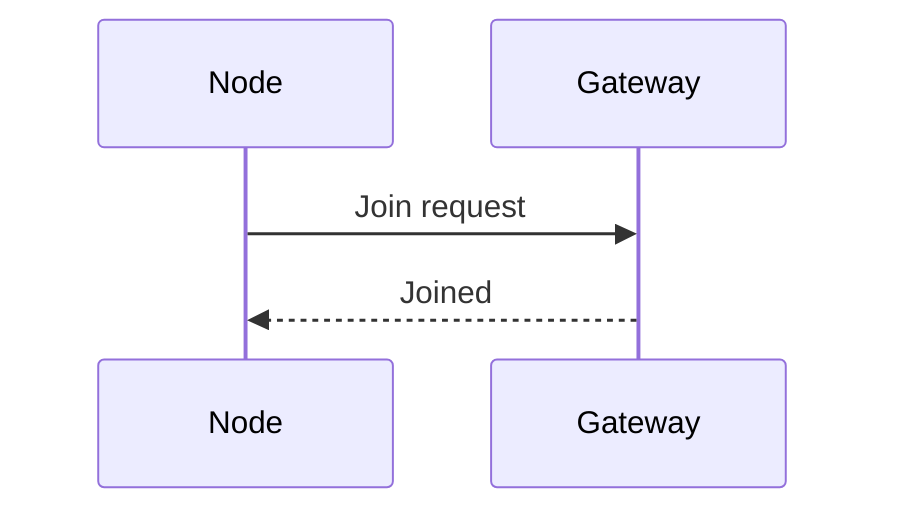

# Writing a poster

This chapter walks through writing a poster from an empty file to a printed page. It explains what each part of the Markdown becomes, which block suits which kind of idea, and how to make the layout fit. [Posters](12_posters.md) is the reference for every setting and block.

A poster is read standing up, from a few steps away, in a minute or two. So it says one thing, in few words, with pictures doing most of the work. py-doc lays it out for you: you write the Markdown in reading order, and it places the parts and sizes the page.

## Plan before you write

Answer three questions before the first line:

1. **What is the one message?** Write it as one sentence. It becomes the summary banner, and every section should support it.
1. **Who reads it, and where?** An installer at a trade stand needs steps and pictures. A reviewer at a conference needs results and evidence.
1. **What are the four to eight parts?** Each becomes a section with a heading. Fewer, fuller sections read better than many thin ones.

A good budget is 300 to 600 words for an A1 poster, and half that for A3. If the text is longer, the page widens to fit it and everything prints smaller.

## Start the file

Make a Markdown file with front matter and one section, then build it:

```markdown
---
title: SN-100 Sensor Node
subtitle: Five years of readings from one coin cell
byline: A. Writer, Product Engineering
---

## 1. Hardware: what is on the board

The node has a sensor, a microcontroller and a radio.
```

```bash
py-doc poster sn100.md        # writes sn100.html
```

Open `sn100.html` in a browser. Keep it open as you write: build again and reload to see each change. The page is self-contained, so you can send it or move it on its own.

## The parts of the page

A poster is built from its `##` headings. Four headings are special, and every other one is a section:

| You write | It becomes | Advice |
|---|---|---|
| Front matter `title`, `subtitle`, `byline` | The header | A title of up to six words. The subtitle says why it matters |
| `## Stats` | The strip of figures under the header | Three or four figures that make the case at a glance |
| `## Abstract` | The introduction box | Two or three sentences: the problem and what the poster shows |
| `## 1. Heading: accent` | A section, in columns | Number the sections in reading order |
| `## Summary` | The banner and the closing blocks | The one message, then one block for each thing to remember |
| `## References` | A small list above the footer | Only what a reader would look up |

The parts always appear in the order of this table, whatever order you write them in. Sections keep your order, top to bottom, then left to right.

## The header

The header holds the title, the subtitle and the byline from the front matter. Add a logo with `logo:`, and move things with `header:`:

```yaml
logo: brand/logo.svg
header:
  align: left        # centre (default) or left
  logo: right        # left (default), right or none
```

A left-aligned header suits a long title. A centred one suits a short title and a logo on each side of the page's meaning.

## The stats strip

`## Stats` is a table of a value and a label. The header row is ignored, so it can say anything:

```markdown
## Stats

| Value | Label | Change | Verdict |
|---|---|---|---|
| 5 years | Battery life | +14 % | |
| 4 s | Typical join | -7 s | good |
| 2 uA | Sleep current | | |
```

The two last columns are optional. A change gets an arrow: up for a `+`, down for a `-`, and sideways otherwise. Up is coloured as good news and down as bad news, so write `good` or `bad` in the fourth column when that is wrong. A shorter join time is good news, for example.

Keep each value short, such as `5 years` or `0.2 °C`, so it reads from across a room. Put the explanation in the label.

## The introduction

`## Abstract` is the blue box under the stats. Write two or three sentences that a reader can take in before deciding to read on. It is ordinary Markdown, so **bold** and links work.

## Sections

Every other `##` heading is a section. The text before the first colon is the heading, and the text after it is coloured, so a heading reads as a topic and a question:

```markdown
## 2. Power: where the charge goes
```

The sections are shared out between the columns, balanced by length: two columns for a portrait poster and three for a landscape one. Change that with `columns:` and `split:` in the front matter:

```yaml
columns: 3
split: 2, 2        # two sections in the first column, two in the second, the rest in the third
```

Two attributes in braces after a heading change one section:

- `{.wide}` makes the section span every column. Use it for a timeline, a wide diagram or a table with many columns. The sections before it are balanced into columns above it, and the ones after it below.
- `{colour=red}` colours its heading bar, to mark a warning or a section that stands apart.

```markdown
## 5. Roadmap: what comes next {.wide}
## 6. Troubleshoot: when it will not join {colour=amber}
```

## Choose a block for each idea

A section is ordinary Markdown with py-doc's blocks in it. Pick the block by what the idea is, not by what looks busy:

| The idea is | Use | For example |
|---|---|---|
| A few parts, each with a line of text | `cards` | Sensor, controller and radio |
| States and what moves between them | `flow` | Asleep, measure, send |
| What happens in each time window | `lanes` | Every minute, every hour |
| How a whole divides into shares | `segments` | One minute of the node's time |
| Dates and milestones | `timeline` | Pilot, release, retirement |
| Numbers to compare | `chart` | Messages a day before and after |
| A screen the reader will see | `lcd` | The display after joining |
| Structure, sequence or architecture | A diagram fence | A Mermaid sequence diagram |
| A warning or a tip | A callout | Do not update below 2.4 V |
| A lookup | A table | Error codes and their fixes |
| A link to more | `qr` | The full manual |

The [Posters](12_posters.md) chapter lists every option of every block. The sections below show the common ones.

### Cards

````markdown
```cards cols=3 style=top
Sensor | Temperature and humidity on I2C | blue
Controller | Sleeps at 2 uA | navy
Radio | Sends one message, then switches off | green
```
````

Each line is a heading, a text and, for `style=top`, a colour. `cols` sets how many go across. `style=label` gives small capital headings, and `style=plain` gives text only.

### Flow and lanes

````markdown
```flow
[Asleep|navy] -timer-> [Measure|blue] -changed-> [Send|amber]
[Measure|blue] -unchanged-> [Back to sleep, nothing sent]
```

```lanes
Every minute | *Wake | *Measure | Send if changed
Every hour | *Wake | *Measure | *Send status
```
````

In a flow, `[Text|colour]` is a filled box and `[Text]` an outlined one, and `-label->` is an arrow with a label. In lanes, a cell that starts with `*` is filled and any other is dashed, so filled cells show what always happens.

Lines in a `flow`, `lanes` or `segments` block that are not part of it become notes under it. To put two or three of them in one box, use a `figure` block with `+++` lines between them.

### Segments

````markdown
```segments
title: One minute of the node's time (not to scale)
6 | Asleep, 58 s | 2 uA | navy
2 | Measure, 1 s | 300 uA | blue
2 | Send, 1 s | 12 mA | amber
```
````

The first number is each part's share of the width. Say "not to scale" in the title when the shares are not the true proportions, which they rarely can be when one part is a thousand times another.

### Timelines

````markdown
```timeline
Jan 2026 | Pilot | 200 nodes | navy
Apr 2026 | Firmware 2.1 | Sends only what changed
Oct 2026 | Ten-year cell
```
````

A timeline in a row needs room, so put it in a `{.wide}` section, or write `timeline vertical` for a column.

### Charts

````markdown
```chart type=column title="Messages a day" unit=" msg"
series: 2.0, 2.1
Office | 1440 | 610
Warehouse | 1440 | 980
```
````

`type` is `column`, `bar` or `line`. Each line is a label and one value for each series, and `series:` names them. Use `bar` when the labels are long, and `line` for a change over time. A chart is drawn by py-doc itself, in the theme's colours, so it needs no tool container.

### Diagrams

Any diagram fence works, as in a document:

````markdown

````

Mermaid diagrams get the poster's colours and font. Diagrams are drawn by the tool container, so building a poster with one needs Docker, as a document does. A diagram that cannot be drawn is shown as its code with a warning, and the rest of the poster is still written.

A diagram is drawn at its natural size and shrunk to its column. Keep it small: five to ten boxes with short labels read better than one large diagram, and a wide one belongs in a `{.wide}` section.

### Callouts

```markdown
> [!WARNING]
> Do not update a node whose battery is below 2.4 V.

> **Tip:** join one node at a time.
```

The kinds are note, tip, important, warning and caution, in either spelling, each in its own colour. A quote with no kind is a plain callout. Use one or two on a poster: when everything is a warning, nothing is.

### Pictures, tables, code and captions

A local picture, ``, is embedded in the page. A table is shown as in a document, so keep it to two or three columns. A code block is shown as code. A caption is a `[[CAPTION:Figure]] text` line next to the picture, or a paragraph that starts with `Fig.`.

## The summary and references

`## Summary` closes the poster. Its first paragraph is the banner, so make it the one message from your plan. Each `###` under it is a block, for the two or three things a reader should take away:

```markdown
## Summary

One coin cell, five years, one message only when something changes.

### Measure often

A reading a minute costs little, because measuring is cheap.

### Send rarely

The radio is the cost, so the node sends only what is new.
```

`## References` is a list in small type above the footer. Number it, and cite its entries in the text as `[1]`.

## The footer

The footer has three texts, logos and a QR code:

```yaml
footer:
  left: SN-100                          # in the theme's strong colour
  centre: Product Engineering
  right: "Version {{version}}"
  logos: [brand/partner.svg]
  qr: https://example.com/sn-100
  qr-label: Datasheet
  document: SN-PO-001                   # shown small, under the footer
  version: "{{version}}"
```

The texts are Markdown and take `{{variables}}`. The QR code is drawn as SVG, so it scans from a printed page.

`document` and `version` are shown in small type on a line under the footer, such as "SN-PO-001 · Version 2.1". So a printed poster can be traced to its source. Without them, the poster uses `document_number` and `version` from its front matter, the same properties a document has.

## Make it fit

The page always has the shape of its paper. A script in it finds the narrowest layout that holds all the content, no narrower than `width`, and scales the page to the window or the paper. So you never set a font size. Instead:

| You see | Do this |
|---|---|
| Space above the footer | Lower `width`, such as `width: 1100`, to make everything larger |
| Small text everywhere | Cut words, or move a long section to its own `{.wide}` row |
| One column much longer than the others | Set `split:`, because a chart or a diagram is short in text but tall on the page |
| A diagram with tiny text | Simplify it, or put it in a `{.wide}` section |
| A wide table squeezed into a column | Make its section `{.wide}`, or cut columns |

`orientation: landscape` turns the page and uses three columns. `paper:` sets the paper size for printing, from `a0` to `a4`, and does not change the layout.

## Brand it

A theme sets the colours, fonts and logo. Use a built-in one (`default`, `dark` or `print`), or a theme file for your company:

```yaml
theme: brand/company.yml
```

Set a theme once for every poster of a project in `py-doc.yml`, so a poster's Markdown needs only the words:

```yaml
poster:
  theme: brand/company.yml
  footer: {centre: Example Instruments}
```

Change one colour for one poster beside the theme with `colours:`, such as `colours: {accent: "#d9573a"}`. [Posters](12_posters.md) lists every colour and what it paints.

## Reuse text

A poster takes the same includes, conditions and variables as a document, so it can share text with the documents it summarises:

```markdown
[[INCLUDE: ../docs/shared/safety.md]]

[[IF: internal]]
Field trial results, not for release.
[[ENDIF]]

This is firmware {{version}}.
```

Set the values under the poster in `py-doc.yml`, in its front matter, or for one build with `--var version=2.1 --condition internal=false`.

## Build, print and share

List the project's posters in `py-doc.yml`, then build them all, or one by name:

```yaml
posters:
  sensor-node:
    source: posters/sensor-node.md
    pdf: true
```

```bash
py-doc poster                 # every poster
py-doc poster sensor-node     # one
py-doc poster --pdf           # and a one-page PDF of each
```

The HTML page is the one to share by email or on a screen. The PDF is the one to send to a printer: it is one page of the poster's paper size. To print from a browser instead, use Chrome's print dialogue with no margins and background graphics on.

## A complete poster

This is a whole poster in one file. Build it, then change it piece by piece:

````markdown
---
title: SN-100 firmware 2.1
subtitle: Longer life, faster joins, safer updates
byline: Release notes for installers and support
paper: a3
width: 1100
footer:
  left: Firmware 2.1
  qr: https://example.com/release-2-1
  qr-label: Full notes
---

## Stats

| Value | Label | Change | Verdict |
|---|---|---|---|
| 5.7 years | Battery life | +14 % | |
| 4 s | Typical join | -7 s | good |

## Abstract

Firmware 2.1 sends less, joins faster and can always go back to the last version that worked.

## 1. Power: sending less

The node now stays quiet when a reading has not changed.

```chart type=column title="Messages a day"
series: 2.0, 2.1
Office | 1440 | 610
Warehouse | 1440 | 980
```

## 2. Updates: safe by design

```cards cols=2 style=top
Two copies | The new firmware is written beside the old one | blue
Roll back | A failed self-test returns to the old copy | amber
```

> **Warning:** do not update a node whose battery is below 2.4 V.

## Summary

Install 2.1 everywhere: it costs one message and saves months of battery.

### Installers

Nothing changes on site. Joining is quicker.

### Support

Every update reports its result.
````

`examples/poster/` in the repository has three full posters: portrait, landscape in a company's theme, and dark.

## Before you print

1. Read the summary banner alone. Does it say the one message?
1. Read only the headings and the stats. Do they tell the story?
1. Stand back from the screen. Can you read the section text from two steps away at the size it will print?
1. Check every number, name and date against its source.
1. Scan the QR code with a phone.
1. Build the PDF and open it. Check it is one page of the right paper size and orientation.

## When something goes wrong

| Message or symptom | Cause and fix |
|---|---|
| `no sections found` | The file has no `##` heading other than the special ones. Add a section |
| `unknown key ... in posters.name` | A misspelt setting in `py-doc.yml`. The message lists the allowed keys |
| `'x' is not a poster setting, so it is ignored` | A front matter key the poster does not use, such as `author`. It is harmless |
| `split cannot be used with wide sections` | Remove `split:`; the columns between wide sections are balanced for you |
| `... is not a colour` | Use a hex value such as `#2a3150`, a CSS colour name, or a palette name |
| `mermaid diagram not rendered` | The diagram has a mistake, or Docker is not running. The poster shows its code |
| A chart error naming a line | Every value after the label must be a number |
| The fonts look different in the PDF | The tool container has no network, so web fonts are replaced. See [Posters](12_posters.md#pdf) |
| A blank space or a long column | See [Make it fit](#make-it-fit) |
