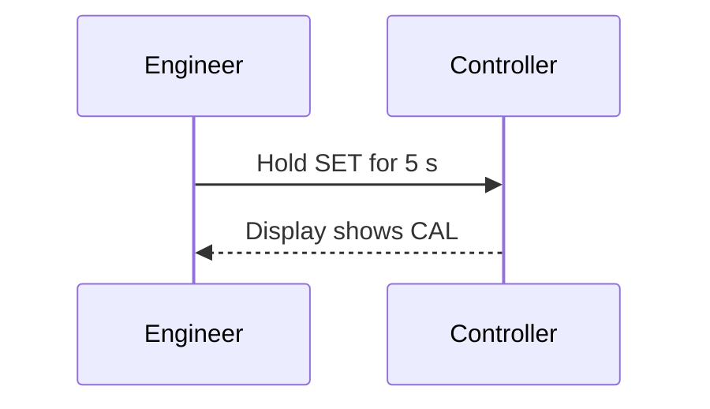

# Writing a document

This chapter walks through writing a technical document with py-doc, from planning it to a reviewed Word, PDF or HTML file and a page on the web site. It shows how to lay out the files, what to put in each part, and which py-doc feature fits each job. [Writing](03_writing.md) is the reference for the Markdown, and [Outputs](04_outputs.md) for the formats.

One set of Markdown files makes every format. So write for the reader, not for Word: headings, paragraphs, lists, tables and pictures, with py-doc's markers where you need more. The template decides how it looks.

## Plan the document

Answer four questions before the first heading:

1. **Who reads it, and what do they do next?** An installer follows steps. A reviewer checks a design against requirements. An operator looks things up under pressure.
1. **What kind of document is it?** A guide teaches, a reference is looked up, a specification states what must be true, and a design explains a decision. Mixing kinds makes each one harder to use.
1. **What are its chapters?** Write the outline as a list of headings first. Each chapter should answer one question a reader has.
1. **Which formats does it need?** Word for review and sign-off, PDF for release, HTML or the site for reading on screen. One source makes them all.

## Set up the files

Start a project, then add the document to `py-doc.yml`:

```bash
py-doc init my-docs --name "Pump Controller"
```

```yaml
documents:
  install-guide:
    sources:
      - docs/install/00_introduction.md
      - docs/install/01_prepare.md
      - docs/install/02_install.md
      - docs/install/03_check.md
    outputs:
      docx: {toc: true}
      pdf: {toc: true}
      html: {toc: true}
```

Keep one file for each chapter, numbered so they sort in reading order. Short files are easier to review, to reuse in another document, and to see in a diff. The order in `sources` is the order of the document.

## Front matter

The first file of a document starts with front matter. Its values become the title page, the document properties and the template's placeholders:

```markdown
---
title: Pump Controller Installation Guide
subtitle: For site engineers
author: A. Writer
date: 2026-10-20
version: "1.2"
status: Draft
document_number: PC-IG-001
classification: Internal
description: How to install, wire and commission the PC-200 pump controller.
---
```

Write `version` in quotes, so `1.10` is not read as a number and shortened to `1.1`. `status: Draft` makes a template with a `_Draft` twin use the draft one. A value in `py-doc.yml` wins over the front matter, so a project can fix the company name in one place.

## Headings

Use `#` for the chapter title in each file and `##` to `####` inside it. Do not skip a level: a `####` straight under a `##` confuses the contents list and the reader, and the lint reports it.

Write headings as short statements of what the section is about, in sentence case, without a full stop. A reader skims the headings first, so they should tell the story on their own.

Numbers are optional. Write `## 2.1 Wiring` or `## Wiring`; when the Word template numbers its headings, py-doc takes the written numbers off so they never show twice. [Heading numbers](04_outputs.md#heading-numbers) has the details.

## Paragraphs and lists

Keep a paragraph to one idea, and a sentence short: the lint notes a sentence over 40 words, and Vale, when it is installed, one over 30. Put the point first, then the detail.

Use a numbered list (`1.` on every line) for steps a reader follows in order, and a bullet list for things that have no order. Write each step as one action:

```markdown
1. Switch off the supply at the isolator.
1. Remove the four screws of the cover.
1. Connect the supply to terminals L and N.
```

## Tables

Use a table to compare things or to look them up, with a caption on the line before:

```markdown
[[CAPTION:Table]] Terminal connections

| Terminal | Connect | Wire |
|---|---|---|
| L | Supply live | 1.5 mm² brown |
| N | Supply neutral | 1.5 mm² blue |
```

Keep tables narrow enough for the page: four or five columns in portrait. A wider table belongs in a landscape section (below) or split in two.

## Pictures and diagrams

Put a picture with its caption on the line before it:

```markdown
[[CAPTION:Figure]] The terminal block
{width=60%}
```

The alt text in the brackets is read aloud to readers who cannot see the picture, so say what it shows. `{width=60%}` makes it that share of the text width.

Draw a diagram in the Markdown, so it is reviewed and changed like text and redrawn at every build:

````markdown
[[CAPTION:Figure]] Commissioning sequence

````

Mermaid, PlantUML, Graphviz and the other diagram types are listed in [Diagrams](03_writing.md#diagrams). Prefer five to fifteen boxes with short labels. A diagram too large to read on the page is a sign it should be two.

## Callouts

A callout stands out from the text. Use it for what a reader must not miss:

```markdown
> [!WARNING]
> Isolate the supply before you remove the cover.

> **Tip:** label each wire before you disconnect it.
```

The kinds are note, tip, important, warning and caution. Keep warnings for real risks, and put a warning before the step it is about, not after.

## Code and commands

Put commands and code in fenced blocks with their language, so they are highlighted and can be copied:

````markdown
```bash
pc-config --port /dev/ttyUSB0 --read
```
````

Include a real source file instead of copying it, so the document never shows old code:

```markdown
[[CAPTION:Figure]] The configuration script
[[INCLUDE-CODE: ../../tools/configure.py]]
```

## Links

Link to another chapter by its file, and to a section by its heading:

```markdown
See [Check the installation](03_check.md#check-the-installation).
```

The links work in the Word, PDF and HTML files and on the site. Write link text that says where it goes, never "click here".

## Reuse and variants

Write a shared passage once and include it where it is needed:

```markdown
[[INCLUDE: ../shared/safety.md]]
```

Make two versions of a document from one source with conditions, and keep changing values in variables:

```markdown
[[IF: internal]]
Factory test limits are in the test specification.
[[ENDIF]]

This guide is for firmware {{firmware}}.
```

```yaml
documents:
  install-guide:
    variables: {firmware: "4.2"}
    conditions: {internal: false}
```

`py-doc build --condition internal=true` builds the internal version without changing a file.

## Page layout

A few markers change the page, in Word in particular:

- `[[LANDSCAPE]]` starts a landscape section, for a wide table or diagram, and `[[PORTRAIT]]` returns to portrait.
- `[[PAGEBREAK]]` starts a new page.
- `[[STYLE:Lead Paragraph]] text` gives a paragraph a named Word style from the template.

Use them sparingly. Most of the look belongs in the template, where it is the same for every document.

## Templates

The Word template decides fonts, colours, headings, the title page, headers and footers. Name it once for every document:

```yaml
outputs:
  docx: {template: templates/Company.docx}
```

Placeholders such as `Replace-with-Title` and `Replace-with-Version` in the template are filled from the front matter. `py-doc template check templates/Company.docx` reports what a template lacks. [Templates](04_outputs.md#templates) has the details, and the PDF and HTML outputs take a template of their own.

## Check the writing

Lint the document before review, and fix what it finds:

```bash
py-doc lint docs/install
```

The lint checks glossary terms, wordy phrases, acronyms that are not spelt out, broken links, pictures without alt text, skipped heading levels and long sentences. Structure rules can also ask for a caption on every table and picture. Add your own terms to `lint.glossary` in `py-doc.yml`, so a product name is always spelt the same way. [Linting](07_lint.md) has every rule.

## Build and publish

```bash
py-doc build install-guide              # Word, PDF and HTML, as py-doc.yml lists
py-doc build install-guide -f docx      # only Word, for review
py-doc build --lint --site              # lint, every document, then the web site
```

The files go to `build/` unless `py-doc.yml` says otherwise. The same sources make a page of the web site for each chapter, with the callouts, diagrams and links kept. See [Web sites](08_sites.md).

## Before review

1. Read only the headings. Do they tell the reader what is in each part?
1. Check every step in a numbered list is one action, in the order a reader does it.
1. Check every picture, diagram and table has a caption, and every picture has alt text.
1. Run `py-doc lint` and fix every warning.
1. Open the Word file and update its fields, so the contents list has page numbers.
1. Check the version, status and document number on the title page.

## When something goes wrong

| Message or symptom | Cause and fix |
|---|---|
| `included file not found` | The path in `[[INCLUDE:]]` is from the file that holds it. Fix the path |
| `condition 'x' is not defined` | Add `x` under the document's `conditions`, or pass `--condition x=true` |
| A diagram error with a file and line | The diagram has a mistake. The message is the tool's own |
| The section numbers show twice | The template numbers its headings. Set `heading_numbers: strip`, or leave the numbers out of the headings |
| A placeholder named in a warning | The front matter has no value for it, such as `document_number` |
| The contents list has no page numbers | Open the file in Word and update the fields |
