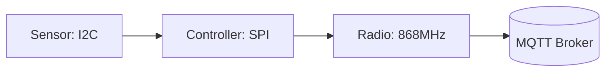

## Key figures {.stats}

| Value | Label | Change | Verdict |
|---|---|---|---|
| 2 µA | Sleep current | -0.5 µA | good |
| 5 years | Battery life at one reading a minute | +14 % | |
| 0.2 °C | Temperature accuracy | | |
| 1 KB | Firmware update block | | |

## Introduction {.abstract}

The SN-100 measures temperature and humidity and publishes each reading over MQTT. It sleeps between readings, so one coin cell lasts five years. This poster shows how it wakes, measures, sends and goes back to sleep.

## 1. Hardware: what is on the board {.flow}

The node has a sensor, a microcontroller and a radio on one 52 by 29 mm board, powered from one CR2477 cell.

[[CAPTION:Figure]] The parts of the node and how a reading travels


```cards cols=3 style=top
Sensor | Temperature and humidity on I2C, up to 400 kHz | blue
Controller | Sleeps at 2 µA, wakes on its own timer | navy
Radio | Sends one MQTT message, then switches off | green
```

## 2. Power: where the charge goes

```segments
title: One minute of the node's time (not to scale)
6 | Asleep, 58 s | 2 µA | navy
2 | Measure, 1 s | 300 µA | blue
2 | Send, 1 s | 12 mA | amber
```

Sending costs the most, so the node sends only when a reading has changed by more than the reporting threshold.

> [!WARNING]
> Keep the reporting threshold above sensor noise, or the node sends every reading and the cell lasts months, not years.

## 3. Behaviour: one reading cycle

```flow
[Asleep|navy] -timer-> [Measure|blue] -changed-> [Send|amber] -sent-> [Asleep|navy]
[Measure|blue] -unchanged-> [Back to sleep, nothing sent]
```

## In short {.summary}

One coin cell lasts five years because the node sleeps at 2 µA and sends only when readings change.
