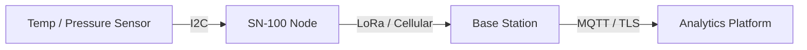

# 1. Introduction

Welcome to the SN-100 technical briefing. This deck is authored in Markdown and converted into PowerPoint (`.pptx`) via `py-doc slides`.

## Why a Sensor Node?

- Sensors speak I2C and SPI; the cloud speaks MQTT and IP
- The node translates protocols and buffers sensor bursts
- Autonomous operation with ultra-low standby power

::: notes
Emphasize that the buffer is the primary architectural requirement for handling intermittent connectivity.
:::

## Before and After Comparison

:::: columns
::: column
**Traditional Architecture**

- Point-to-point analog wiring
- Polled on-demand by central gateway
- Single point of failure at cable junctions
:::

::: column
**SN-100 Architecture**

- Digital bus with local ring buffer
- Push-based publish over MQTT / TLS
- Independent battery backup
:::
::::

<!-- notes: Point out that cable junction failure was the #1 field service cost last quarter. -->

## System Communication

[[CAPTION:Figure]] End-to-end data transmission path

## Field Deployment Checklist

::: incremental
1. Verify battery isolator tab has been removed
1. Check diagnostic LED blinks green once every 5 seconds
1. Ensure external antenna is torqued to 0.4 Nm
1. Confirm registration handshake in field portal
:::

> [!WARNING]
> Do not energize the external transmitter when the antenna connector is open-circuit.

::: notes
Remind installers to record the device IMEI in the commissioning app before sealing the enclosure.
:::
