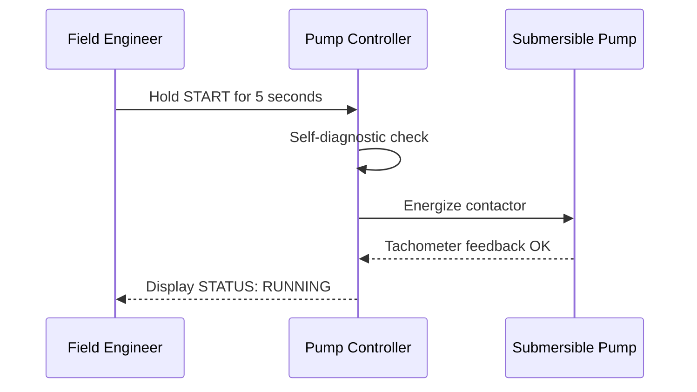

# 1. Introduction

This document demonstrates the Markdown features used in **py-doc** for generating Word documents (`.docx`), slides, and HTML.

[[PAGEBREAK]]

# 2. Callouts and Admonitions

Both GitHub-style alerts and Word-style bold labels are formatted into color-coded callout boxes matching Word template styles:

> [!NOTE]
> This is a **Note** callout using GitHub syntax (`> [!NOTE]`). In Word, this maps to the `Div.note` paragraph style.

> [!TIP]
> This is a **Tip** callout. Use it to share best practices or shortcuts.

> **Important:** This callout uses the bold label syntax (`> **Important:**`). py-doc accepts both formats.

> **Warning:** Disconnect the power supply at the isolator before removing the protective enclosure.

> [!CAUTION]
> Operating outside the rated voltage may cause irreversible equipment damage.

[[PAGEBREAK]]

# 3. Numbered Captions

Captions written with `[[CAPTION:Figure]]` or `[[CAPTION:Table]]` are automatically numbered sequentially in reading order:

[[CAPTION:Figure]] Commissioning sequence flowchart


[[CAPTION:Figure]] Internal terminal wiring diagram
```
+---------------------------------------+
|  [ L ]  [ N ]  [ E ]     [ + ]  [ - ] |
|  - 230V AC Supply -     - 24V Sensor -|
+---------------------------------------+
```

[[CAPTION:Table]] Terminal strip pin assignments

| Terminal | Function | Specification | Wire Color |
|:---|:---|:---|:---|
| L | Live Supply | 230V AC, 50Hz, 16A | Brown |
| N | Neutral Supply | 230V AC, 50Hz | Blue |
| E | Protective Earth | Ground reference | Green/Yellow |
| + | Sensor Power | 24V DC regulated | Red |
| - | Sensor Common | 0V reference | Black |

[[PAGEBREAK]]

# 4. Layout Markers & Styles

### Word Section Breaks
[[LANDSCAPE]]
The section above switches Word output into landscape orientation for wide tables or architectural diagrams.

[[PORTRAIT]]
And this returns the page orientation to portrait.

### Word Paragraph Styles
[[STYLE:Lead Paragraph]] This paragraph has the Word style **Lead Paragraph** applied via `[[STYLE:Lead Paragraph]]`.

### Directives
Directives used by py-doc for includes and conditionals are displayed as visual badges:

[[INCLUDE: shared/safety_precautions.md]]

[[IF: internal_build]]
This section only appears in internal builds.
[[ENDIF]]
