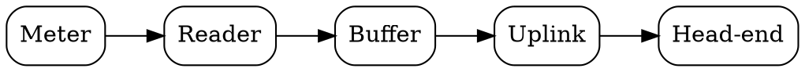
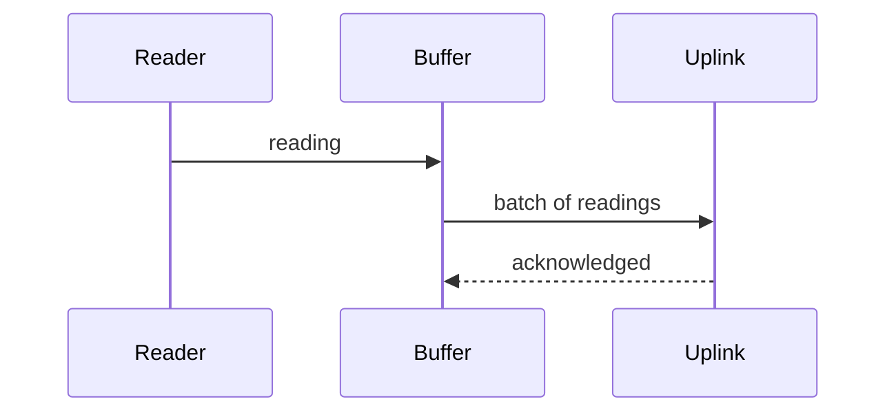
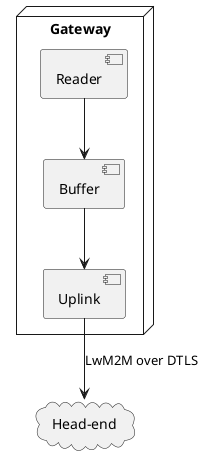

# Design

## Components

The gateway has three parts: a reader, a buffer and an uplink.

[[CAPTION:Figure]] Data flow through the gateway

## Sequence

## Deployment sketch

## Code

The reader loop, included from a file:

[[INCLUDE-CODE: includes/reader.c]]

## A wide table

[[LANDSCAPE]]

| Register | Address | Width | Description | Access | Reset |
|---|---|---|---|---|---|
| ENERGY | 0x0100 | 32 | Total active energy | R | 0 |
| POWER | 0x0104 | 32 | Instantaneous power | R | 0 |
| STATUS | 0x0108 | 16 | Meter status bits | R | 0 |

[[PORTRAIT]]
