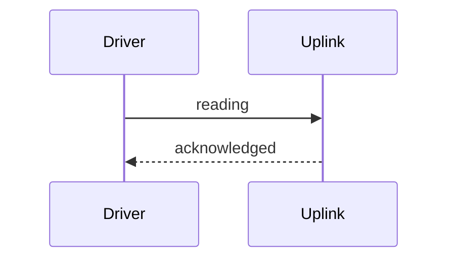
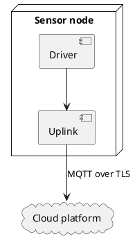

# Introduction

## Why a sensor node

- Sensors speak I2C, the cloud speaks IP
- The node translates and buffers
  - It keeps seven days of readings
  - It sends them when the network returns
- It runs for **three years** on one battery

<!-- notes: Keep this to one minute. The buffer is the main reason for the design. -->

## What is in the box

:::: columns
::: column
- Sensor board
- Battery pack
- Enclosure
:::
::: column
[[CAPTION:Figure]] The company logo
{width=60%}
:::
::::

## How it works

::: incremental
1. Wake on a timer
1. Read the sensors
1. Publish over MQTT
:::

::: notes
Each step appears on a click.

The notes can have several paragraphs, because this is a pandoc notes block.
:::

# Design

## Data flow

[[CAPTION:Figure]] From sensor to cloud

<!-- notes: Walk the audience along the arrows, left to right. -->

## Publishing a reading

[[CAPTION:Figure]] One reading

## Where the parts run

[[CAPTION:Figure]] The node and the cloud

## Measurement code

[[CAPTION:Figure]] The measurement function
[[INCLUDE-CODE: ../includes/sensor.c]]

## Registers

[[CAPTION:Table]] Registers

| Register | Address | Width | Reset |
|:---------|--------:|:-----:|------:|
| `TEMP` | 0x0100 | 16 | 0 |
| `HUMID` | 0x0102 | 16 | 0 |
| `INTERVAL` | 0x0106 | 16 | 300 |

## Battery life

Average current sets the life of the battery:

$$t = \frac{C}{I_{avg}}$$

A 2400 mAh cell at 90 uA lasts about three years.

# Operation

## Callouts on slides

> [!TIP]
> Callouts work on slides too.

> **Note:** both spellings are accepted.

## Text styles and links

This slide has **bold**, *italic*, ~~struck out~~ and `inline code` text. It links to the
[py-doc repository](https://github.com/markbac/py-doc). Version {{version}} of the deck is shown in the footer.

::: {.pagebreak}
:::

A page break starts a new slide, and a slide can have no title.

## Included text

[[INCLUDE: ../includes/audience.md]]

[[IF: internal]]
## Internal only

This slide appears only when the build sets the condition `internal` to true.
[[ENDIF]]

## Next steps

[[CAPTION:Table]] Next steps

| Step | Owner |
|---|---|
| Confirm buffer size | Firmware |
| Write test plan | Test |
