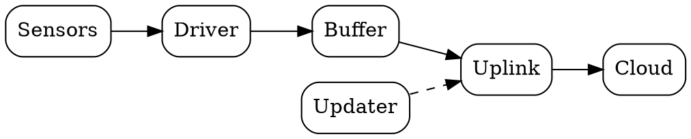
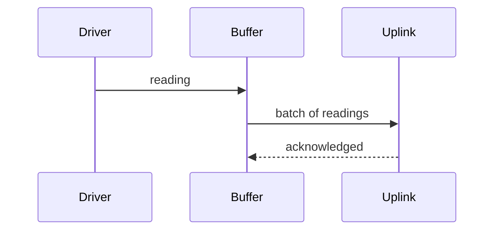
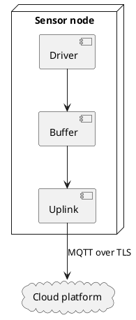
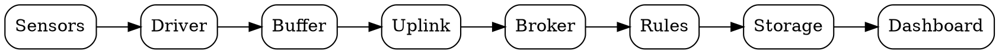

# Design

## Components

The node has four parts: a sensor driver, a buffer, an uplink and an updater.

[[CAPTION:Figure]] Data flow through the node

## Sequence

[[CAPTION:Figure]] How one reading is published

## Deployment sketch

[[CAPTION:Figure]] Where the parts run

## Code

The measurement function, included from a file:

[[CAPTION:Figure]] The measurement function
[[INCLUDE-CODE: ../includes/sensor.c]]

## A wide table

The register map is wider than a portrait page, so it sits in a landscape section.

[[LANDSCAPE]]

[[CAPTION:Table]] Registers

| Register | Address | Width | Description | Access | Reset |
|---|---|---|---|---|---|
| `TEMP` | 0x0100 | 16 | Temperature in 0.01 degrees Celsius | R | 0 |
| `HUMID` | 0x0102 | 16 | Relative humidity in 0.01 percent | R | 0 |
| `STATUS` | 0x0104 | 16 | Status bits | R | 0 |
| `INTERVAL` | 0x0106 | 16 | Seconds between measurements | RW | 300 |

[[PORTRAIT]]

## A wide picture

A diagram in a landscape section is drawn wider, up to the width of the landscape page.

[[LANDSCAPE]]

[[CAPTION:Figure]] The whole chain in one row

[[PORTRAIT]]
