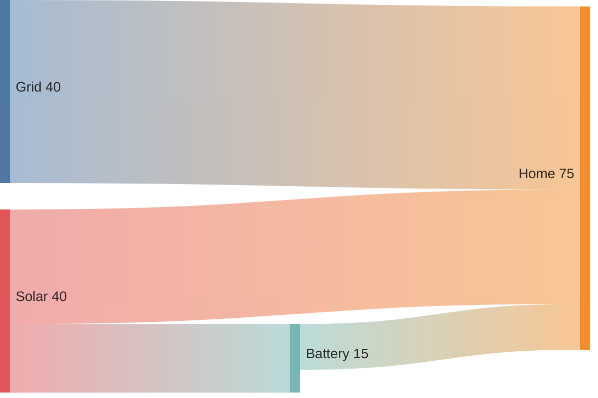
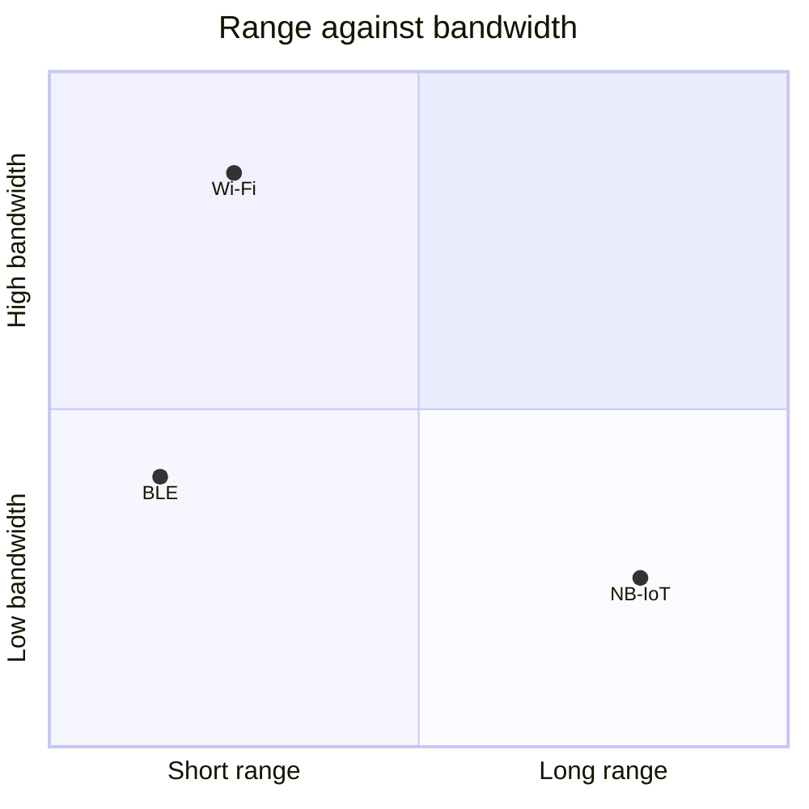
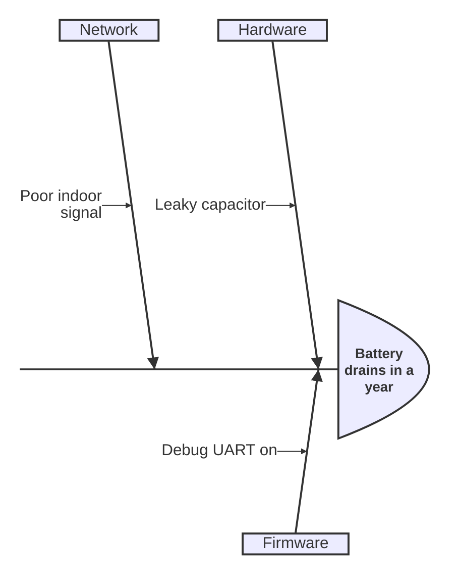

# Diagram types

Every fenced diagram type that `py-doc` draws is shown once in this chapter. The block stays in the Markdown and is
drawn when the document is built. The datasheet includes this chapter, so both documents show the same set. Graphviz, Mermaid and PlantUML are in the design chapter.

## Block diagram

[[CAPTION:Figure]] Blocks of the node
```blockdiag
blockdiag {
  sensors -> driver -> buffer -> uplink;
}
```

## Pinout

[[CAPTION:Figure]] Pin connections
```ditaa
+-------+    +-------+
| SDA   |<-->| Node  |
| SCL   |<---|       |
+-------+    +-------+
```

## Timing

[[CAPTION:Figure]] I2C timing
```wavedrom
{ signal: [
  { name: "SCL", wave: "p....." },
  { name: "SDA", wave: "x345x.", data: ["addr", "data", "ack"] }
]}
```

## Packet layout

[[CAPTION:Figure]] Header of a reading
```packetdiag
packetdiag {
  colwidth = 32;
  0-7: Version;
  8-15: Type;
  16-31: Length;
}
```

## Frame layout

[[CAPTION:Figure]] Bytes of a reading frame
```bytefield-svg
(def boxes-per-row 8)
(draw-column-headers)
(draw-box "Version" {:span 2})
(draw-box "Type" {:span 2})
(draw-box "Length" {:span 4})
(draw-box "Payload" {:span 8})
```

## Wiring

[[CAPTION:Figure]] Cable to the sensor board
```wireviz
connectors:
  X1:
    pincount: 2
  X2:
    pincount: 2
cables:
  W1:
    wirecount: 2
    colors: [RD, BK]
connections:
  -
    - X1: [1, 2]
    - W1: [1, 2]
    - X2: [1, 2]
```

## Network

[[CAPTION:Figure]] Addresses on the site network
```nwdiag
nwdiag {
  network site {
    address = "10.0.0.0/24";
    sensor1 [address = "10.0.0.10"];
    broker [address = "10.0.0.2"];
  }
}
```

## Activities

[[CAPTION:Figure]] Who does what at start up
```actdiag
actdiag {
  measure -> publish -> sleep;
  lane sensor {
    label = "Sensor";
    measure;
  }
  lane radio {
    label = "Radio";
    publish;
    sleep;
  }
}
```

## Messages

[[CAPTION:Figure]] Publish and acknowledge
```seqdiag
seqdiag {
  node -> broker [label = "publish"];
  node <-- broker [label = "acknowledge"];
}
```

## Syntax

[[CAPTION:Figure]] Syntax of a reading command
```railroad
Sequence
  Terminal "READ"
  Optional
    Terminal "ALL"
```

## Sketch

[[CAPTION:Figure]] A quick sketch
```pikchr
box "Sensor"; arrow; box "Node"; arrow; box "Cloud"
```

## Chart

[[CAPTION:Figure]] Average temperature by month
```vega-lite
{
  "data": {"values": [
    {"month": "Jan", "temp": 4}, {"month": "Feb", "temp": 5},
    {"month": "Mar", "temp": 9}, {"month": "Apr", "temp": 13}
  ]},
  "mark": "line",
  "encoding": {
    "x": {"field": "month", "type": "ordinal", "sort": null},
    "y": {"field": "temp", "type": "quantitative"}
  }
}
```

## Bar chart

[[CAPTION:Figure]] Readings per sensor, drawn with full Vega
```vega
{
  "width": 300, "height": 150, "padding": 5,
  "data": [{"name": "table", "values": [{"c": "A", "a": 4}, {"c": "B", "a": 7}, {"c": "C", "a": 2}]}],
  "scales": [
    {"name": "x", "type": "band", "domain": {"data": "table", "field": "c"}, "range": "width", "padding": 0.1},
    {"name": "y", "type": "linear", "domain": {"data": "table", "field": "a"}, "nice": true, "range": "height"}
  ],
  "axes": [{"orient": "bottom", "scale": "x"}, {"orient": "left", "scale": "y"}],
  "marks": [{"type": "rect", "from": {"data": "table"}, "encode": {"enter": {
    "x": {"scale": "x", "field": "c"}, "width": {"scale": "x", "band": 1},
    "y": {"scale": "y", "field": "a"}, "y2": {"scale": "y", "value": 0}}}}]
}
```

## Rack

[[CAPTION:Figure]] The gateway rack
```rackdiag
rackdiag {
  8U;
  1: Patch panel;
  2: Switch;
  3: Firewall;
  4: Gateway server [2U];
  6: UPS [2U];
}
```

## Energy flow

[[CAPTION:Figure]] Where a day's energy goes, drawn with Mermaid


## Trade-offs

[[CAPTION:Figure]] Radios by range and bandwidth


## Root cause

[[CAPTION:Figure]] Why a battery drains early


## Files

[[CAPTION:Figure]] The firmware source tree


## Topology

[[CAPTION:Figure]] Where a reading goes, with icons from the logos, tabler and mdi packs

```mermaid
architecture-beta
    group cloud(logos:aws)[Cloud]
    service api(logos:aws-lambda)[API] in cloud
    service db(logos:postgresql)[Readings] in cloud
    service gateway(tabler:router)[Gateway]
    service node(mdi:thermometer)[Node]
    api:R -- L:db
    gateway:T -- B:api
    node:R -- L:gateway
```


## Poster blocks

The blocks of a poster work in a document too. Each becomes a picture.

[[CAPTION:Figure]] Messages a day, drawn as a poster chart
```chart type=column unit=" msg"
series: 2.0, 2.1
Office | 1440 | 610
Warehouse | 1440 | 980
```

[[CAPTION:Figure]] The parts of the node, as poster cards
```cards cols=3 style=top
Sensor | Temperature and humidity on I2C | blue
Controller | Sleeps at 2 µA | navy
Radio | Sends one message, then sleeps | green
```

## Circuit

[[CAPTION:Figure]] The divider that scales the battery for the analogue-to-digital converter
```circuit
V1: battery 3 V | up
R1: resistor 100 kΩ | right
R2: resistor 100 kΩ | down
line | to V1.start
dot | at R1.end
```

## Music

[[CAPTION:Figure]] The tune the node plays when it joins
```music
T:Joined
L:1/8
C E G c2 z G c4
```
