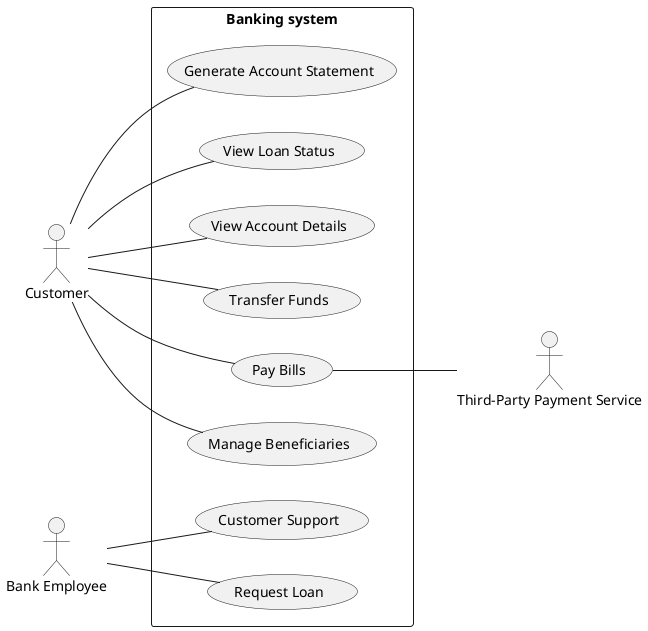

# Interface samples

This document is separate from the SN-100. It describes a sample library system, and shows how to
keep interface specifications in their own files and include them in a document. Each
specification is pulled in with a code include, so the document always shows the file as it is in
the repository. The language of each code block comes from the file's extension.

| File | Format | What it describes |
|---|---|---|
| `includes/apis/library-openapi.yaml` | OpenAPI 3.1 | The HTTP API: books, users and webhooks, with paging, filters and OAuth2 |
| `includes/apis/library-asyncapi.yaml` | AsyncAPI 2.0 | The events published over MQTT when books are added, checked out or returned |
| `includes/apis/library.proto` | Protocol Buffers (gRPC) | The same operations as gRPC calls |
| `includes/apis/library.graphql` | GraphQL | The same data as a GraphQL schema |

[[CAPTION:Table]] The interface files

## Use cases

[[CAPTION:Figure]] Who uses a banking system, and for what

## HTTP API

[[CAPTION:Figure]] The OpenAPI description
[[INCLUDE-CODE: includes/apis/library-openapi.yaml]]

## Events

[[CAPTION:Figure]] The AsyncAPI description
[[INCLUDE-CODE: includes/apis/library-asyncapi.yaml]]

## gRPC service

[[CAPTION:Figure]] The Protocol Buffers definition
[[INCLUDE-CODE: includes/apis/library.proto]]

## GraphQL schema

[[CAPTION:Figure]] The GraphQL schema
[[INCLUDE-CODE: includes/apis/library.graphql]]
