## Introduction {.abstract}

Each section is one diagram type that a tool in the container already draws. Use these before writing a native block: they need no code in py-doc, and they work in documents and sites too.

## 1. Flow: sankey

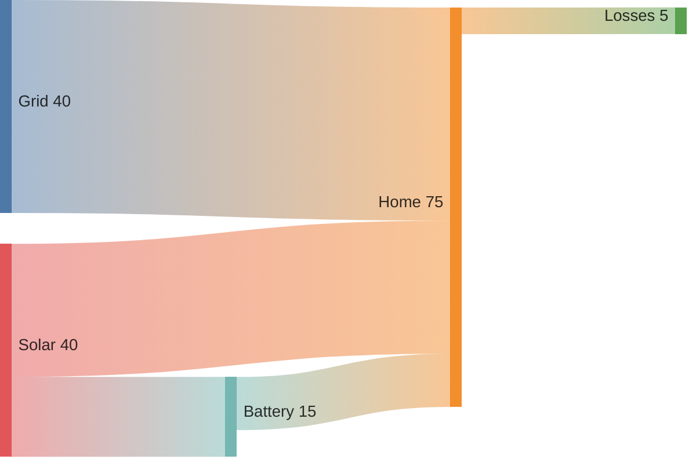

## 2. Trade-off: quadrant chart

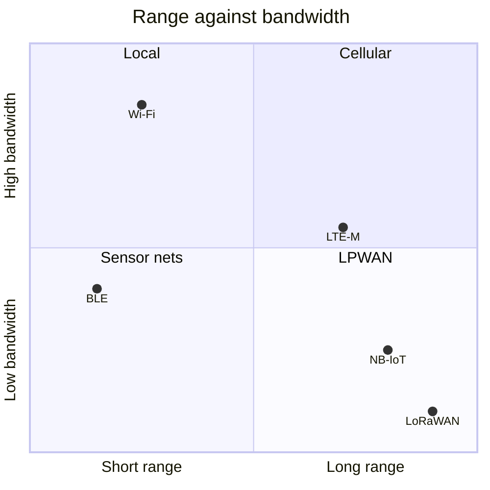

## 3. Comparison: radar

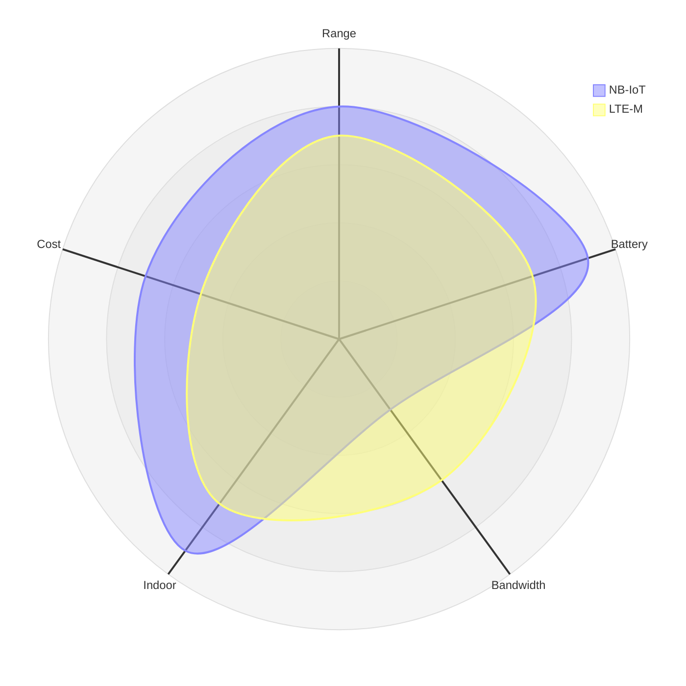

## 4. Proportion: treemap

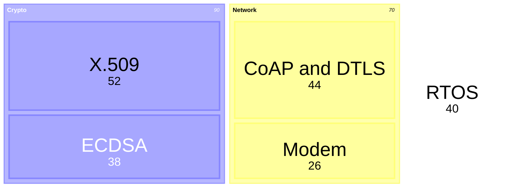

## 5. Overlap: Venn

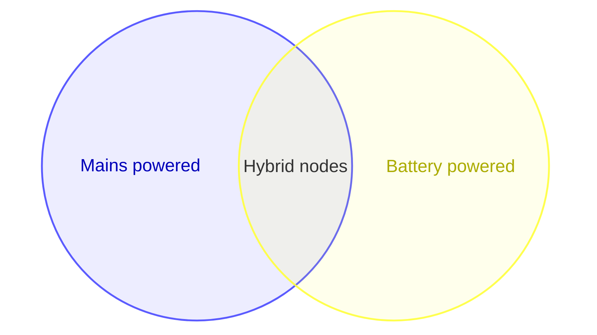

## 6. Root cause: Ishikawa

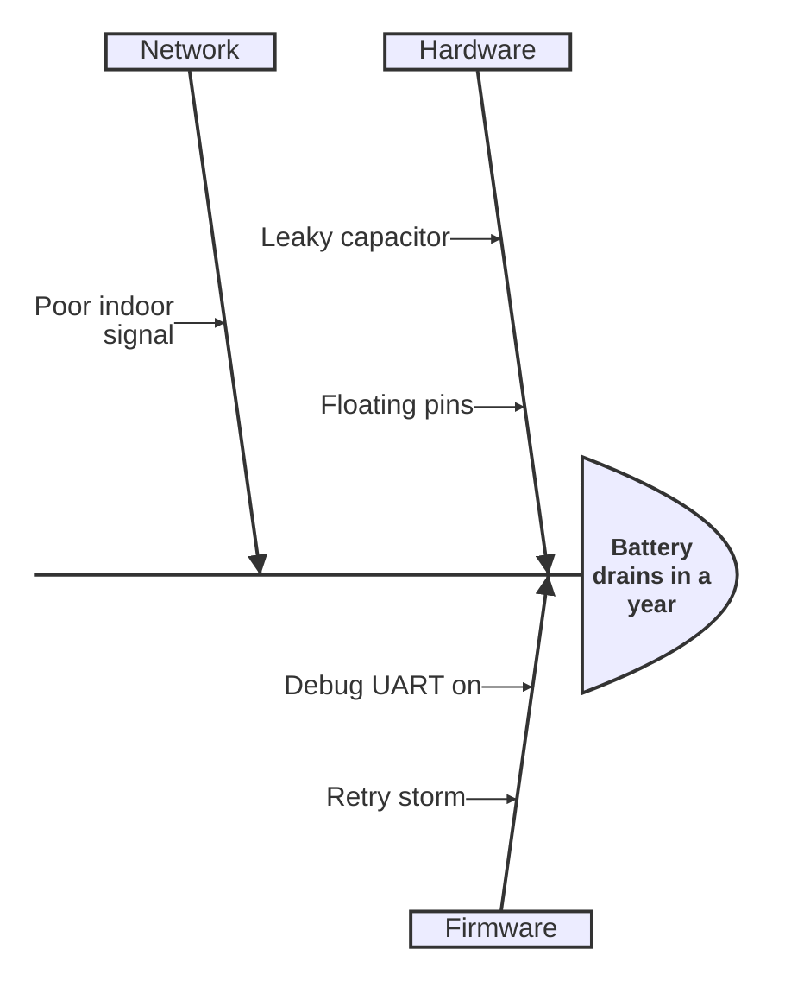

## 7. Strategy: Wardley map

```mermaid
wardley-beta
title Metering service
anchor Customer [0.95, 0.60]
component Billing [0.70, 0.45]
component Head-end [0.50, 0.55]
component Cloud [0.20, 0.85]
Customer -> Billing
Billing -> Head-end
Head-end -> Cloud
```

## 8. Files: tree view


## 9. Ideas: mind map

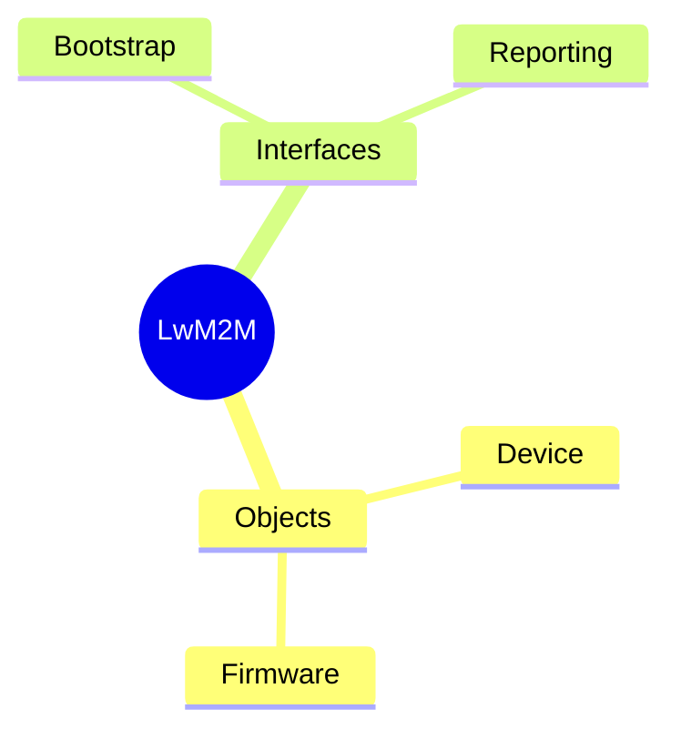

## 10. Branches: git graph

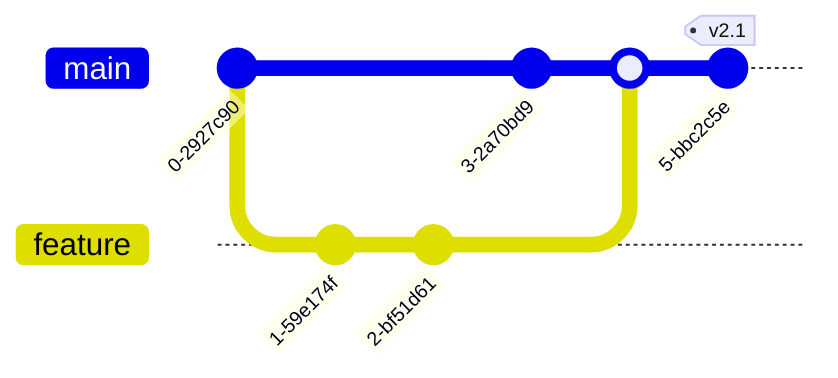

## 11. Dates: timeline

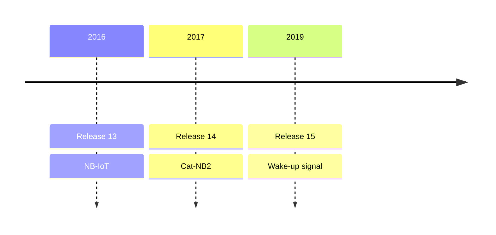

## 12. Plan: Gantt

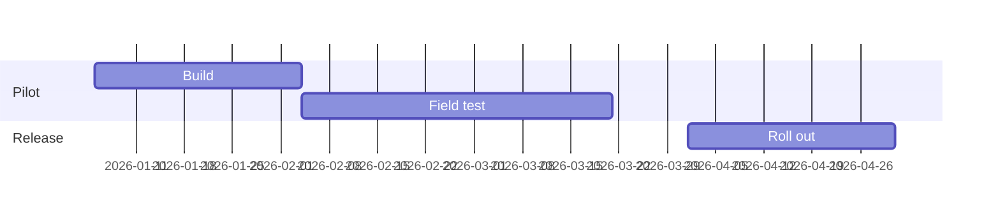

## 13. Values: XY chart

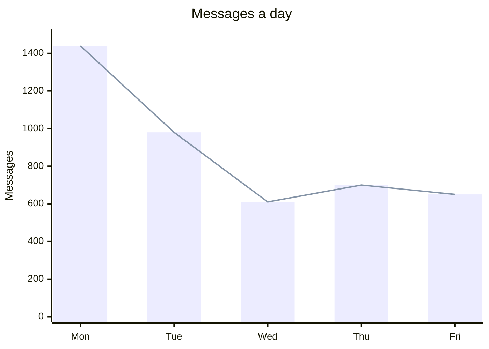

## 14. Layout: block diagram

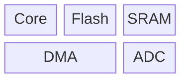

## 15. Hand-offs: swimlanes

```mermaid
swimlane-beta LR
  subgraph Customer
    A([Top up]) --> B(Send payment)
  end
  subgraph Supplier
    C[Credit the meter]
  end
  B --> C
```

## 16. Decisions: flowchart

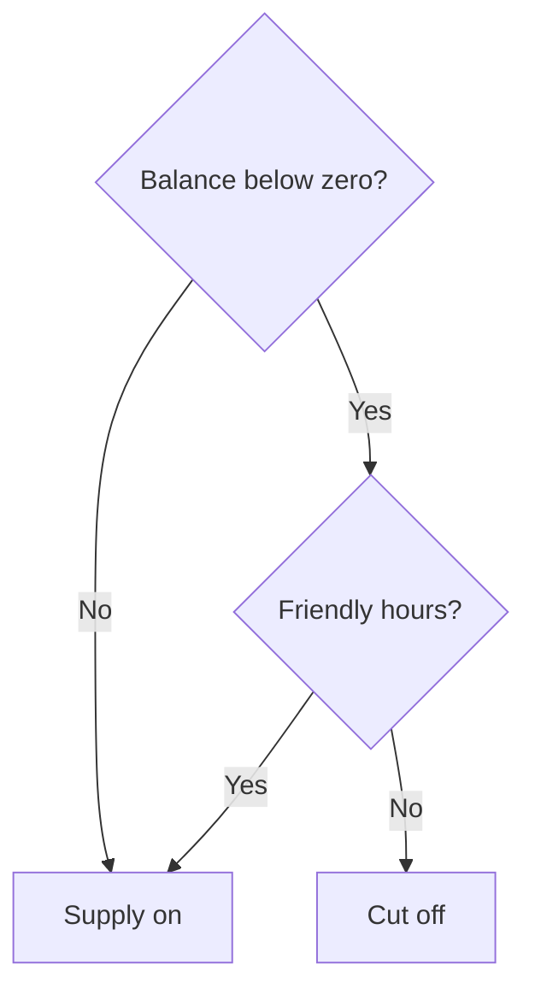

## 17. Bits: packet

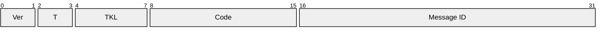

## 18. Timing: WaveDrom

```wavedrom
{ "signal": [
  { "name": "CLK",  "wave": "p......" },
  { "name": "CS#",  "wave": "10....1" },
  { "name": "MOSI", "wave": "x=.=.x.", "data": ["A5", "3C"] }
]}
```

## 19. Task states: PlantUML timing

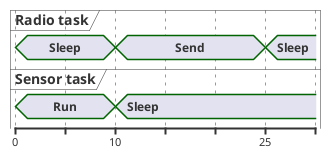

## 20. Messages: PlantUML sequence

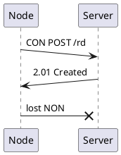

## 21. Structure: Graphviz

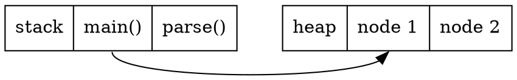

## 22. Rack: rackdiag

```rackdiag
rackdiag {
  8U;
  1: Patch panel;
  2: Switch;
  3: Firewall;
  4: Server [2U];
  6: UPS [2U];
}
```

## 23. Statistics: Vega-Lite

```vega-lite
{
  "data": {"values": [
    {"g": "A", "v": 3}, {"g": "A", "v": 5}, {"g": "A", "v": 4}, {"g": "A", "v": 9},
    {"g": "B", "v": 6}, {"g": "B", "v": 7}, {"g": "B", "v": 8}, {"g": "B", "v": 2}
  ]},
  "mark": "boxplot",
  "encoding": {"x": {"field": "g", "type": "nominal"}, "y": {"field": "v", "type": "quantitative"}}
}
```

## 24. Topology: architecture with icons

```mermaid
architecture-beta
    group cloud(logos:aws)[Cloud]
    service api(logos:aws-lambda)[API] in cloud
    service db(logos:postgresql)[Readings] in cloud
    service gateway(tabler:router)[Gateway]
    service node(mdi:thermometer)[Node]
    api:R -- L:db
    gateway:T -- B:api
    node:R -- L:gateway
```

## In short {.summary}

Look here first: if a tool in the container draws it, write the diagram, not a new block.
