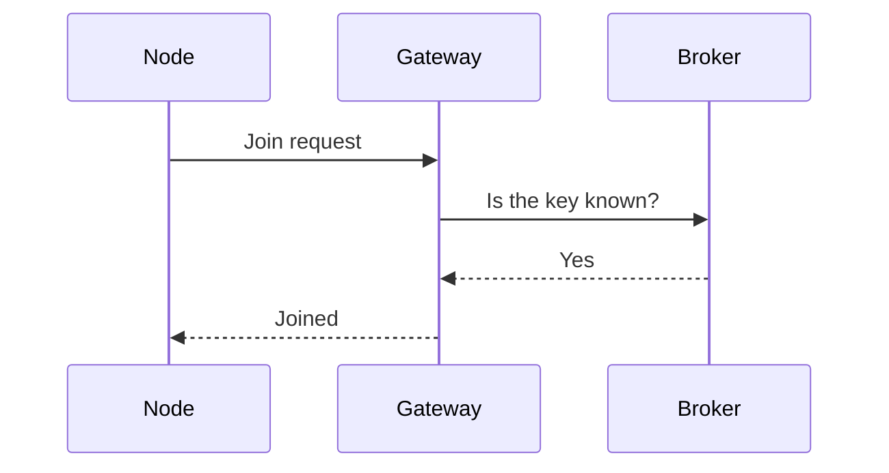

## Stats

| Value | Label |
|---|---|
| 1 day | To commission 50 nodes |
| 3 | Gateways for a three-storey building |
| -95 dBm | Weakest signal accepted |
| 0 | Tools beyond a phone and a ladder |

## Abstract

A network of SN-100 nodes reports through gateways to an MQTT broker. Commissioning places the gateways, joins each node, checks its signal and readings, and records where it is. This poster is the checklist the field team follows.

## 1. Plan: survey the site

Walk the building with the survey app before fitting anything.

```cards cols=1 style=label
Gateways | One a floor, near the middle, away from metal cabinets
Nodes | At head height, out of sunlight and away from heaters
Records | A floor plan with every node's number and room
```

> Concrete floors stop the radio. Plan one gateway on every floor, even a small one.

```cards cols=2 style=plain
Phone | The SN Install app, signed in to the customer's site
Ladder | 2 m, for nodes at head height on high walls
Cells | Two spare CR2477 cells for every ten nodes
Driver | The torque-limited driver from the kit, set to 0.6 N m
```

## 2. Install: fit the hardware

```lanes
Gateway | *Mount | *Power | *Ethernet | Check light
Node | *Fix plate | *Insert cell | Clip on
```

Fit every gateway before the first node, so a node always has a gateway to join.

> [!IMPORTANT]
> Above 2 m, work from a podium step, not a ladder, and never alone.

## 3. Join: add the node to the network

```flow
[Unjoined|slate] -button 3 s-> [Joining|sea] -key accepted-> [Joined|teal]
[Joining|sea] -no gateway-> [Retries every 10 min]
```



[[CAPTION:Figure]] A node joins through the nearest gateway.

## 4. Verify: check each node

The display shows the result of the join, then the first reading.

```lcd
JOINED  GW-2
RSSI -71 dBm
-- Good signal

T  21.4 C
RH 48 %
-- First reading
```

## 5. Signal: what is good enough

```segments
title: Signal strength at the node (dBm)
3 | Excellent | -40 to -70 | teal
2 | Good | -70 to -85 | sea
2 | Weak | -85 to -95 | sand
1 | Move it | below -95 | coral
```

A weak node works, but it retries more and its cell lasts less.

| A node is accepted when | Check |
|---|---|
| Its signal is -95 dBm or better | The app, after the join |
| Its first reading arrives within 2 minutes | The dashboard |
| Its reading is within 1 °C of the room thermometer | By eye |
| Its label photo and room are recorded | The app |

## 6. Handover: leave the site ready

1. Upload the marked-up floor plan from the app.
1. Walk the dashboard with the customer: every node, every room.
1. Leave the spare cells and the support number on site.

```qr size=130 label="Upload the floor plan"
https://example.com/commissioning/upload
```

[[INCLUDE: shared/contacts.md]]

## 7. Troubleshoot: when a node will not join {.wide colour=slate}

| Display | Do this |
|---|---|
| `NO GW` | Check the gateway light, then move the node nearer |
| `KEY ERR` | Scan the node's label again in the app |
| `LOW BAT` | Fit a new cell before joining |
| `E01` | The sensor is not found: return the node, do not open it |
| `RETRY 5/5` | The broker did not answer: check the gateway's Ethernet, then call support |

## Summary

Plan the gateways, fit them first, join each node and record where it is.

### Survey first

The floor plan decides the gateways, not the other way round.

### One node at a time

Join, check the signal, read the display, write it down.

### Leave a record

The floor plan with node numbers is the handover document.
