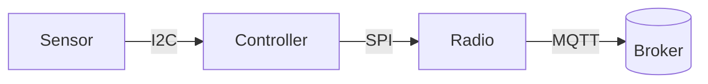

## Stats

| Value | Label | Change | Verdict |
|---|---|---|---|
| 2 uA | Sleep current | -0.5 uA | good |
| 5 years | Battery life at one reading a minute | +14 % | |
| 0.2 °C | Temperature accuracy | | |
| 1 KB | Firmware update block | | |

## Abstract

The SN-100 measures temperature and humidity and publishes each reading over MQTT. It sleeps between readings, so one coin cell lasts five years. This poster shows how it wakes, measures, sends and goes back to sleep.

## 1. Hardware: what is on the board

The node has a sensor, a microcontroller and a radio, powered from one CR2477 cell.

```cards cols=3 style=top
Sensor | Temperature and humidity on I2C, up to 400 kHz | blue
Controller | Sleeps at 2 uA, wakes on its own timer | navy
Radio | Sends one MQTT message, then switches off | green
```



Fig. 1 The parts of the node and how a reading travels.

## 2. Power: where the charge goes

```segments
title: One minute of the node's time (not to scale)
6 | Asleep, 58 s | 2 uA | navy
2 | Measure, 1 s | 300 uA | blue
2 | Send, 1 s | 12 mA | amber
```

Sending costs the most, so the node sends only when a reading has changed by more than the reporting threshold.

```chart type=bar title="Charge per minute (uC)" unit=" uC"
Asleep | 116
Measure | 300
Send | 12000
```

> [!WARNING]
> Keep the reporting threshold above the sensor noise, or the node sends every reading and the cell lasts months, not years.

## 3. Behaviour: one reading

```flow
[Asleep|navy] -timer-> [Measure|blue] -changed-> [Send|amber] -sent-> [Asleep|navy]
[Measure|blue] -unchanged-> [Back to sleep, nothing sent]
```

```lanes
Every minute | *Wake | *Measure | Send if changed
Every hour | *Wake | *Measure | *Send status
```

## 4. Display: what the installer sees

The optional display shows the last reading and the link state.

```lcd
T  21.4 C
RH 48 %
-- Normal reading

LINK LOST
RETRY 3/5
-- Broker not reached
```

| Code | Meaning |
|---|---|
| `E01` | Sensor not found on I2C |
| `E02` | Broker refused the connection |
| `E03` | Battery below 2.2 V |

## 5. Roadmap: what comes next {.wide}

```timeline
Jan 2026 | Pilot | 200 nodes in two buildings | navy
Apr 2026 | Firmware 2.1 | Sends only what changed | blue
Jul 2026 | Display option | For installers | green
Oct 2026 | Ten-year cell | Twice the life | amber
```

## Summary

One coin cell, five years, one message only when something changes.

### Measure often

A reading a minute costs little, because measuring is cheap.

### Send rarely

The radio is the cost, so the node sends only what is new.

### Fail visibly

Every fault has a code on the display and in the status message.
