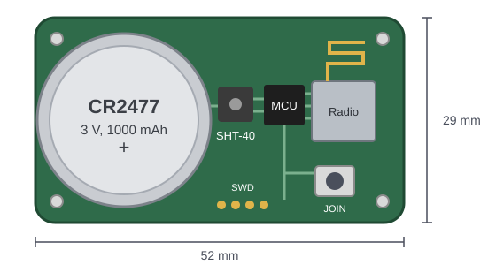
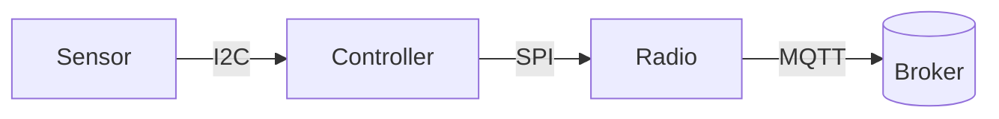

## Key figures {.stats}

| Value | Label | Change | Verdict |
|---|---|---|---|
| 2 µA | Sleep current | -0.5 µA | good |
| 5 years | Battery life at one reading a minute | +14 % | |
| 0.2 °C | Temperature accuracy | | |
| 1 KB | Firmware update block | | |

## Introduction {.abstract}

The SN-100 measures temperature and humidity and publishes each reading over MQTT. It sleeps between readings, so one coin cell lasts five years. This poster shows how it wakes, measures, sends and goes back to sleep.

## 1. Hardware: what is on the board {.flow}

The node has a sensor, a microcontroller and a radio on one 52 by 29 mm board, powered from one CR2477 cell.



[[CAPTION:Figure]] The board, top side, to scale. The cell holder takes most of it.

```cards cols=3 style=top
Sensor | Temperature and humidity on I2C, up to 400 kHz | blue
Controller | Sleeps at 2 µA, wakes on its own timer | navy
Radio | Sends one MQTT message, then switches off | green
```



[[CAPTION:Figure]] The parts of the node and how a reading travels.

| Specification | Value |
|---|---|
| Temperature | -20 to +60 °C, ±0.2 °C |
| Humidity | 0 to 100 % RH, ±1.8 % |
| Radio | 868 MHz, +14 dBm, -121 dBm sensitivity |
| Cell | CR2477, 3 V, 1,000 mAh |
| Enclosure | 80 by 50 by 22 mm, IP54 |

## 2. Power: where the charge goes

```segments
title: One minute of the node's time (not to scale)
6 | Asleep, 58 s | 2 µA | navy
2 | Measure, 1 s | 300 µA | blue
2 | Send, 1 s | 12 mA | amber
```

Sending costs the most, so the node sends only when a reading has changed by more than the reporting threshold.

```chart type=bar title="Charge per minute (µC)" unit=" µC"
Asleep | 116
Measure | 300
Send | 12000
```

> [!WARNING]
> Keep the reporting threshold above the sensor noise, or the node sends every reading and the cell lasts months, not years.

## 3. Cell: how its voltage falls

```chart type=line title="Cell voltage over its life" unit=" V" min=2.2 max=3.2 step=0.2 values=last area=yes height=240 colours=blue axis="Volts at 20 °C"
Year 0 | 3.05
Year 1 | 2.96
Year 2 | 2.92
Year 3 | 2.88
Year 4 | 2.81
Year 5 | 2.62
```

The voltage stays flat for four years and falls in the fifth, so a node warns at 2.4 V, months before it stops.

## 4. Behaviour: one reading

```flow
[Asleep|navy] -timer-> [Measure|blue] -changed-> [Send|amber] -sent-> [Asleep|navy]
[Measure|blue] -unchanged-> [Back to sleep, nothing sent]
```

```lanes
Every minute | *Wake | *Measure | Send if changed
Every hour | *Wake | *Measure | *Send status
```

## 5. Display: what the installer sees

The optional display shows the last reading and the link state.

```lcd
T  21.4 C
RH 48 %
-- Normal reading

LINK LOST
RETRY 3/5
-- Broker not reached
```

| Code | Meaning |
|---|---|
| `E01` | Sensor not found on I2C |
| `E02` | Broker refused the connection |
| `E03` | Battery below 2.2 V |

> [!TIP]
> Hold the join button for one second to wake the display without sending a reading.

## 6. Messages: what it sends

Each reading is one MQTT message of about 60 bytes, published with QoS 1 to `sn100/<id>/reading`.

```json
{"t": 21.4, "rh": 48.2, "cell_v": 2.96, "seq": 18342}
```

Once an hour the node adds a status message, with its firmware, signal and error codes, to `sn100/<id>/status`.

## 7. Roadmap: what comes next {.wide}

```timeline
Jan 2026 | Pilot | 200 nodes in two buildings | navy
Apr 2026 | Firmware 2.1 | Sends only what changed | blue
Jul 2026 | Display option | For installers | green
Oct 2026 | Ten-year cell | Twice the life | amber
```

## 8. SN-100-T: temperature only {cols=3}

Order code `SN100-T-868`. For rooms where only the temperature matters, such as server rooms.

- Temperature, ±0.2 °C
- Cell life 6.5 years

## 9. SN-100-TH: temperature and humidity

Order code `SN100-TH-868`. The standard node, and the one this poster describes.

- Humidity, ±1.8 % RH
- Cell life 5 years

## 10. SN-100-THD: with a display

Order code `SN100-THD-868`. For installers and for rooms a person checks by eye.

- The display of section 5
- Cell life 4.5 years

## In short {.summary}

One coin cell, five years, one message only when something changes.

### Measure often

A reading a minute costs little, because measuring is cheap.

### Send rarely

The radio is the cost, so the node sends only what is new.

### Fail visibly

Every fault has a code on the display and in the status message.
