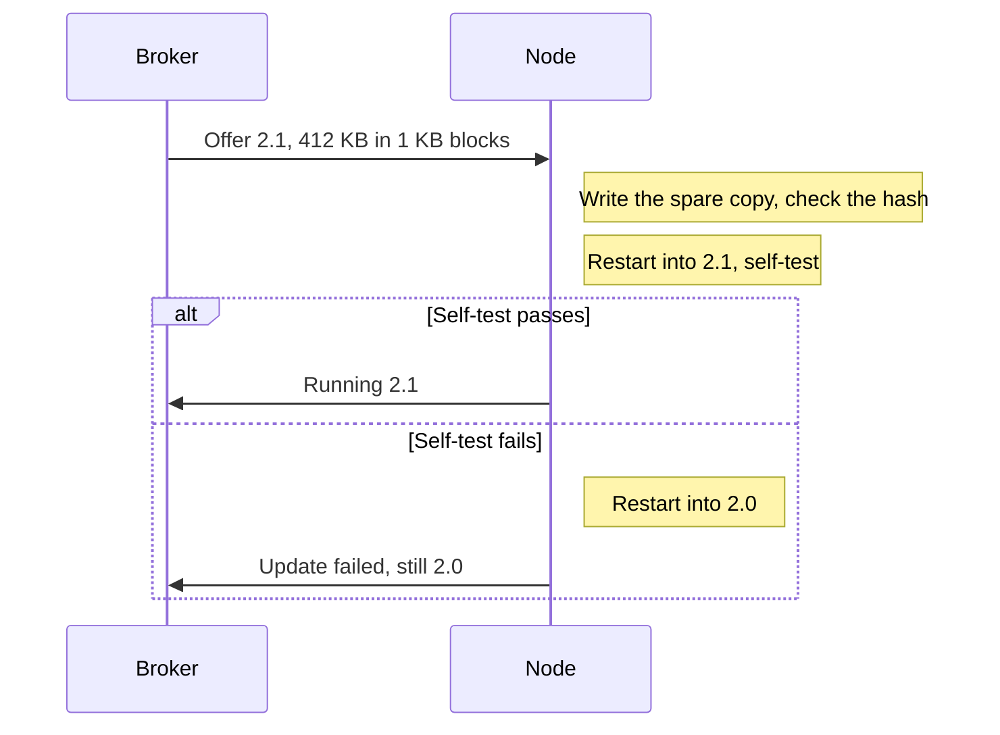

## Key figures {.stats}

| Value | Label | Change | Verdict |
|---|---|---|---|
| 5.7 years | Battery life | +14 % | |
| 4 s | Typical join | -7 s | good |
| 2 | Firmware copies kept | +1 | |
| 0 | Failed updates in the pilot | -3 | good |

## Introduction {.abstract}

Firmware 2.1 sends less, joins faster and can always go back to the last version that worked.

## 1. Power: sending less

The node now compares each reading with the last one sent and stays quiet when nothing has changed.

```chart type=column title="Messages a day"
series: 2.0, 2.1
Office | 1440 | 610
Warehouse | 1440 | 980
Cold store | 1440 | 1210
```

## 2. Joining: faster

```flow
[Wake|navy] -scan 3 channels, was 8-> [Join|blue] -> [Report|green]
```

The node remembers the channel of its last gateway and tries it first.

```compare
| 2.0 | 2.1
Typical join | 11 s | 4 s
Channels scanned | 8 | 3, or 1 when the last still works
Battery life | 5.0 years | 5.7 years
Firmware copies | 1 | 2
```

## 3. Updates: safe by design

```cards cols=2 style=top
Two copies | The new firmware is written beside the old one | blue
Self-test | The node checks the new one before switching | green
Roll back | A failed self-test returns to the old copy | amber
Report | The result goes to the broker either way | navy
```



[[CAPTION:Figure]] An update over the air. The node checks the hash of the spare copy, restarts into it and tests itself, so it is never left without working firmware.

## 4. What changed

```cards cols=1
Added | Change-only reporting, with a threshold of 0.1 °C and 1 % RH by default (SN-412)
Added | Two firmware copies and a self-test after every update (SN-388)
Changed | The node tries its last gateway's channel first, then scans 3 channels, not 8 (SN-405)
Fixed | A node no longer stops reporting after 49.7 days of uptime (SN-397)
Fixed | The display no longer shows LINK LOST while the broker is still connecting (SN-401)
```

## 5. Compatibility

| Part | Needs |
|---|---|
| Gateway firmware | 1.5 or later, for change-only reporting |
| Broker | Any MQTT 3.1.1 or 5 broker |
| SN Install app | 3.4 or later, to show the firmware copy |
| Hardware | Every SN-100, revision B and C |

## 6. Upgrading

| From | Do this |
|---|---|
| 2.0 | Update over the air, no visit needed |
| 1.x | Update to 2.0 first, then 2.1 |

> **Warning:** do not update a node whose battery shows below 2.4 V. The update stops and the node keeps 2.0.

```timeline vertical
1 May | Pilot sites | 200 nodes
15 May | Every site | Over the air, overnight
1 June | 2.0 retired | No more 2.0 updates
```

## 7. Known issues

> [!CAUTION]
> A node on a gateway older than 1.5 still sends every reading, as 2.0 did. Update the gateway first (SN-418).

> [!NOTE]
> Readings sent while a node restarts into the new copy are kept and sent afterwards, so no reading is lost.

## 8. Contacts: for this release

```people cols=2
Lena Chen | Firmware release manager | sn100-firmware@example.com
Ruth Osei | Field support lead | +44 1632 960 100
```

## In short {.summary}

Install 2.1 everywhere: it costs one message and saves months of battery.

### Installers

Nothing changes on site. Joining is quicker.

### Support

Every update reports its result, so a failed node is visible at once.

## References {.references}

1. SN-100 Datasheet, SN-DS-001.
1. SN-100 release notes, firmware {{version}}.
