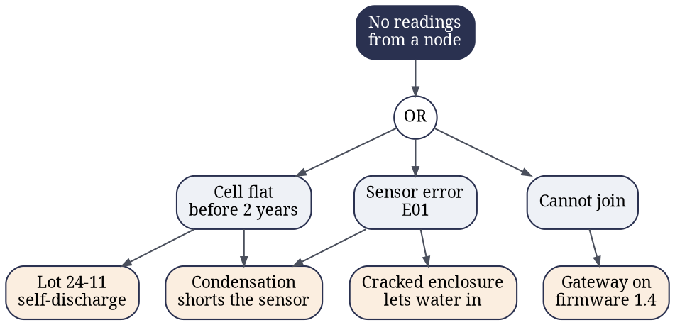
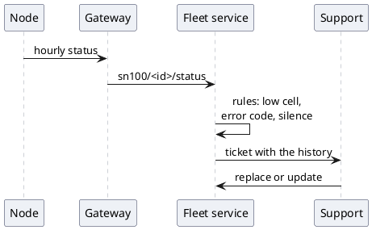

## Stats

| Value | Label | Change | Verdict |
|---|---|---|---|
| 48,200 | Nodes in service | +6,100 | |
| 0.51 % | Annualised return rate | -0.24 pts | good |
| 61 | Nodes returned this quarter | -18 | good |
| 5.2 years | B10 cell life | +0.4 years | |

## Abstract

This review covers every SN-100 node in service from 1 July to 30 September 2026. The return rate fell for the third quarter running, to 0.51 % a year, just above the 0.50 % target. Condensation in cold stores is now the largest single cause, and a coated sensor ships from batch 26-40. Life tests put the B10 cell life at 5.2 years, so nine cells in ten outlast the five years on the datasheet.

## 1. Fleet: where the nodes are

[[CAPTION:Table]] Nodes in service on 30 September, by site type

| Site type | Sites | Nodes | Share |
|---|---|---|---|
| Offices | 212 | 21,400 | 44 % |
| Warehouses | 64 | 14,900 | 31 % |
| Cold stores | 27 | 6,300 | 13 % |
| Hospitals | 18 | 5,600 | 12 % |
| **Total** | **321** | **48,200** | **100 %** |

Cold stores hold one node in eight but sent back almost one return in three, so they get their own action below.

> [!NOTE]
> A node counts as in service from its first reading to its last. Nodes in stock, or on a site that has not been commissioned, are left out.

## 2. Returns: what came back

```vega-lite
{
  "$schema": "https://vega.github.io/schema/vega-lite/v6.json",
  "width": 420, "height": 230,
  "data": {"values": [
    {"month": "Jul", "cause": "Condensation", "n": 8}, {"month": "Aug", "cause": "Condensation", "n": 6}, {"month": "Sep", "cause": "Condensation", "n": 5},
    {"month": "Jul", "cause": "Cell lot 24-11", "n": 6}, {"month": "Aug", "cause": "Cell lot 24-11", "n": 5}, {"month": "Sep", "cause": "Cell lot 24-11", "n": 3},
    {"month": "Jul", "cause": "Installation damage", "n": 4}, {"month": "Aug", "cause": "Installation damage", "n": 4}, {"month": "Sep", "cause": "Installation damage", "n": 3},
    {"month": "Jul", "cause": "Will not join", "n": 4}, {"month": "Aug", "cause": "Will not join", "n": 3}, {"month": "Sep", "cause": "Will not join", "n": 2},
    {"month": "Jul", "cause": "No fault found", "n": 2}, {"month": "Aug", "cause": "No fault found", "n": 3}, {"month": "Sep", "cause": "No fault found", "n": 3}
  ]},
  "mark": {"type": "bar", "cornerRadiusEnd": 2},
  "encoding": {
    "x": {"field": "month", "type": "ordinal", "sort": ["Jul", "Aug", "Sep"], "title": null, "axis": {"labelAngle": 0}},
    "y": {"aggregate": "sum", "field": "n", "type": "quantitative", "title": "Nodes returned"},
    "color": {"field": "cause", "type": "nominal", "title": null,
              "scale": {"range": ["#2a3150", "#3f74b8", "#b4540a", "#2e6b3a", "#9aa1ad"]},
              "legend": {"orient": "right"}}
  },
  "config": {"font": "Georgia", "view": {"stroke": null}}
}
```

[[CAPTION:Figure]] Returns by month and cause: 24, 21 and 16

[[CAPTION:Table]] Returns by cause, with the change on the second quarter

| Cause | Returns | Share | Change on Q2 |
|---|---|---|---|
| Condensation on the sensor | 19 | 31 % | +4 |
| High self-discharge, cell lot 24-11 | 14 | 23 % | -9 |
| Cracked enclosure at installation | 11 | 18 % | -3 |
| Will not join a gateway | 9 | 15 % | -6 |
| No fault found | 8 | 13 % | -4 |

## 3. Trend: the return rate

```chart type=line title="Annualised return rate (%)" unit=" %" max=1.2 step=0.2 height=260 colours=navy,amber values=last dashed=Target axis="Returns a year (%)"
series: Measured, Target
Q4 2025 | 0.92 | 0.50
Q1 2026 | 0.81 | 0.50
Q2 2026 | 0.75 | 0.50
Q3 2026 | 0.51 | 0.50
```

The rate is the quarter's returns times four, over the nodes in service at the end of the quarter. Three causes fell. Condensation rose with the summer's new cold-store sites.

> [!TIP]
> Most "will not join" returns came from gateways still on firmware 1.4. Updating the gateway first fixes the node on site, with no return.

## 4. Causes: why a node stops reporting



[[CAPTION:Figure]] The fault tree, from the symptom to its root causes (shaded)

Condensation appears twice: a wet sensor draws current and flattens the cell, or it reads out of range and reports `E01`. One fix, a coated sensor, removes both.

## 5. Detection: how a fault reaches us



[[CAPTION:Figure]] How a fault becomes a support ticket

Every node sends a status message each hour, beside its readings. A rule opens a ticket on a cell below 2.4 V before two years, on any error code, or on six hours of silence.

```json
{"id": "SN100-04F2A1", "fw": "2.1.0", "cell_v": 2.31, "rssi": -88,
 "errors": ["E01"], "uptime_h": 11630, "joins": 3}
```

## 6. Testing: the accelerated life test

```figure
@segments
title: The test plan, by time in the chambers
10 | Damp heat | 85 °C, 85 % RH, 1,000 h | navy
6 | Thermal cycling | -20 to +60 °C, 300 cycles | blue
4 | Drop, vibration | IEC 60068-2-6, -27 | amber
+++
@flow
[Screen|navy] -120 nodes-> [Stress|blue] -failed-> [Teardown|green]
[Stress|blue] -passed-> [Next stage]
+++
@lanes
Chamber A | *Damp heat | *Cycling | Teardown
Chamber B | *Cycling | *Damp heat | Teardown
The two chambers run the stages in opposite orders, so an effect of the order shows up.
```

```ditaa
+-----------+       +---------+       +------------+
| Chamber A +------>|         |       | Logger PC  |
| 60 nodes  |       |         +------>| and broker |
+-----------+       | Gateway |       |        {s} |
                    |         |       +------------+
+-----------+       |    cBLU |
| Chamber B +------>|         |
| 60 nodes  |       +---------+
+-----------+
```

[[CAPTION:Figure]] The rig: both chambers report through one gateway to the logger

## 7. Cell life: the Weibull analysis

Nine of the 120 cells failed during the test. Their ages, converted to field hours with an acceleration factor of 19, give the fit below. The last failure, at 38,900 field hours, came near the end of the test.

[[INCLUDE-CODE: reliability/weibull.py]]

```highlight
β 1.78 | Shape | Above 1: cells wear out, with no early failures | navy
18.4 years | Characteristic life (η) | 160,889 h, when 63 % have failed | blue
5.2 years | B10 life | Nine cells in ten last longer | green
```

> [!IMPORTANT]
> The five-year life on the datasheet holds for nine nodes in ten at one reading a minute. Faster reporting shortens it in proportion.

## 8. Actions: what we are changing

```cards cols=1
Coat the sensor | Conformal coating from batch 26-40, cold-store orders first. Owner J. Patel, from 3 November
Retire cell lot 24-11 | Stock quarantined. 3,100 installed nodes get a new cell at their next visit. Owner R. Osei, by 31 December
Torque-limited driver | In every installer kit, set to 0.6 N m, to stop cracked enclosures. Owner M. Duarte, done 30 September
Gateway 1.5 by default | The gateway updates itself before it accepts its first node. Owner L. Chen, from firmware 1.5.2
```

```progress unit=" nodes"
New cells for lot 24-11 | 1,240 | 3,100
Cold-store nodes with a coated sensor | 410 | 6,300
Gateways on 1.5 or later | 2,860 | 2,860
```

> [!CAUTION]
> Do not replace a lot 24-11 cell with any cell from stock until the stock has been checked: the quarantine covers only labelled boxes.

[[IF: internal]]
## 9. Cost: what the returns cost us

| Item | Q2 2026 | Q3 2026 |
|---|---|---|
| Replacement nodes | £5,530 | £4,270 |
| Site visits | £9,480 | £7,320 |
| Failure analysis | £2,100 | £1,830 |
| **Total** | **£17,110** | **£13,420** |

Two customers, Harbour Cold Chain and Meridian Hospitals, account for 22 of the 61 returns. Both are in the coated-sensor first batch.
[[ENDIF]]
[[NOT: internal]]
## 9. Customers: what changes for you

Nodes with a coated sensor ship from November. Nothing changes on site, and your account manager will arrange any cell replacement at the next service visit.
[[ENDIF]]

## 10. Contacts: who to ask

[[INCLUDE: shared/contacts.md]]

```qr size=150 label="The full report, SN-RR-2026-Q3"
https://example.com/reliability/sn-rr-2026-q3
```

## Summary

The return rate is at target, the cell outlasts its promise, and the one growing cause has a fix in production.

### Measure

Every node reports its health each hour, so a fault is seen before the customer sees it.

### Find the cause

Every return is torn down. Only one in eight finds no fault.

### Fix it once

One coating removes both ways condensation stops a node.

## References

1. SN-100 Datasheet, SN-DS-001, revision C.
1. SN-100 field reliability review, Q2 2026, SN-RR-2026-Q2.
1. Northfield Test Laboratory, life test report NTL-2026-0412.
1. IEC 60068-2-78, damp heat, steady state.
