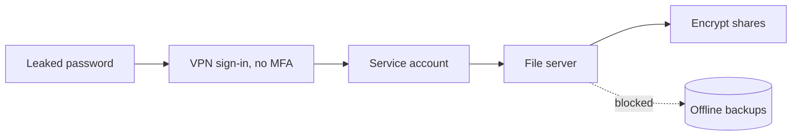

## Key figures {.stats}

| Value | Label | Change | Verdict |
|---|---|---|---|
| 11 min | To first containment | -64 % | good |
| 4 h | To restore critical systems | -50 % | good |
| 0 | Ransoms paid | | |
| 24 h | Regulator notified within | | |

## Introduction {.abstract}

At 02:14 on a Saturday, a file server began renaming thousands of files. This poster follows how the team found it, stopped it and recovered, and what the organisation changed afterwards. Use it as the checklist on the wall.

## 1. The hazard: how it gets in, and what it costs

```bowtie
hazard: Ransomware on the network
top: Files encrypted
threat: Phishing email | Mail filtering, User training
threat: Stolen VPN password | Multi-factor sign-in
threat: Unpatched server | Patch within 14 days
consequence: Operations stop | Offline backups, Restore runbook
consequence: Data published | Data loss prevention, Encryption at rest
consequence: Fines | Notify within 72 h
```

The barriers on the left keep an attacker out; those on the right limit the harm once one is in. This time two on the left were missing: MFA on the VPN, and a patched server. The ones on the right held.

## 2. Hour by hour

```lanes
02:00–03:00 | *Detect | *Isolate | *Preserve
03:00–06:00 | *Scope | *Reset passwords | Brief the board
06:00–12:00 | *Restore critical | *Monitor | Notify the regulator
12:00–24:00 | *Restore the rest | Tell customers | *Lessons
```

```timeline
02:14 | Alert | | red
02:25 | Contained | | brand
06:40 | Payroll restored | | green
11:30 | Regulator told | | second
21:00 | All systems back | | green
```

## 3. Why the backups were safe

```fault-tree
and: Backups lost too
  basic: Online copy encrypted | 0.3
  or: Offline copy lost
    basic: Tape not rotated | 0.02
    basic: Immutable store deleted | 0.001
```

Because the offline copies need both failures at once, the chance of losing every backup was 0.6 %.

## 4. The attack, step by step



> [!WARNING]
> The service account had a password that never expired and could sign in to the VPN. Accounts that machines use should never be able to sign in as a person.

## 5. The first hour: contain

```steps
Detect | The EDR alert on mass file renames, 02:14 | red
Isolate | Cut the server and its share from the network, 02:25 | brand
Preserve | Image memory and disk before anything is wiped | second
Escalate | Wake the incident lead and the legal team | grey
Scope | Find every machine that talked to it | brand
```

```terminal title="Finding the first file it touched"
$ grep -c ".locked" /var/log/fileserver/audit.log
48211
$ head -1 /var/log/fileserver/audit.log | cut -d' ' -f1-4
2026-03-14 02:14:07 RENAME svc-backup
# the service account, not a person: its password was in the leaked set
```

## 6. Ready for next time

```checklist cols=2
[x] MFA on every VPN account
[x] Service accounts without interactive sign-in
[x] Immutable backups, tested monthly
[x] Runbook printed and on the wall
[ ] Tabletop exercise each quarter
[!] Legacy server still unpatched: retire by June
```

```progress better=lower unit=" days"
Time to patch a critical flaw | 9 | 14
```

```progress unit=" accounts"
Signing in with MFA | 412 | 415
```

## In short {.summary}

Eleven minutes from alarm to containment, because the plan was written, practised and on the wall.

### Contain first

Isolate, then investigate.

### Backups decide the outcome

Offline and immutable meant no ransom.

### Learn

Every lesson became a ticket with a date.
