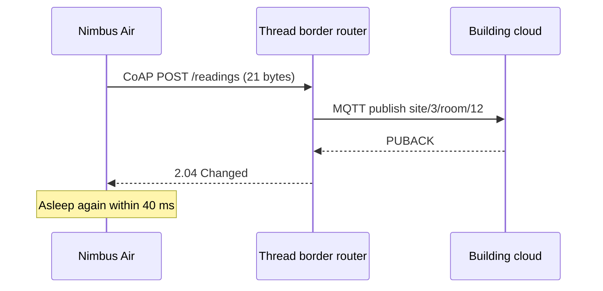

## Key figures {.stats}

| Value | Label | Change | Verdict |
|---|---|---|---|
| 10 years | Battery life on 2 × AA | +4 years | good |
| 6 | Things it measures | +2 | good |
| 2 min | Between readings | | |
| 1.9 µA | Asleep | -60 % | good |

## Introduction {.abstract}

Nimbus Air measures temperature, humidity, CO₂, light, sound and presence in a meeting room, and sends them over Thread to the building's gateway every two minutes. It sleeps 99.7 % of the time, which is how two AA cells last a decade. This poster shows what is inside, where the energy goes and what a reading looks like on the wire.

## 1. Inside: what is on the board

```cards cols=2 style=top
Sense | SCD41 CO₂, SHT45 temperature and humidity, light, sound, PIR | brand | icon=tabler:temperature
Think | nRF52840: Arm Cortex-M4F, 1 MB flash, 256 KB RAM | second | icon=tabler:cpu
Talk | Thread 1.3 radio, Matter over IPv6 | spark | icon=tabler:antenna
Last | 2 × AA lithium, 3,000 mAh, with a fuel gauge | green | icon=tabler:battery-4
```

## 2. The header: what each pin does

The sensor board plugs into the controller through a 12-pin header, so a new sensor needs a new board, not a new design.

```pinout package=qfn title="The sensor header, J3"
1 | 3V0 | pwr
2 | GND | gnd
3 | SDA | i2c
4 | SCL | i2c
5 | PIR_OUT | gpio
6 | MIC | adc
7 | LIGHT | adc
8 | LED | pwm
9 | SWDIO | swd
10 | SWCLK | swd
11 | NRST | reset
12 | GND | gnd
```

## 3. Power: where the charge goes

```segments
title: One day of Nimbus Air, by charge used
height: 70
52 | CO₂ measurement | The SCD41 heats its lamp for 5 s | brand
21 | Radio | 720 short Thread messages | spark
14 | Sleep | 1.9 µA, all day | second
8 | Other sensors | Temperature, light, sound, presence | green
5 | Display LED | Only when someone presses the button | grey
```

CO₂ is the costly measurement: the sensor shines an infrared lamp through its chamber. Measuring it every two minutes, and the rest every minute, keeps the budget under 0.8 mAh a day.

```highlight
0.8 mAh | A day | Everything, measured on the bench | brand
82 % | Charge left after 2 years | From the fuel gauge of the pilot fleet | green
```

## 4. A day: what happens when

```lanes
Every minute | *Temperature | *Humidity | *Light | *Sound | Sleep
Every 2 minutes | *CO₂ | *Send | Sleep
On motion | *Presence | *Send at once
Every day | *Battery report | *Check for firmware
```

```flow
[Asleep|second] -timer-> [Measure|brand] -done-> [Send|spark] -acked-> [Asleep|second]
[Send|spark] -no ack-> [Retry in 10 s]
[Asleep|second] -motion-> [Send|spark]
```

## 5. On the wire: one reading

```hex-dissect title="A CoAP message with six readings, CBOR encoded"
bytes: 58 45 1d 2a 6f 91 b3 2c ff a6 01 19 08 fc 02 18 2d 03 19 03 a2
0 | Version 1, confirmable, token 8 bytes | 0x58 | brand
1 | Code | POST | second
2-3 | Message ID | 0x1d2a | green
4-7 | Token | 6f 91 b3 2c | spark
8 | Payload marker | 0xff | grey
9 | A map of six items | 0xa6 | brand
10-13 | Temperature, 0.01 °C | 22.68 °C | red
14-16 | Humidity, % | 45 % | second
17-20 | CO₂, ppm | 930 ppm | amber
```

Six readings fit in 21 bytes: CBOR packs each as a small key and a number, with no names or text.

## 6. The conversation: from sensor to cloud



## 7. Flash: where the firmware lives

```memory
0x0000_0000 | 48 KB | Bootloader | brand
0x0000_C000 | 448 KB | Application, slot A | second
0x0007_C000 | 448 KB | Update, slot B | spark
0x000F_C000 | 16 KB | Settings and keys | red
```

Two application slots mean an update is written beside the running firmware, and the old one stays until the new one has joined the network and reported.

## 8. Roadmap: what comes next

```timeline
Q1 2026 | Pilot | 400 sensors in 3 buildings | brand
Q3 2026 | Release | Matter certified | green
Q1 2027 | Air Pro | Particulates PM2.5 | spark
Q4 2027 | Air Solar | Indoor light harvesting | amber
```

## 9. Fitting: three minutes on the wall

```steps
Place | 1.5 m up, away from windows, vents and the coffee machine
Fix | Two screws, or the adhesive pad on glass
Pull the tab | The cells connect and the LED blinks blue
Scan | The QR code on the back joins it to the building | green
```

> [!TIP]
> One sensor covers a room of up to 40 m². In open-plan offices, fit one every 8 m.

## In short {.summary}

A sensor that is fitted once and forgotten for ten years.

### Sleep is the product

99.7 % of its life is spent asleep at 1.9 µA.

### Measure what costs least, most often

CO₂ every two minutes, the rest every minute.

### Never brick a room

Two firmware slots, and the old one kept until the new one reports.
